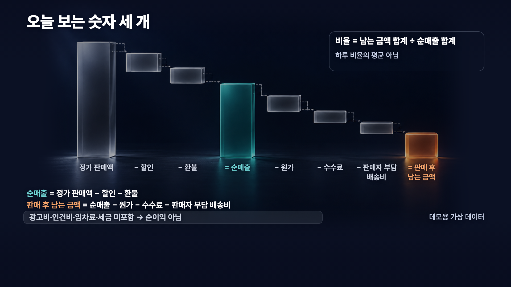
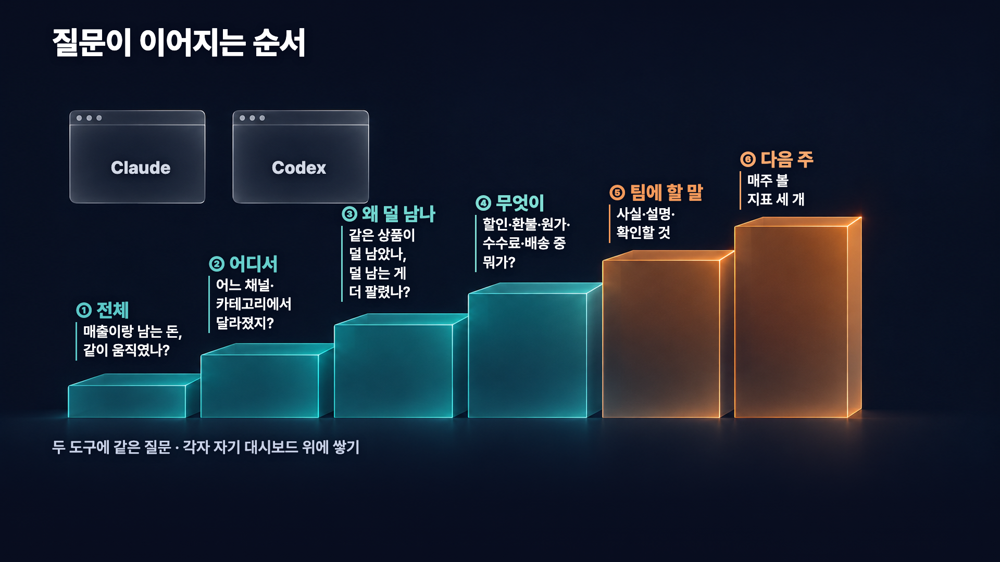

# 아직 대시보드 직접 만드세요? 클로드·코덱스로 분석부터 시각화까지 한번에!


이 가이드는 영상에서 쓴 요청문으로 본인 BigQuery 데이터를 분석해 대시보드를 만들고, 결과를 공유하고 정기적으로 업데이트하는 방법까지 정리한 것입니다. 연결·분석 요청문은 영상 원문을 실었고, 프로젝트·데이터셋 주소만 본인 값으로 바꿀 수 있게 표시했습니다.

## 목차

1. [시작 전 확인](#1-시작-전-확인)
2. [숫자 정의](#2-숫자-정의)
3. [연결 준비](#3-연결-준비)
4. [단계별 분석](#4-단계별-분석)
5. [결과 공유](#5-결과-공유)
6. [정기 업데이트](#6-정기-업데이트)

## 1. 시작 전 확인

먼저 조건을 확인하세요.

- **Claude**: 대시보드는 Claude Dashboards로 만듭니다. Pro·Max·Team·Enterprise 요금제에서 베타로 제공됩니다. 정기 업데이트 예약은 Claude Code 루틴(Routines)이 맡습니다.
- **Codex**: 이번 경로에서는 이 컴퓨터의 명령줄 도구(bq, gcloud 등)로 BigQuery를 읽고, 정기 업데이트는 데스크톱 앱의 Codex의 로컬 스케줄로 합니다.
- **데이터**: 본인 계정에 읽기 권한이 있는 BigQuery 데이터가 필요합니다. 영상 데이터 파일은 따로 제공하지 않으니 본인 데이터에 맞춰 응용하세요.

영상에서는 가상의 생활용품 판매 데이터를 썼습니다. 실제 매출이 아닙니다. 주문 약 18만 건, 상품 24개, 판매 채널 3개이고, 원본 주문 데이터를 하루 × 상품 × 채널 단위로 묶은 `daily_product_channel` 뷰(원본 표를 원하는 단위로 묶어 읽는 조회 규칙)를 분석했습니다.

분석에는 아래 항목이 필요합니다.

- 날짜, 상품, 카테고리, 채널
- `order_count`(주문 수), `net_sales_krw`(순매출), `contribution_krw`(남는 금액)
- 할인, 환불, 원가, 수수료, 판매자 부담 배송비 집계

본인 데이터라면 실제 열 이름, 집계 단위, 기간으로 바꾸세요. 열 이름은 짐작해서 쓰지 말고 먼저 목록을 확인하세요.

## 2. 숫자 정의



두 도구에 같은 정의를 써야 결과를 서로 맞춰 볼 수 있습니다.

- **순매출** = 정가 판매액 − 할인 − 환불
- **남는 금액** = 순매출 − 원가 − 수수료 − 판매자 부담 배송비
- **남는 금액 비율** = 남는 금액 합계 ÷ 순매출 합계 (순매출 합계가 0이면 '계산 불가')
- **주문 수** = `order_count` 합계 (뷰의 행 수가 아닙니다)

남는 금액에는 광고비, 인건비, 임차료, 세금이 빠져 있습니다. 순이익이 아니니 보고할 때 '순이익'이라고 부르지 마세요.

## 3. 연결 준비

### Claude

1. Claude에서 **Customize > Connectors**로 들어가 BigQuery를 연결하세요.
2. 결과를 대시보드로 받으려면 **Output > Dashboards**를 고르세요.

대시보드에서는 차트마다 쓰인 SQL과 마지막 갱신 시각을 볼 수 있습니다. 숫자가 이상하면 여기부터 확인하세요. Claude Dashboards는 빠르게 살펴보는 탐색 질문에 맞춰져 있으니, 더 깊은 분석이 필요하면 다른 도구로 이어 가세요.

공식 문서: [Claude 대시보드 시작하기](https://support.claude.com/ko/articles/17454700-get-started-with-claude-dashboards)

### Codex

> **이번 영상처럼 BigQuery 커넥터를 사용할 수 없는 Codex 환경에서는 로컬 연결과 로컬 스케줄로 설정합니다.**

1. 아래 0단계 요청문으로 BigQuery 조회용 명령줄 도구와 로그인 상태부터 확인하세요. 설치가 필요하면 Codex에게 필요한 절차를 안내받아 직접 진행하세요.
2. 로그인과 권한 승인도 터미널(명령어를 입력하는 창)에서 직접 하세요. 키나 토큰은 채팅창에 붙여 넣지 마세요.
3. 터미널에서 본인 데이터를 읽는 작은 읽기 전용 조회가 성공하는지 먼저 확인하세요.
4. Codex에 Data 플러그인이 설치돼 있으면 `@Data`로 분석을 시작하세요.

Data 플러그인에는 BigQuery를 포함한 연결 목록이 있지만, 실제로 쓸 수 있는지는 계정·조직 허용과 연결 설정에 따라 다릅니다.

공식 문서: [ChatGPT Work·Codex에서 Data 플러그인 사용하기](https://help.openai.com/ko-kr/articles/20001518-using-the-data-plugin-in-chatgpt-work-and-codex)

## 4. 단계별 분석

요청문을 붙여 넣기 전에 아래 값을 본인 데이터에 맞게 고치세요. 프로젝트·데이터셋 주소는 자리표시자로 표시돼 있고, 나머지는 영상 데이터 기준이라 직접 바꿔야 합니다.

- **프로젝트·데이터셋**: `{{PROJECT_ID}}.{{DATASET_ID}}`를 본인 BigQuery 프로젝트 ID와 데이터셋 이름으로 바꾸세요.
- **기간**: 요청문의 두 기간(2026-08-24 ~ 2026-09-20, 2026-09-21 ~ 2026-10-18)은 영상 데이터에 맞춘 고정 비교 기간입니다. 본인 데이터 기간으로 바꾸세요. 매주 볼 거라면 '최근 완료된 4주와 그 전 4주'처럼 기간이 움직이는 규칙을 따로 정하세요.
- **리전**(데이터가 저장된 지역): 요청문의 `US`는 영상 데이터의 리전입니다. 본인 데이터셋의 리전으로 바꾸세요.
- **열 이름**: 0단계에서 확인한 실제 열 이름으로 바꾸세요.
- **`update_batch` 제외 조건**: 영상용으로 추가한 데이터를 분석에서 빼는 조건입니다. 본인 데이터에 해당 항목이 없으면 지우세요.



한 번에 다 묻지 않고 연결 확인부터 한 단계씩 좁혀 갑니다. 단계마다 Claude 요청문, Codex 요청문 순서이니 쓰는 도구 쪽만 따라 하셔도 됩니다.

### 0단계. 연결만 확인

분석 전에 데이터를 제대로 읽는지부터 봅니다.

**Claude**

<!-- prompt:AB-0-CLAUDE -->
```text
BigQuery의 {{PROJECT_ID}}.{{DATASET_ID}}.daily_product_channel 뷰(위치 US)에 지금 연결된 계정으로 접근할 수 있는지 먼저 확인하려고 합니다. 아직 분석이나 대시보드는 만들지 마세요.
알려 주실 것은 세 가지입니다. 이 대화에서 쓸 수 있는 BigQuery 연결과 도구 이름, 이 뷰의 열 이름과 형식, 읽기 전용으로 조회할 수 있는지입니다. 열 이름과 형식은 메타데이터로만 확인하고 데이터 행은 가져오지 마세요.
쓰기·수정 쿼리는 실행하지 말고, update_batch 테이블은 사용하지 마세요. 접근할 수 없다면 파일 업로드나 다른 연결 방법으로 우회하지 말고, 막힌 지점과 화면에 나온 오류를 그대로 알려 주세요.
확인은 이 Claude 대화에 연결된 BigQuery 커넥터로 해 주세요.
```

**Codex**

<!-- prompt:AB-0-CODEX -->
```text
BigQuery의 {{PROJECT_ID}}.{{DATASET_ID}}.daily_product_channel 뷰(위치 US)를 이 Codex 대화에서 읽기 전용으로 조회하려고 합니다. 이번에는 BigQuery 플러그인 대신 이 컴퓨터의 CLI로 연결합니다. 아직 분석이나 대시보드는 만들지 마세요.
알려 주실 것은 세 가지입니다. 이 뷰를 읽기 전용으로 조회할 CLI 방법과 쓸 도구, 지금 인증된 계정과 그 계정으로 이 뷰를 읽을 수 있는지, 이 뷰의 열 이름과 형식입니다. 열 이름과 형식은 메타데이터로만 확인하고 데이터 행은 가져오지 마세요.
설치나 로그인이 필요하면 직접 실행하지 말고 필요한 단계만 알려 주세요. 제가 확인하고 승인한 뒤 직접 하겠습니다. 다른 계정으로 바꾸거나, 키를 만들거나, 권한을 바꾸지 마세요. 토큰이나 비밀번호는 채팅에 보여 주지도, 요청하지도 마세요.
앞으로도 원본 행을 통째로 내려받지 말고 필요한 합계만 조회합니다. 쓰기·수정 쿼리는 실행하지 말고, update_batch 테이블은 사용하지 마세요. CLI로도 연결할 수 없다면 파일 업로드로 대신하지 말고, 막힌 지점과 화면에 나온 오류를 그대로 알려 주세요.
```

**확인**: 연결 도구와 열 이름·형식, 읽기 전용 접근 가능 여부를 보세요. 이 단계에서는 데이터 행이 아니라 메타데이터만 확인합니다. 이후 요청문의 열 이름은 여기서 확인한 이름으로 바꾸세요.

### 1단계. 전체 두 기간 비교

전체가 얼마나 바뀌었는지 알아야 어디를 파고들지 정할 수 있습니다.

**Claude**

<!-- prompt:AB-1-CLAUDE -->
```text
BigQuery의 {{PROJECT_ID}}.{{DATASET_ID}}.daily_product_channel 뷰(위치 US)로 판매 현황 대시보드를 만들려고 합니다. 데모용 가상 생활용품 판매 데이터이고, 하루×상품×판매채널 단위로 집계돼 있습니다.
알고 싶은 건 이겁니다. 최근 4주(2026-09-21~2026-10-18)와 그 전 4주(2026-08-24~2026-09-20)를 비교하면 순매출과 판매 후 남는 금액이 같은 방향으로 움직였나요? 두 기간의 주문 수, 순매출, 남는 금액, 남는 금액 비율을 나란히 보여 주세요. 두 기간 모두 첫날과 마지막 날을 포함합니다.
지표 정의: 주문 수는 order_count 합계, 순매출은 net_sales_krw 합계, 남는 금액은 contribution_krw 합계, 비율은 남는 금액 합계 ÷ 순매출 합계입니다. 순매출 합계가 0이면 비율은 '계산 불가'로 표시해 주세요. 남는 금액에는 광고비·인건비·임차료·세금이 빠져 있으니 순이익이라고 부르지 마세요.
숫자마다 어떻게 셌는지와 언제 조회한 값인지 볼 수 있게 해 주시고, 만든 결과가 열 때마다 원본을 다시 읽는지, 만든 시점의 데이터를 담아 두는지도 알려 주세요.
읽기 전용으로만 조회해 주세요. 원본 행을 통째로 내려받지 말고 필요한 합계만 조회해 주세요. update_batch 테이블은 사용하지 말고, 쓰기·수정 쿼리는 실행하지 마세요. 원본에 접근할 수 없으면 데이터나 차트를 지어내지 말고 막힌 지점을 알려 주세요. 외부에 게시하거나 공유하지 말고 저만 볼 수 있는 상태로 두세요.
결과는 Claude Dashboards 대시보드로 만들어 주세요.
```

**Codex**

<!-- prompt:AB-1-CODEX -->
```text
@Data
BigQuery의 {{PROJECT_ID}}.{{DATASET_ID}}.daily_product_channel 뷰(위치 US)로 판매 현황 대시보드를 만들려고 합니다. 데모용 가상 생활용품 판매 데이터이고, 하루×상품×판매채널 단위로 집계돼 있습니다.
알고 싶은 건 이겁니다. 최근 4주(2026-09-21~2026-10-18)와 그 전 4주(2026-08-24~2026-09-20)를 비교하면 순매출과 판매 후 남는 금액이 같은 방향으로 움직였나요? 두 기간의 주문 수, 순매출, 남는 금액, 남는 금액 비율을 나란히 보여 주세요. 두 기간 모두 첫날과 마지막 날을 포함합니다.
지표 정의: 주문 수는 order_count 합계, 순매출은 net_sales_krw 합계, 남는 금액은 contribution_krw 합계, 비율은 남는 금액 합계 ÷ 순매출 합계입니다. 순매출 합계가 0이면 비율은 '계산 불가'로 표시해 주세요. 남는 금액에는 광고비·인건비·임차료·세금이 빠져 있으니 순이익이라고 부르지 마세요.
숫자마다 어떻게 셌는지와 언제 조회한 값인지 볼 수 있게 해 주시고, 만든 결과가 열 때마다 원본을 다시 읽는지, 만든 시점의 데이터를 담아 두는지도 알려 주세요.
읽기 전용으로만 조회해 주세요. 원본 행을 통째로 내려받지 말고 필요한 합계만 조회해 주세요. update_batch 테이블은 사용하지 말고, 쓰기·수정 쿼리는 실행하지 마세요. 원본에 접근할 수 없으면 데이터나 차트를 지어내지 말고 막힌 지점을 알려 주세요. 외부에 게시하거나 공유하지 말고 저만 볼 수 있는 상태로 두세요.
결과는 Codex에서 만들 수 있는 대화형 대시보드로 만들어 주세요.
```

**확인**: 두 기간 숫자가 위 숫자 정의대로 계산됐는지 보세요. Claude와 Codex의 숫자가 다르면 기간과 계산식부터 다시 보세요.

### 2단계. 채널 × 카테고리 변화

전체 변화가 어느 채널, 어느 카테고리에서 왔는지 나눠 봅니다.

**Claude**

<!-- prompt:AB-2-CLAUDE -->
```text
앞에서 정한 두 기간(이전 4주 2026-08-24~2026-09-20, 최근 4주 2026-09-21~2026-10-18)과 지표 정의를 그대로 씁니다.
남는 금액이 어디서 달라졌는지 보고 싶어요. 판매채널과 상품 카테고리별로 두 기간의 남는 금액과 비율 변화를 보여 주시고, 변화가 큰 조합이 먼저 보이게 해 주세요.
읽기 전용 조회만 하고, update_batch 테이블과 쓰기·수정 쿼리는 쓰지 마세요.
새 대시보드를 만들지 말고, 앞에서 만든 Claude Dashboards 대시보드에 추가해 주세요.
```

**Codex**

<!-- prompt:AB-2-CODEX -->
```text
앞에서 정한 두 기간(이전 4주 2026-08-24~2026-09-20, 최근 4주 2026-09-21~2026-10-18)과 지표 정의를 그대로 씁니다.
남는 금액이 어디서 달라졌는지 보고 싶어요. 판매채널과 상품 카테고리별로 두 기간의 남는 금액과 비율 변화를 보여 주시고, 변화가 큰 조합이 먼저 보이게 해 주세요.
읽기 전용 조회만 하고, update_batch 테이블과 쓰기·수정 쿼리는 쓰지 마세요.
새 대시보드를 만들지 말고, 앞에서 만든 Codex 대시보드에 추가해 주세요.
```

**확인**: 채널·카테고리별 금액을 모두 더하면 1단계 전체와 같은지 보세요.

### 3단계. 상품 비율 변화와 판매 구성 변화 나누기

남는 금액 비율의 변화가 상품마다 남는 비율이 달라져서인지, 판매 구성(어떤 상품이 많이 팔렸는지)이 달라져서인지 나눠 봅니다.

**Claude**

<!-- prompt:AB-3-CLAUDE -->
```text
앞에서 정한 두 기간(이전 4주 2026-08-24~2026-09-20, 최근 4주 2026-09-21~2026-10-18)과 지표 정의를 그대로 씁니다.
앞 단계 결과에서 남는 금액 비율이 가장 크게 달라진(퍼센트포인트 기준) 판매채널×카테고리 조합 하나를 더 들여다볼게요. 어떤 조합을 골랐는지 먼저 적어 주세요.
그 조합의 비율 변화를, 같은 상품의 남는 비율이 달라진 부분(상품 자체 비율 변화)과 상품별 순매출 비중이 달라진 부분(판매 구성 변화)으로 나눠서 보여 주세요. 어떻게 나눠 계산했는지 계산식도 짧게 적어 주세요.
읽기 전용 조회만 하고, update_batch 테이블과 쓰기·수정 쿼리는 쓰지 마세요.
새 대시보드를 만들지 말고, 앞에서 만든 Claude Dashboards 대시보드에 추가해 주세요.
```

**Codex**

<!-- prompt:AB-3-CODEX -->
```text
앞에서 정한 두 기간(이전 4주 2026-08-24~2026-09-20, 최근 4주 2026-09-21~2026-10-18)과 지표 정의를 그대로 씁니다.
앞 단계 결과에서 남는 금액 비율이 가장 크게 달라진(퍼센트포인트 기준) 판매채널×카테고리 조합 하나를 더 들여다볼게요. 어떤 조합을 골랐는지 먼저 적어 주세요.
그 조합의 비율 변화를, 같은 상품의 남는 비율이 달라진 부분(상품 자체 비율 변화)과 상품별 순매출 비중이 달라진 부분(판매 구성 변화)으로 나눠서 보여 주세요. 어떻게 나눠 계산했는지 계산식도 짧게 적어 주세요.
읽기 전용 조회만 하고, update_batch 테이블과 쓰기·수정 쿼리는 쓰지 마세요.
새 대시보드를 만들지 말고, 앞에서 만든 Codex 대시보드에 추가해 주세요.
```

**확인**: 두 변화가 따로 나왔는지, 어떻게 나눴는지 설명이 붙어 있는지 보세요.

### 4단계. 할인·환불·원가·수수료·배송비

어느 항목이 남는 금액을 움직였는지 금액과 순매출 대비 비율로 같이 봅니다.

**Claude**

<!-- prompt:AB-4-CLAUDE -->
```text
앞에서 정한 두 기간(이전 4주 2026-08-24~2026-09-20, 최근 4주 2026-09-21~2026-10-18)과 지표 정의를 그대로 씁니다.
전체 기준과 앞 단계에서 고른 조합 각각에서 할인, 환불, 원가, 수수료, 판매자 부담 배송비가 순매출 대비 얼마나 달라졌는지 두 기간을 비교해 주세요. 비율과 함께 금액도 보여 주세요.
읽기 전용 조회만 하고, update_batch 테이블과 쓰기·수정 쿼리는 쓰지 마세요.
새 대시보드를 만들지 말고, 앞에서 만든 Claude Dashboards 대시보드에 추가해 주세요.
```

**Codex**

<!-- prompt:AB-4-CODEX -->
```text
앞에서 정한 두 기간(이전 4주 2026-08-24~2026-09-20, 최근 4주 2026-09-21~2026-10-18)과 지표 정의를 그대로 씁니다.
전체 기준과 앞 단계에서 고른 조합 각각에서 할인, 환불, 원가, 수수료, 판매자 부담 배송비가 순매출 대비 얼마나 달라졌는지 두 기간을 비교해 주세요. 비율과 함께 금액도 보여 주세요.
읽기 전용 조회만 하고, update_batch 테이블과 쓰기·수정 쿼리는 쓰지 마세요.
새 대시보드를 만들지 말고, 앞에서 만든 Codex 대시보드에 추가해 주세요.
```

**확인**: 항목마다 금액과 순매출 대비 비율이 같이 나왔는지 보세요.

### 5단계. 사실·가능한 설명·다음 확인

데이터로 확인된 것과 추측을 섞지 않으려고 세 칸으로 나누고, 문장마다 근거 차트를 붙입니다.

**Claude**

<!-- prompt:AB-5-CLAUDE -->
```text
앞에서 정한 두 기간(이전 4주 2026-08-24~2026-09-20, 최근 4주 2026-09-21~2026-10-18)과 지표 정의를 그대로 씁니다.
지금까지 본 내용을 팀에 공유하려고 해요. 대시보드 맨 위에 '확인된 사실 / 가능한 설명 / 다음에 확인할 것' 세 칸을 만들어 주세요. 원인은 단정하지 말고, 무엇을 할지 정하는 문장은 넣지 말고, 문장마다 근거가 된 차트를 적어 주세요.
읽기 전용 조회만 하고, update_batch 테이블과 쓰기·수정 쿼리는 쓰지 마세요.
새 대시보드를 만들지 말고, 앞에서 만든 Claude Dashboards 대시보드에 추가해 주세요.
```

**Codex**

<!-- prompt:AB-5-CODEX -->
```text
앞에서 정한 두 기간(이전 4주 2026-08-24~2026-09-20, 최근 4주 2026-09-21~2026-10-18)과 지표 정의를 그대로 씁니다.
지금까지 본 내용을 팀에 공유하려고 해요. 대시보드 맨 위에 '확인된 사실 / 가능한 설명 / 다음에 확인할 것' 세 칸을 만들어 주세요. 원인은 단정하지 말고, 무엇을 할지 정하는 문장은 넣지 말고, 문장마다 근거가 된 차트를 적어 주세요.
읽기 전용 조회만 하고, update_batch 테이블과 쓰기·수정 쿼리는 쓰지 마세요.
새 대시보드를 만들지 말고, 앞에서 만든 Codex 대시보드에 추가해 주세요.
```

**확인**: 추측이 '사실' 칸에 섞이지 않았는지, 문장마다 근거 차트가 있는지 보세요.

### 6단계. 다음 주부터 볼 지표 3개

분석을 한 번으로 끝내지 않고 매주 볼 숫자를 정합니다.

**Claude**

<!-- prompt:AB-6-CLAUDE -->
```text
앞에서 정한 두 기간(이전 4주 2026-08-24~2026-09-20, 최근 4주 2026-09-21~2026-10-18)과 지표 정의를 그대로 씁니다.
다음 주부터 매주 이 화면으로 같은 기준을 확인하려고 해요. 오늘 본 내용에서 계속 볼 지표를 세 개만 남기고 지표마다 계산식을 적어 주세요. 매주 같은 방식으로 셀 수 있고 우리가 직접 조정할 수 있는 항목 위주로 골라 주시고, 광고비나 재구매처럼 이 데이터에 없는 건 '데이터 없음'으로 메모만 남겨 주세요.
읽기 전용 조회만 하고, update_batch 테이블과 쓰기·수정 쿼리는 쓰지 마세요.
새 대시보드를 만들지 말고, 앞에서 만든 Claude Dashboards 대시보드에 추가해 주세요.
```

**Codex**

<!-- prompt:AB-6-CODEX -->
```text
앞에서 정한 두 기간(이전 4주 2026-08-24~2026-09-20, 최근 4주 2026-09-21~2026-10-18)과 지표 정의를 그대로 씁니다.
다음 주부터 매주 이 화면으로 같은 기준을 확인하려고 해요. 오늘 본 내용에서 계속 볼 지표를 세 개만 남기고 지표마다 계산식을 적어 주세요. 매주 같은 방식으로 셀 수 있고 우리가 직접 조정할 수 있는 항목 위주로 골라 주시고, 광고비나 재구매처럼 이 데이터에 없는 건 '데이터 없음'으로 메모만 남겨 주세요.
읽기 전용 조회만 하고, update_batch 테이블과 쓰기·수정 쿼리는 쓰지 마세요.
새 대시보드를 만들지 말고, 앞에서 만든 Codex 대시보드에 추가해 주세요.
```

**확인**: 지표마다 계산식이 있는지, 지금 데이터에 없는 항목이 따로 적혔는지 보세요.


AI가 정리한 결과를 보고 무엇을 할지, 누구와 공유할지는 사람이 정합니다.

## 5. 결과 공유

공유는 분석이 끝난 뒤 따로 하는 일입니다. 도구마다 순서가 다릅니다.

### Codex: 먼저 배포하고 Sites에서 사용자 추가

1. 공유할 대시보드 결과가 원하는 모양인지 확인하세요.
2. **Publish**(배포)를 누르세요. 처음에는 나만 보기처럼 가장 좁은 범위로 배포하세요.
3. 배포된 사이트를 **Sites**에서 여세요.
4. **Share**에서 받을 사람의 이메일을 추가하고 보기 권한으로 저장하세요.
5. 받는 사람 계정에서 링크가 열리고 숫자가 같은지 확인하세요.

Data로 분석한 데이터는 배포할 때 사이트로 복사될 수 있어서, 원본 데이터 권한이 없는 사람도 사이트에 담긴 숫자는 보게 됩니다. 계정에 Publish나 Share 메뉴가 보이지 않으면 공개 링크로 우회하지 말고 지원팀이나 관리자에게 확인하세요.

공식 문서: [ChatGPT Sites 만들고 사용하기](https://help.openai.com/ko-kr/articles/20001339-creating-and-using-chatgpt-sites)

### Claude: 먼저 사본을 만들고 공유

작업은 사본에서만 하고, BigQuery에 연결된 원본 대시보드는 건드리지 마세요. 단순히 복제만 해서는 커넥터를 다시 조회하는 구조가 남을 수 있으니, 지금 숫자를 담아 커넥터 없이도 열리는 공유용 사본을 따로 만들어 달라고 요청하세요.

아래는 영상 원문이 아니라 이 가이드에서 따로 만든 예시 요청문입니다.

```text
지금 대시보드는 원본으로 그대로 두세요. 원본의 연결과 차트는 바꾸지 마세요.
공유용 사본을 따로 만들어 주세요.
- 지금 보이는 숫자를 사본 안에 담아 주세요.
- 커넥터를 다시 조회하지 않아도 숫자가 보이게 해 주세요.
- 사본 위쪽에 숫자를 마지막으로 조회한 시각을 적어 주세요.
- 원본의 실시간 연결과 사본을 섞지 마세요.
공유는 제가 사본을 검토한 뒤 직접 하겠습니다. 사본을 만든 뒤 멈춰 주세요.
```

1. 위 요청문으로 공유용 사본을 만드세요.
2. 사본에 숫자와 조회 시각이 담겨 있고, 원본과 따로 열리는지 확인하세요.
3. 사본에서 **Share**를 누르세요.
4. **Add people** 또는 **Invite people by email**에서 받을 사람의 이메일을 넣으세요.
5. 권한을 고르고 초대하세요.
6. 받는 사람이 초대받은 이메일과 같은 계정으로 로그인해 숫자를 확인하게 하세요.

이메일로 초대한 외부 사용자는 Claude나 커넥터에 기대는 부분을 쓸 수 없습니다. 원본처럼 커넥터에 연결된 대시보드를 같은 조직 안에서 공유하면, 보는 사람 자신의 연결과 권한으로 데이터를 읽습니다. Artifact(Claude가 만든 결과물 화면) 종류와 계정 조건에 따라 초대 메뉴가 없을 수도 있습니다.

공식 문서: [Artifact 공유하기](https://support.claude.com/ko/articles/9547008-share-artifacts)

## 6. 정기 업데이트

공유한 숫자를 새로 고치는 순서는 두 도구가 같습니다.

1. 원본을 다시 읽습니다.
2. 같은 지표 정의와 기간 규칙으로 다시 집계합니다.
3. 숫자, 설명 문장, 조회 시각을 바꿉니다.
4. 기존 공유 사이트나 공유용 사본에 반영합니다.
5. 받는 사람이 같은 링크에서 바뀐 숫자를 보는지 확인합니다.

브라우저 새로고침은 원본을 다시 읽는 것과 다릅니다. 예약을 만들기 전에 반영할 공유 대상의 정확한 URL이나 ID, 그리고 거기에 반영하는 경로를 확인해 두세요.

### Codex: 데스크톱 앱의 로컬 스케줄

> **이번 영상처럼 BigQuery 커넥터를 사용할 수 없는 Codex 환경에서는 로컬 연결과 로컬 스케줄로 설정합니다.**

1. 터미널에서 작은 읽기 전용 조회가 되는지 확인하세요.
2. 같은 사이트 갱신까지 수동으로 한 번 확인하세요. 막히는 부분이 있으면 예약 전에 연결과 권한부터 해결하세요.
3. 데스크톱 앱의 Codex에서 로컬 프로젝트를 고르세요.
4. 스케줄 메뉴(계정 화면에 따라 Scheduled, Automations 등으로 보입니다)에서 새 예약을 만드세요.
5. 작업 지시, 시간, 시간대(Asia/Seoul), 로컬 실행이 맞게 선택됐는지 확인하세요.
6. 테스트로 한 번 돌려 결과를 확인한 뒤 활성화하세요.

아래는 영상 원문이 아니라 가이드용 작업 지시 예시입니다. 대괄호 부분을 실제 값으로 채우고, 시간과 반영할 사이트를 검토한 뒤 예약을 만드세요. 새 대화에서 실행되더라도 원본·기간·계산식을 알 수 있도록 예약 지시문 안에 남깁니다.

```text
매주 월요일 오전 9시(Asia/Seoul)에 이 로컬 프로젝트에서 실행되는 작업입니다.
원본: [프로젝트.데이터셋.뷰와 리전]
대상 사이트: [갱신할 기존 Sites URL]
기간 규칙: [비교할 두 기간 또는 매주 이동하는 기간 규칙]
지표 정의: [확정한 지표 이름과 계산식]
1. 이 컴퓨터의 BigQuery 명령줄 도구로 원본을 읽기 전용으로 조회하세요. 원본은 바꾸지 마세요.
2. 위에 적은 지표 정의와 기간 규칙으로 다시 집계하세요.
3. 숫자, 설명 문장, 조회 시각을 바꿔 기존과 같은 사이트에 반영하세요. 새 사이트를 만들지 마세요.
4. 공유 범위와 받는 사람은 바꾸지 마세요.
5. 연결이나 인증이 안 되면 멈추세요. 이전 숫자는 그대로 두고 실패 내용을 알려 주세요. 0원으로 덮어쓰지 마세요.
```

예약 시간에 컴퓨터가 켜져 있고 해당 데스크톱 앱이 실행 중이어야 하며, 프로젝트 폴더 접근·BigQuery 인증·네트워크가 살아 있어야 합니다. 웹에서는 이 컴퓨터의 폴더를 직접 열 수 없으니 데스크톱 앱에서 만드세요.

Sites 안의 **Automations > Create schedule**은 다른 경로입니다. 데스크톱에서 만들어도 클라우드에서 실행되고, 이 컴퓨터의 로그인 정보를 가져가지 못합니다. 이번처럼 로컬 연결로 읽는 경우에는 Sites 예약만으로 해결되지 않습니다.

공식 문서: [Codex 자동화(예약 작업) · 영문](https://learn.chatgpt.com/docs/automations)

### Claude Code: 루틴(Routines)

대시보드는 Claude Dashboards가 만들고, 정해진 시간에 다시 돌리는 일은 Claude Code 루틴이 맡습니다. Claude Code에서 `/schedule`을 입력하거나 웹에서 `claude.ai/code/routines`를 열어 만듭니다. 최신 화면에서는 Scheduled tasks로 보일 수 있습니다.

루틴은 클라우드에서 실행됩니다. 원본을 읽을 커넥터, 실행 환경, 공유본에 반영할 도구를 그 루틴에서 쓸 수 있어야 합니다. claude.ai에 연결한 MCP 커넥터(Claude가 외부 서비스에 접속하는 연결)는 쓸 수 있지만, 이 컴퓨터의 Claude Code에만 등록한 MCP나 이 컴퓨터의 로그인 정보는 자동으로 넘어가지 않습니다.

1. 실행 시간, 시간대, 루틴이 바꿔도 되는 범위를 정하세요.
2. 수동으로 한 번 돌려 결과를 확인하세요.
3. 결과가 맞으면 예약하세요.
4. 실행 기록과 받는 사람 화면의 숫자를 확인하세요.

아래는 영상 원문이 아니라 가이드용 루틴 지시 예시입니다. 대괄호 부분을 실제 값으로 채우고, 시간과 반영할 공유본을 검토한 뒤 예약을 만드세요. 원래 분석 대화의 내용을 자동으로 이어받는다고 가정하지 말고, 원본·기간·계산식을 지시문에 함께 남기세요.

```text
매주 월요일 오전 9시(Asia/Seoul)에 실행되는 루틴입니다.
원본: [프로젝트.데이터셋.뷰와 리전]
대상 공유본: [갱신할 기존 공유본 URL 또는 ID]
기간 규칙: [비교할 두 기간 또는 매주 이동하는 기간 규칙]
지표 정의: [확정한 지표 이름과 계산식]
1. claude.ai에 연결된 BigQuery 커넥터로 원본을 읽기 전용으로 조회하세요. 원본은 바꾸지 마세요.
2. 위에 적은 지표 정의와 기간 규칙으로 다시 집계하세요.
3. 숫자, 설명 문장, 조회 시각을 바꾼 갱신본을 준비하세요.
4. 기존 공유본에 반영할 수 있는 경로가 있을 때만 같은 공유본에 반영하세요. 경로가 없거나 사람 승인이 필요하면 갱신본만 준비하고 멈추세요.
5. 공유 범위와 받는 사람은 바꾸지 마세요.
6. 커넥터 연결이나 조회가 실패하면 멈추세요. 이전 숫자는 그대로 두고 실패 내용을 알려 주세요. 0원으로 덮어쓰지 마세요.
```

루틴은 데이터 조회를 예약해 주지만, 이미 공유한 Artifact가 모든 환경에서 자동으로 갱신된다는 보장은 없습니다. 공유 범위, 새 버전이 받는 사람에게 보이는 방식, 권한 승인 같은 반영 경로를 먼저 확인하세요. 반영 경로가 없으면 루틴에는 새 데이터와 갱신본 준비까지만 맡기고, 게시와 갱신은 사람이 하세요.

공식 문서: [Claude Code 루틴](https://code.claude.com/docs/ko/routines)

## 반복 업무도 자동으로 돌려 보세요

대시보드로 매주 볼 숫자를 정했다면, 이제 그 숫자를 다시 확인하는 일도 예약해 보세요. 루틴을 직접 만드는 과정이 궁금하다면 [클로드코드 루틴으로 더 강력해진 자동화 기능! 직접 써봤습니다](https://www.youtube.com/watch?v=W-PmZZeiI2k) 영상에서 정해진 시간에 실행하는 방법과 외부 요청을 받아 작업하는 예시를 이어서 보실 수 있습니다.

생산성은 규모가 아닌 시스템에서 나옵니다

