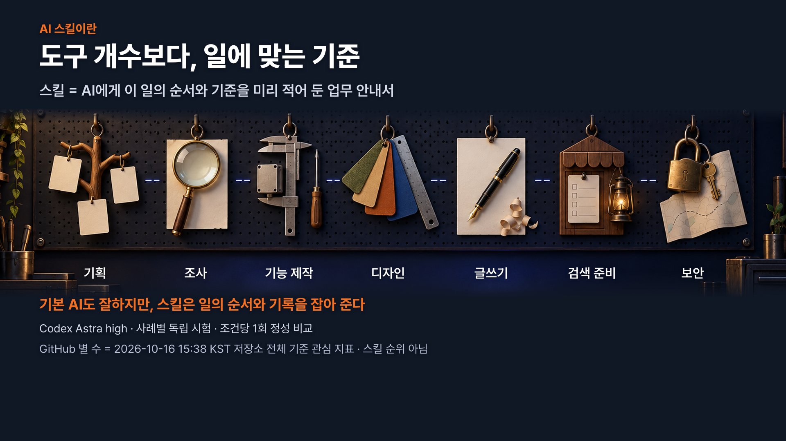
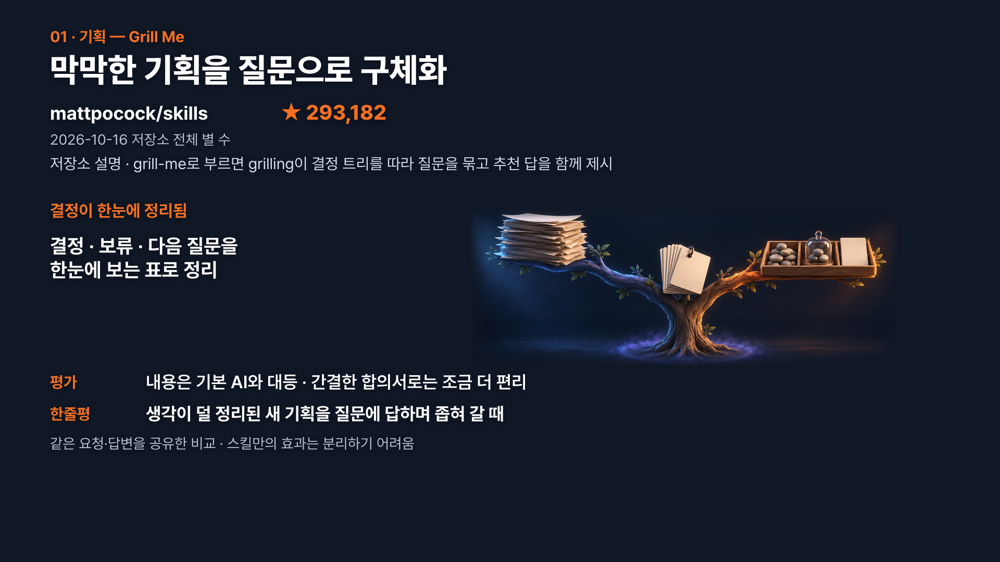
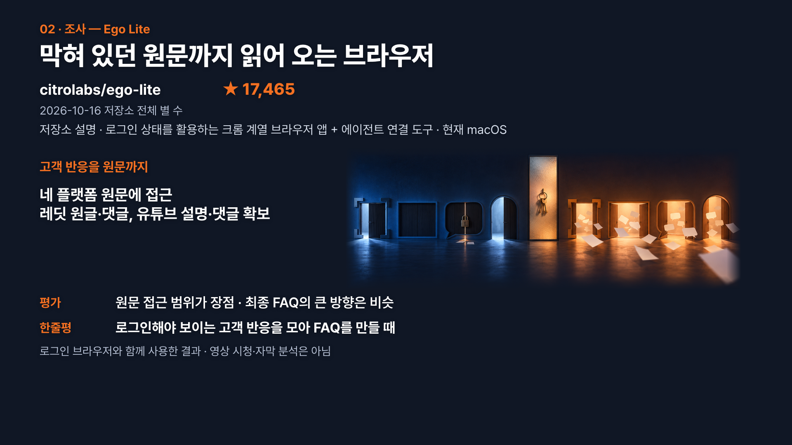
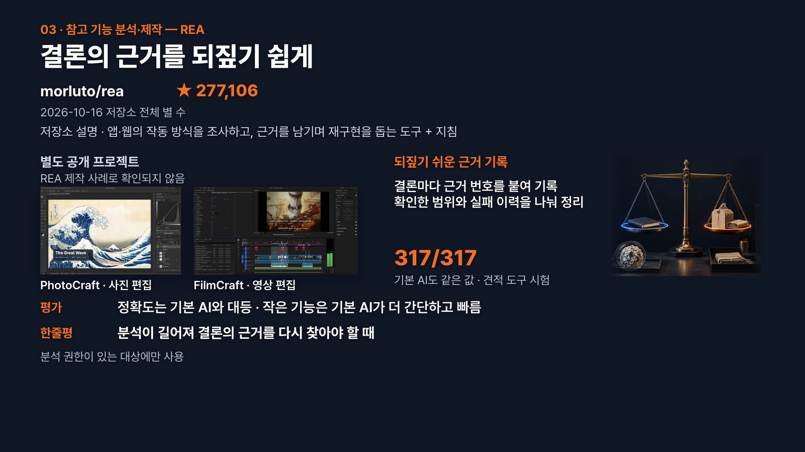
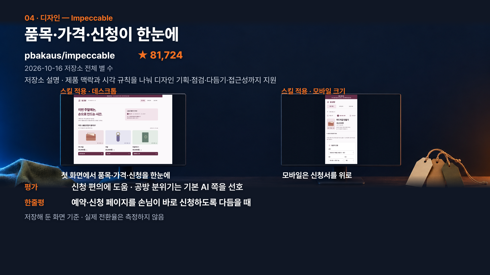
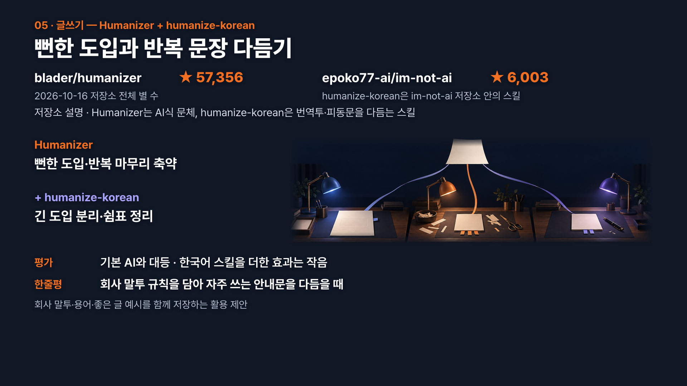
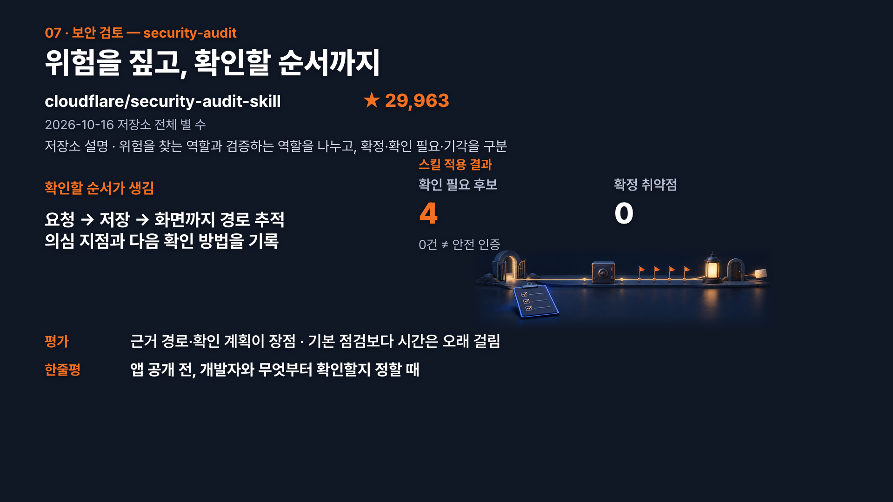
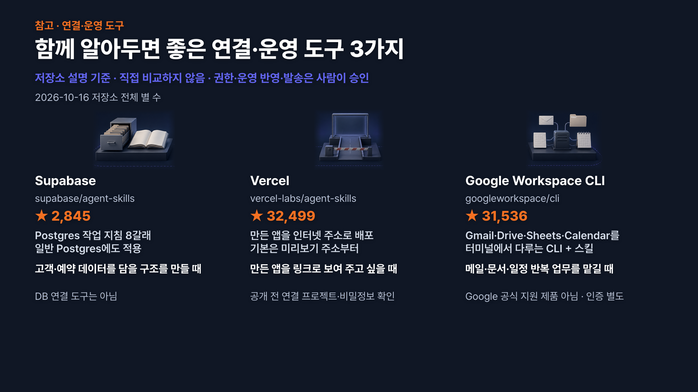

# 2026 비개발자라면 활용해야할 AI 에이전트 스킬 10가지!

이 가이드는 영상에서 소개한 AI 에이전트 스킬 10가지를 비개발자의 업무 흐름(기획 → 리서치 → 제작 → 디자인 → 글쓰기 → 마케팅 → 보안) 순서로 정리하고, 스킬마다 어떤 상황에서 어떻게 쓰면 좋은지 담았습니다. 전부 설치하라는 목록이 아닙니다. 지금 내 업무에서 막히는 곳에 맞는 스킬을 한두 개 고를 때 쓰시면 됩니다.

---

## 스킬이란? — 내 업무에 맞춰 고르는 장비

운동은 장비빨이라고들 하지만, 아무리 비싼 장비도 내 운동에 맞지 않으면 짐이 됩니다. AI 스킬도 마찬가지예요. 스킬은 AI에게 ‘이 일은 이런 순서로, 이런 기준으로 해 줘’라고 미리 적어 둔 **업무 안내서**입니다. 업무에 맞는 스킬을 쓰면 AI가 무엇을 확인하고 어떤 기준을 따라야 할지 알려 줄 수 있어요.

요즘 최신 모델은 스킬 없이도 웬만한 일을 잘 해냅니다. 그래서 스킬이 많다고 결과가 무조건 좋아지지는 않아요. 그래도 스킬이 필요한 때는 있습니다. 익숙하지 않은 분야의 일을 체계적으로 하고 싶을 때, 업무 방식을 우리 조직에 맞추고 싶을 때, 모델이 가끔 놓치는 부분을 챙기고 싶을 때예요.

아래 소개에는 성격이 다른 이름이 섞여 있으니 먼저 구분해 두세요.

| 구분 | 뜻 | 예 |
|---|---|---|
| 스킬 | AI가 읽고 따르는 지침 파일(`SKILL.md`) | grill-me, seo-audit |
| 저장소 | 스킬을 모아 둔 GitHub 리포지토리 | mattpocock/skills, marketingskills |
| 브라우저 앱 | 사람이 설치해 쓰는 실제 브라우저 | Ego Lite |
| CLI·분석 도구 | 스킬과 별도로 설치·연결하는 실행 프로그램 | Google Workspace CLI(gws), REA 분석 도구 |

### 시작하는 법

저장소마다 설치 방법이 나와 있습니다. 쓰고 있는 AI 에이전트(Claude Code, Codex 등)에게 저장소 링크를 주면서 설치해서 쓸 수 있게 해 달라고 요청해도 돼요. 다만 링크 하나로 모든 게 연결되지는 않으니 아래 순서로 확인하세요. 아래 네 가지는 AI 에이전트에게 함께 확인해 달라고 요청하면 됩니다. 다만 로그인과 계정 권한 승인은 본인이 내용을 확인하고 진행하세요.

1. **지원 환경** — 내 에이전트와 운영체제에서 쓸 수 있는지
2. **설치 범위** — 스킬 파일만 있으면 되는지, 브라우저 앱·CLI·분석 엔진도 필요한지
3. **필요한 인증** — 로그인, API 권한, 계정 연결이 필요한지
4. **작은 시험** — 실제 업무 하나를 작게 맡겨 결과를 본 뒤 범위 넓히기

## 한눈에 보는 스킬 10가지

업무별 소개 7묶음에, 업무 단계와 상관없이 곁에 두면 좋은 참고 도구 3가지를 더했습니다. 5번 글쓰기는 Humanizer와 한국어 스킬(humanize-korean)을 한 묶음으로 셌어요.

| 번호 | 단계 | 스킬 | 이럴 때 꺼내 보세요 |
|---|---|---|---|
| 1 | 기획 | Grill Me | 잘 모르는 분야의 기획을 빠짐없이 잡고 싶을 때 |
| 2 | 리서치 | Ego Lite | 로그인이 필요한 플랫폼에서 자료를 모을 때 |
| 3 | 제작 | REA | 다른 서비스의 특정 기능을 내 프로젝트에 붙이고 싶을 때 |
| 4 | 디자인 | Impeccable | 원하는 디자인은 있는데 용어로 설명하기 어려울 때 |
| 5 | 글쓰기 | Humanizer + humanize-korean | 글이 AI스럽거나 원하는 문체로 맞추고 싶을 때 |
| 6 | 마케팅 | marketingskills (seo-audit 등) | 마케팅·검색 준비의 방향을 잡고 싶을 때 |
| 7 | 보안 | Cloudflare security-audit | 만든 결과물을 공개하기 전에 점검하고 싶을 때 |

| 번호 | 참고 도구 | 이럴 때 꺼내 보세요 |
|---|---|---|
| 8 | Supabase Postgres 스킬 | 시트·엑셀을 넘어 웹앱용 데이터베이스가 필요할 때 |
| 9 | Vercel 배포 스킬 | 만든 웹앱을 주소 하나로 팀·고객과 공유할 때 |
| 10 | Google Workspace CLI | 플러그인으로 Gmail·드라이브·시트 작업이 잘 안 될 때 |

## 1. Grill Me — 덜 정리된 기획을 질문으로 다지기

Grill Me는 개발자 Matt Pocock의 [skills 저장소](https://github.com/mattpocock/skills)에서 Productivity 분류에 있는 스킬입니다. AI가 꼬치꼬치 캐물으면서, 업무에서 놓치기 쉬운 조건을 짚게 도와줘요. 질문마다 AI가 추천 답도 함께 달아 줍니다. 추천이 마음에 들면 그대로 받고, 아니면 내 답으로 바꾸면 돼요. 영상에서는 가죽공방 체험 회사를 운영한다고 가정하고 기획을 맡겼습니다. Grill Me는 ‘누구를 대상으로 할지’ 같은 조건을 하나씩 질문으로 뽑았고, 답을 모아 최종 기획안으로 정리했어요.

기획안 자체는 요즘 모델이 스킬 없이도 잘 써 줍니다. Grill Me가 쓸모 있는 건 **어떤 질문을 거쳐 무엇을 결정했는지**가 기록으로 남기 때문이에요. 조직에서는 과정도 결과물만큼 중요할 때가 많습니다. 인수인계나 보고를 할 때 결정 근거를 그대로 보여 줄 수 있어요.

- **잘 맞는 때**: 처음 맡은 분야의 새 기획, 생각이 아직 덜 정리된 프로젝트 (예: 처음 여는 고객 체험 행사, 새로 만드는 사내 교육 과정)
- **안 써도 되는 때**: 이미 잘 아는 분야의 익숙한 업무

## 2. Ego Lite — 로그인이 필요한 리서치를 AI 전용 공간에서

[Ego Lite](https://github.com/citrolabs/ego-lite)는 크롬 계열 브라우저 앱입니다. AI 에이전트가 이 브라우저를 다루게 해 주는 ego-browser 스킬이 함께 들어 있어요. 그래서 스킬만이 아니라 브라우저 앱도 설치해야 합니다. 촬영 시점 기준으로 macOS용(Apple 실리콘·Intel)이 나와 있고, Windows 버전은 비공개 베타를 준비 중이라고 안내돼 있어요. 처음 실행할 때 크롬 데이터를 가져오기로 선택하면 로그인 정보와 쿠키를 옮겨 쓸 수 있습니다.

가장 큰 특징은 사람과 AI가 브라우저를 나눠 쓴다는 점입니다. 리서치를 맡기면 내가 보던 탭은 그대로 두고, AI용 공간(Space)을 따로 띄워 병렬로 작업해요. 영상에서는 Codex에게 에이전트용 프로필로 Reddit에서 가죽공방 관련 포스트 세 개를 모아 달라고 요청했습니다. Codex가 별도 공간에서 수집하는 동안 사람은 다른 웹사이트를 보며 일할 수 있었고, 수집이 끝나자 Codex가 내용을 바로 요약해 줬어요. Claude Code와 Codex에 공간을 하나씩 맡겨 동시에 돌리기도 쉽습니다.

| 이런 리서치라면 | 추천 |
|---|---|
| 공개 웹페이지 몇 개 읽기 | 에이전트 기본 기능으로 충분 |
| Reddit·X·인스타그램처럼 로그인이 복잡한 곳 | Ego Lite + 스킬 조합 |
| 여러 조사를 동시에 진행 | AI 공간을 나눠 병렬로 |

신제품을 내기 전에 커뮤니티 반응을 살피거나, 고객이 자주 묻는 질문을 SNS에서 모을 때 써 볼 만합니다. 로그인 정보를 가져온다는 건 AI가 실제 계정 권한으로 움직인다는 뜻이에요. 에이전트 전용 계정이나 프로필을 쓰고, 플랫폼 약관과 수집 허용 범위를 확인하세요. 결과를 받으면 조사 키워드가 맞는지, 내용마다 원문 링크와 작성일이 붙어 있는지부터 보면 됩니다.

## 3. REA — 마음에 드는 기능의 작동 방식을 근거로 모으기

[REA](https://github.com/morluto/rea)(reverse-engineer-anything)는 이미 있는 앱이나 웹이 어떻게 작동하고 어떻게 설계됐는지 조사하는 도구입니다. 조사로 모은 근거를 바탕으로 비슷한 기능을 만들도록 도와줘요. REA는 지침을 담은 스킬과 실제 분석을 맡는 MCP 서버·CLI로 이뤄져 있습니다. 스킬 파일만 설치해서는 분석 도구가 연결되지 않으니, 저장소 안내에 따라 분석 도구 설정도 함께 해야 해요.

1. 궁금한 동작을 정한다 (예: 어떤 노트 앱의 검색 방식)
2. REA가 앱이나 웹을 조사해 근거를 모은다
3. 그 근거를 바탕으로 내 프로젝트에 비슷한 기능을 만든다

최신 모델이면 이런 스킬 없이도 앱을 충분히 만들 수 있습니다. 간단한 앱으로 시험했을 때도 REA 없이 문제를 잘 풀었어요. REA는 이미 있는 서비스의 특정 기능을 비슷하게 붙이고 싶은데, AI가 계속 헤맬 때 꺼내면 됩니다. 사내 대시보드나 업무 앱을 만들다가 ‘저 서비스의 그 기능처럼’을 말로 설명하기 어려울 때가 있죠. 그럴 때 근거를 모아 체계적으로 설계하는 데 도움을 받을 수 있습니다.

상용 앱 전체를 자동으로 복제해 주는 도구는 아닙니다. 분석해도 되는 대상인지, 라이선스나 권리를 침해하지 않는지 먼저 확인하세요. 그다음 기능 하나의 동작을 참고하는 용도로 쓰면 됩니다. 결과에서는 결론마다 근거가 붙어 있는지, 확인된 사실과 추정이 구분돼 있는지 보세요.

## 4. Impeccable — 원하는 디자인을 AI가 알아듣는 말로

[Impeccable](https://github.com/pbakaus/impeccable)은 디자인 작업을 돕는 스킬입니다. Anthropic이 제공해 온 유명한 frontend-design 스킬에서 영감을 받아, 디자인용 명령(커맨드)을 여럿 더했어요. CLI와 브라우저 확장 같은 보조 도구도 함께 제공합니다. 영상에서는 체험 신청 앱에 적용해, 화면을 모바일과 데스크톱으로 나눠 설계한 결과를 보여 드렸습니다. 모바일에서는 체험 일정과 신청이 맨 위에 오고, 데스크톱에서는 여러 선택지를 넓게 보여 주는 식이었어요. 운영 중인 웹사이트를 읽기 쉽게 다듬는 데에도 활용했습니다.

디자인 용어를 몰라도 고민만 있으면 맞는 기능을 고를 수 있습니다.

| 이런 고민이 있다면 | 써 볼 기능 |
|---|---|
| 디자인 규칙을 문서로 남기고 싶다 | `DESIGN.md` 작성 |
| 어디가 불편한지 콕 집기 어렵다 | UX 비평, 품질 점검 |
| 화면이 너무 밋밋하다 | 더 눈에 띄게 강조하기 |
| 화면이 너무 복잡하다 | 단순하게 덜어 내기 |

## 5. Humanizer + humanize-korean — AI스러운 글을 내 말투로

보고서, 뉴스레터, 메일까지, 비개발자 업무에서 글쓰기는 큰 비중을 차지합니다. AI에게 글을 맡길 때 가장 흔한 고민은 글이 너무 AI스럽다는 거죠. 이 항목은 저장소 두 개를 한 묶음으로 소개합니다.

| 이름 | 하는 일 | 저장소 |
|---|---|---|
| Humanizer | 뻔한 도입, 반복 같은 AI식 문체를 고친다 (영문 기반) | [blader/humanizer](https://github.com/blader/humanizer) |
| humanize-korean | 번역투 같은 한국어 표현을 자연스럽게 다듬는다 | [epoko77-ai/im-not-ai](https://github.com/epoko77-ai/im-not-ai) |

humanize-korean은 Humanizer의 공식 한국어판이 아니라 따로 만들어진 프로젝트예요. 두 저장소 모두 어떤 패턴을 고치는지 정리해 두었습니다.

요즘 모델은 글을 워낙 잘 써서 이 스킬들이 꼭 필요하지는 않습니다. 그대로 설치해 끝내기보다 **나만의 커스텀 스킬 재료**로 쓰는 걸 추천해요. 

AI에게 글을 맡기면 문체가 매번 조금씩 달라집니다. 원하는 스타일로 맞춰 두고 싶다면 아래 재료를 두 스킬의 기준과 묶어 하나의 스킬로 만들어 보세요. 우리 조직이나 내가 쓰는 말투, 잘 쓴 글 예시, 자주 쓰는 용어와 피할 표현이 재료가 됩니다.

다듬은 글은 원문과 나란히 놓고 뜻, 숫자, 날짜, 조건이 그대로인지 사람이 확인해야 합니다. 읽는 사람이 편해졌는지, 우리 조직의 말투에 맞는지도 함께 보세요.

## 6. marketingskills — 마케팅 업무의 방향을 잡아 주는 스킬 모음

디자인 지식이 부족할 때 Impeccable을 쓰듯, 마케팅 지식이 부족할 때는 Corey Haines의 [marketingskills 저장소](https://github.com/coreyhaines31/marketingskills)를 쓸 수 있습니다. 검색 최적화만 다루지 않아요. 제품 마케팅, SEO·콘텐츠, 전환 개선(CRO), 카피, 광고·성과 측정, 성장·고객 유지, 세일즈·시장 진입(GTM), 전략까지 영역별 스킬이 모여 있습니다. 마케팅 아이디어가 필요하면 marketing-ideas를, 검색 준비를 점검하고 싶으면 seo-audit을 고르는 식으로 필요한 것만 쓰면 돼요.

영상에서 실제 활용 예로 든 건 seo-audit입니다. 웹사이트나 랜딩 페이지를 만들 때 써 봤더니, 그냥 요청할 때보다 결정할 사항과 인수인계할 내용을 더 잘 정리해 줬어요. seo-audit은 먼저 검색엔진이 페이지를 찾고 읽을 수 있는지 보고, 이어서 기술 기반, 페이지 구성, 콘텐츠 순서로 점검합니다.

새 이벤트 랜딩 페이지나 회사 소개 사이트를 공개하기 전에 써 볼 만해요. 결과에서는 공개 전에 정할 것과 바로 고칠 것이 나뉘어 있는지, 실제로 반영됐는지 확인하세요. 스킬을 쓴다고 검색 순위가 오르는 건 아니니, 공개한 뒤 성과는 따로 지켜봐야 합니다.

## 7. Cloudflare security-audit — 공개 전에 보안 빈틈 점검하기

[security-audit](https://github.com/cloudflare/security-audit-skill)은 인터넷 보안으로 잘 알려진 Cloudflare가 공식으로 내놓은 보안 감사 스킬입니다. 보안 전문가가 아니면 내가 만든 웹사이트나 대시보드에 취약점이 없는지 판단하기 어렵죠. 이 스킬은 여섯 단계로 빈틈과 리스크를 살피고 개선점을 정리합니다. 정찰 → 점검 범위 탐색 → 후보 검증 → 구조화 기록 → 독립 검증 → 보고 순서예요. 문제를 찾는 쪽과 검증하는 쪽을 나누고, 결과를 세 가지로 구분해 주는 게 특징입니다.

| 판정 | 뜻 | 비개발자가 할 일 |
|---|---|---|
| confirmed | 근거와 확인 결과까지 갖춘 문제 | 개발자와 우선순위를 정해 수정 논의 |
| needs_validation | 아직 확인이 덜 된 후보 | 무엇을 확인할지 질문으로 정리 |
| rejected | 검토해 보니 문제가 아니었던 후보 | 기록으로 남기기 |

배포를 직접 하지 않고 개발자가 따로 있어도 쓸모가 있습니다. 개발자에게 작업을 요청하기 전에 한번 돌려 보고, 그 의견을 붙여 전달하면 더 구체적으로 이야기할 수 있어요. 고객 정보가 들어가는 신청 폼이나 팀 대시보드를 공유하기 전에 써 보세요. 다만 검토할 항목과 근거를 정리해 주는 것이지, 안전을 인증해 주는 것은 아닙니다. 확정된 문제가 없다고 해서 안전하다는 뜻은 아니에요. 코드 수정이나 공격 테스트는 가능하면 혼자 하지 말고 개발자와 논의하세요.

## 참고 도구 3가지 — 단계와 상관없이 곁에 두면 좋은 도구

웹앱을 만들고 공유하거나, 매일 쓰는 구글 도구와 연결할 때 자주 찾게 되는 도구들입니다. 아래 세 도구는 이번 직접 비교에는 포함하지 않은 참고 도구입니다.

## 8. Supabase Postgres 스킬 — 시트를 넘어서는 데이터 관리

Supabase는 비개발자도 비교적 쉽게 쓸 수 있고 AI 에이전트와도 잘 맞는 데이터베이스입니다. 데이터는 시트나 엑셀에 보관해도 되지만, 웹앱이나 사내 시스템을 만들 때는 더 확장성 있는 데이터베이스가 필요해지죠. Supabase는 [agent-skills 저장소](https://github.com/supabase/agent-skills)에서 에이전트용 스킬을 제공합니다. 그중 supabase-postgres-best-practices는 Postgres 지침을 쿼리, 연결 관리, 보안·접근 권한, 테이블 설계 등 여덟 범주로 나눠 중요한 순서대로 정리한 스킬이에요. AI가 데이터베이스를 설계하거나 손볼 때 이 기준을 따르게 해 줍니다.

예를 들어 시트로 관리하던 신청자 명단을 웹 신청 폼과 연결된 데이터베이스로 옮길 때 쓸 수 있어요. 

## 9. Vercel 배포 스킬 — 만든 웹앱을 주소 하나로 공유하기

랜딩 페이지, 웹사이트, 웹앱, 대시보드를 여러 사람과 같이 쓰려면 배포를 해야 합니다. Vercel은 비개발자도 손쉽게 쓸 수 있는 대표적인 배포 서비스예요. Vercel Labs의 [agent-skills 저장소](https://github.com/vercel-labs/agent-skills)에 배포 스킬이 들어 있습니다. 배포 절차를 AI에게 안내하고, 결과를 확인할 주소를 받을 때 활용할 수 있어요.

기본은 미리보기(preview) 배포이고, 정식(production) 배포는 직접 요청할 때만 진행하도록 되어 있습니다. 다만 Git으로 연결된 프로젝트는 운영 브랜치에 올리면 바로 정식 배포가 될 수 있어요. 

어느 계정의 어느 프로젝트에 어떤 방식으로 올라가는지, 비밀번호나 API 키 같은 민감한 정보가 함께 올라가지 않는지 먼저 확인하세요. 팀에 시안을 공유하거나 고객에게 확인용 대시보드를 보여 줄 때 유용합니다.

## 10. Google Workspace CLI — 플러그인으로 부족할 때의 대안

조직에서는 Gmail, 드라이브, 시트, 캘린더 같은 구글 제품을 많이 씁니다. 요즘은 플러그인으로 연결하는 경우가 많지만, 에이전트에 따라 플러그인이 필요한 기능을 다 제공하지 않을 때가 있어요. 그럴 때 대안으로 써 볼 만한 게 [Google Workspace CLI](https://github.com/googleworkspace/cli)(gws)입니다. 

gws는 터미널에서 돌아가는 실행 프로그램이고, API별·업무별 스킬이 함께 들어 있어요. 스킬만으로는 연결되지 않습니다. CLI 설치, 구글 계정 인증, API 권한 설정을 따로 해야 해요. Google Workspace 조직의 저장소지만, 공식 지원하는 Google 제품은 아니라고 명시돼 있습니다.

처음에는 시트 읽기, 드라이브 파일 찾기, 일정 조회 같은 읽기 작업부터 맡겨 보세요. 메일 발송, 파일 삭제, 일정 생성처럼 되돌리기 어려운 작업은 실행 전에 사람이 내용을 확인한 뒤 진행하는 게 좋습니다.

---

## 내 업무에 적용하는 순서

생산성은 규모가 아니라 시스템에서 나옵니다. 남이 만든 스킬을 잔뜩 설치해 대충 쓰기보다, 아래 순서로 하나씩 붙여 보세요.

1. 지금 업무에서 가장 막히는 지점 하나를 고릅니다.
2. 관련 스킬을 한두 개만 골라 설치합니다.
3. 내 실제 자료로 작게 실행해 봅니다.
4. 결과를 직접 점검합니다.
5. 쓸 만하면 스킬을 재활용 혹은 우리 회사의 검토 기준을 더해 커스텀 스킬로 저장하고 다시 씁니다.

회사 기준을 담은 스킬이 하나 생기면, 필요할 때마다 스킬을 한두 개씩 더해 가며 나에게 맞는 업무 시스템을 만들 수 있습니다.
