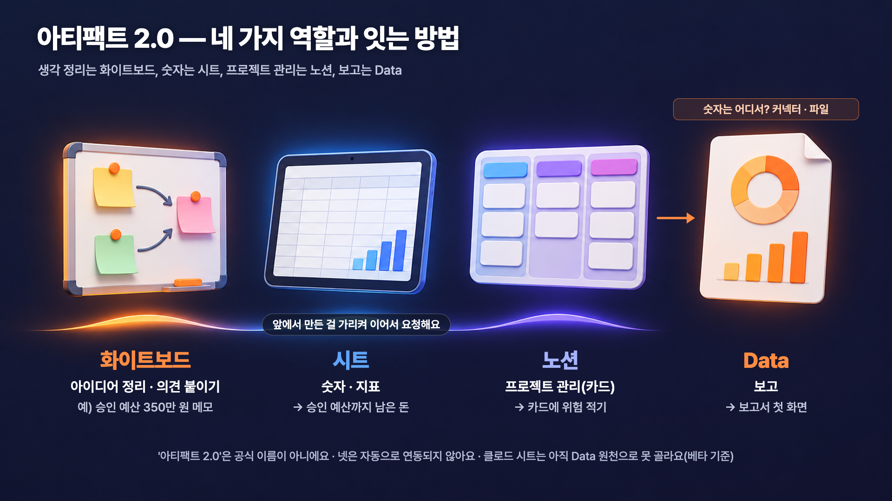
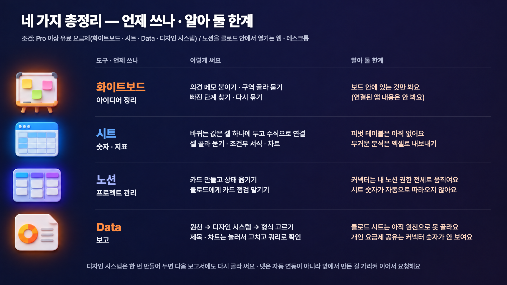

# 클로드 아티팩트 2.0 총정리! 사무업무, 이제 클로드 안에서 다 끝내세요


이 가이드는 「클로드 아티팩트 2.0 총정리」 영상에서 연말 고객 초청 행사 준비를 예로 화이트보드 → 시트 → 노션 → Data 순서로 진행한 과정과, 영상에서 쓴 요청문을 정리한 것입니다. '아티팩트 2.0'은 공식 이름이 아니라, 11월 업데이트 네 가지를 묶어 이 영상에서 부르는 이름입니다.

---

## 목차

1. [아티팩트 2.0 한눈에](#1-아티팩트-20-한눈에)
2. [시작 전 확인](#2-시작-전-확인)
3. [화이트보드: 아이디어 정리](#3-화이트보드-아이디어-정리)
4. [시트: 숫자와 지표](#4-시트-숫자와-지표)
5. [노션: 프로젝트 관리](#5-노션-프로젝트-관리)
6. [바뀐 내용은 한마디로 다 같이 고치기](#6-바뀐-내용은-한마디로-다-같이-고치기)
7. [Data: 팀에 공유할 보고서](#7-data-팀에-공유할-보고서)
8. [네 가지 총정리](#8-네-가지-총정리)
9. [참고 자료](#9-참고-자료)

---

## 1. 아티팩트 2.0 한눈에



아티팩트는 클로드가 대화 옆 창에 따로 만들어 주는 결과물입니다. 11월 업데이트로 여기에 네 가지가 달라졌어요.

| 무엇이 | 어떻게 바뀌었나 | 영상에서 맡긴 일 |
|---|---|---|
| 화이트보드 | 새로 생김(베타) | 행사 아이디어 정리 |
| 시트 | 새로 생김(베타) | 예산과 지표 |
| 인터랙티브 커넥터 | 노션 같은 앱을 클로드 안에서 열어서 고침 | 프로젝트 카드 관리 |
| Data | 대시보드가 Data로 이름이 바뀌고, 보고 형식이 늘어남 | 팀에 공유할 보고서 |

넷이 자동으로 연동되는 건 아닙니다. 영상에서는 아티팩트 탭에서 화이트보드를 만든 뒤, 시트는 "방금 제작한 보드로"처럼 앞에서 만든 걸 가리켜 요청했어요. 노션 작업과 '70명' 반영은 시트를 만든 대화에서 이어서 했고, Data 보고서는 숫자를 어디서 가져올지(오늘은 노션 카드) 따로 골랐습니다.

---

## 2. 시작 전 확인

**요금제**

- 화이트보드, 시트, Data, 디자인 시스템은 Pro, Max, Ultra, Team, Enterprise 요금제에서 쓸 수 있습니다. 무료 요금제에서는 안 됩니다.
- 화이트보드와 시트, 디자인 시스템은 아직 베타입니다. Enterprise 요금제는 관리자가 조직 설정 > 아티팩트에서 켜야 보입니다.
- 노션 같은 앱을 클로드 안에서 열어 고치는 기능은 새 클로드 화면(Chat과 Cowork가 합쳐진 화면)의 웹과 데스크톱 앱에서 됩니다.

**설정**

- 설정에서 코드 실행과 파일 만들기가 켜져 있어야 아티팩트를 쓸 수 있습니다.
- 노션 커넥터를 미리 연결해 두세요. 노션 읽기 도구는 '항상 허용'으로 두는 걸 추천드립니다. 매번 승인을 묻게 해 두면 아티팩트에서는 그 도구를 쓸 수 없어요.
- 커넥터는 내 노션 권한 전체로 움직입니다. 처음에는 연습용 페이지를 하나 만들어 그 아래에서 해 보세요. 영상에서는 '촬영용' 페이지를 썼습니다.

---

## 3. 화이트보드: 아이디어 정리

### 3-1. 메모를 보드로 정리하기

아티팩트 탭에서 화이트보드를 고르고, 행사 메모를 그대로 붙여 넣었습니다. 예시에 나온 이름과 숫자는 모두 연습용입니다.

```text
12월 26일 연말 고객 초청 행사 준비야. 50명 예상. 장소 섭외는 내가(구씨) 11월 20일까지, 초대장 디자인은 민지님이 11월 25일까지, 인스타 홍보는 지수님이 12월 1일부터, 케이터링은 인당 3만 원, 장소비는 고정 80만 원, 기념품은 인당 1만 원.
이 메모를 보드로 정리해 줘. 무엇을 언제 누가 하는지 한눈에 보이게.
빠졌거나 아직 안 정해진 일은 따로 모아 줘. 묶는 방식은 네가 정해.
```

일정은 흐름으로, 예산은 50명 기준 280만 원(1명 늘면 4만 원 추가)으로, 담당이나 마감이 없는 일 8개는 따로 모아서 보드를 만들어 줍니다.

### 3-2. 의견 메모 붙이기

회의에서 나온 내용은 보드 빈 곳에 메모로 붙입니다. 영상에서는 이 두 줄을 붙였어요.

```text
회사 승인 예산: 전부 합쳐 350만 원까지
지수 의견: 인스타보다 기존 고객에게 보내는 문자 초대가 반응이 좋았음
```

### 3-3. 한 구역만 골라 물어보기

아래 도구 막대의 댓글 버튼을 누르고 보드에서 물어볼 곳을 클릭한 뒤, `@Claude`를 붙여 요청합니다. 'Claude에게 보내기'가 체크돼 있어야 클로드가 답해요.

```text
@Claude 이 부분에 돈이 거의 안 들면서 손님이 기억할 만한 아이디어 세 개만 보드에 붙여 줘.
승인 예산은 넘지 않는 걸로.
```

고객별 한 줄 손글씨 카드, 이름 불러 주는 입장, 내년 바람 벽 같은 아이디어가 그 구역 옆에 붙습니다.

### 3-4. 빠진 단계 찾고 다시 묶기

보드 전체에 대한 요청은 아래 **Ask Claude** 칸에 적습니다.

```text
초대장 보내는 날부터 행사 당일 사이에 빠진 단계가 있으면 보드에 붙여 줘.
그다음 내가 붙인 의견까지 넣어서 '확정 / 해 볼 아이디어 / 확인할 것'으로 다시 묶어 줘.
```

> 화이트보드에서 클로드는 보드 안에 있는 것만 봅니다. 노션 같은 연결된 앱의 내용은 화이트보드에서 쓰지 않아요.

---

## 4. 시트: 숫자와 지표

### 4-1. 보드로 예산 시트 만들기

다시 아티팩트 탭에서 이번에는 스프레드시트를 고르고, 앞에서 만든 보드를 가리켜 요청했습니다.

```text
방금 제작한 보드로 행사 예산 시트를 만들어 줘. 탭은 '예산'과 '지표' 두 개로.
예산 탭은 항목별 처음 예산(숫자 그대로)과 예상 비용(참석 인원 칸 하나를 따라 움직이는 수식)으로.
지표 탭에는 1인당 비용, 처음 예산 대비 증감, 보드의 승인 예산까지 남은 돈을 두고, 넘으면 눈에 띄게.
비교 차트도 하나 넣어 줘.
```

보드에 붙여 둔 승인 예산 350만 원까지 읽어서 지표 탭을 만들어 줍니다.

| 지표 | 50명일 때 |
|---|---|
| 1인당 비용 | 56,000원 |
| 처음 예산 대비 증감 | 0원 |
| 승인 예산까지 남은 돈 | 700,000원 |

인원처럼 바뀌는 값은 셀 하나에 두고 나머지를 수식으로 이어 두면, 인원이 바뀌어도 숫자를 다시 계산할 필요가 없어요. 수식은 셀에 그대로 남아서 숫자가 어떻게 나왔는지 눌러 보면 확인할 수 있습니다.

### 4-2. 셀을 골라 물어보기

예산 탭에서 참석 인원 셀(A1:B1)을 고르고, 셀 댓글로 `@Claude`에게 물었습니다.

```text
@Claude 참석 인원이 몇 명까지 늘어도 승인 예산 안이야?
그 인원을 지표 탭에 새 칸으로 넣어 줘. 승인 예산이나 단가가 바뀌면 같이 움직이게.
```

지표 탭에 '승인 예산 안 최대 인원 67명, 지금보다 17명 더 가능'이 새로 생깁니다. (350만 원 − 장소비 80만 원) ÷ 1인당 4만 원 = 67.5명이라 67명이에요.

### 4-3. 시트에서 아직 안 되는 것

- 피벗 테이블, 보호된 범위, PDF 내보내기는 아직 없습니다.
- 무거운 분석은 .xlsx나 CSV로 내보내 엑셀에서 이어서 하시는 게 낫습니다. '전송'으로 다른 도구에 넘길 수도 있어요.
- 휴대폰에서는 쓸 수 있는 기능이 제한됩니다.

---

## 5. 노션: 프로젝트 관리

### 5-1. 프로젝트 페이지와 카드 만들기

시트를 만든 대화에서 이어서, 노션 커넥터로 프로젝트 페이지를 만들고 클로드 안에서 열어 달라고 했습니다.

```text
노션 커넥터로 '촬영용' 페이지 아래에 '연말 고객 초청 행사' 프로젝트 페이지를 만들고, 다 되면 클로드 안에서 열어 줘.
맨 위엔 목표·행사일·예산 현황(시트 지표)·위험을 짧게, 그 아래엔 프로젝트 카드 데이터베이스를 상태별 보드로.
카드는 보드에서 확정한 일과 고른 아이디어로 만들고, 담당·마감·상태·우선순위·처음 예산·예상 비용·위험을 채워 줘.
담당이나 날짜가 안 정해진 카드는 '확인 필요'로 두고, 카드마다 다음 할 일 체크리스트를 넣어 줘.
```

다 만들어지면 대화 오른쪽에 노션 페이지가 열립니다. '확인 필요 / 할 일 / 진행 중'처럼 상태별로 카드가 나뉘고, 카드를 끌어 상태를 옮기거나 내용을 바로 고칠 수 있어요. 노션 앱으로 가고 싶으면 오른쪽 위 **Notion에서 열기**를 누르면 됩니다.

### 5-2. 카드 점검 맡기기

```text
노션 프로젝트 카드를 점검해 줘. 이번 주 안에 마감인 카드는 우선순위를 '높음'으로 올리고,
'확인 필요' 카드에는 보드 의견을 참고해서 누가 맡으면 좋을지 제안을 적어 줘. 바꾼 카드는 목록으로 알려 줘.
```

담당 제안을 보고 괜찮으면 "제안대로 옮겨 줘" 한마디로 반영합니다. 영상에서는 보드에 붙인 지수 의견을 보고 '기존 고객 문자 초대' 카드를 지수님에게 제안했어요.

> 노션 카드의 예산 숫자는 시트를 따라 자동으로 바뀌지 않습니다. 시트 숫자가 바뀌면 클로드에게 다시 반영해 달라고 말해 주세요.

---

## 6. 바뀐 내용은 한마디로 다 같이 고치기

프로젝트를 하다 보면 정보가 바뀌죠. 툴마다 들어가서 고치지 않고, 같은 대화에서 한 번에 말했습니다.

```text
참석 인원이 70명으로 늘었고, 초대장 디자인 마감은 11월 27일로 바뀌었어.
보드, 시트, 노션 카드에 모두 반영해 줘. 시트는 참석 인원 칸만 바꾸고 처음 예산은 그대로 둬.
승인 예산을 넘으면 노션 프로젝트 페이지 위험과 관련 카드에도 적고, 고친 곳은 마지막에 짧게 알려 줘.
```

| | 50명 | 70명 |
|---|---|---|
| 예상 비용 | 280만 원 | 360만 원 |
| 처음 예산 대비 | 0원 | 80만 원 늘어남 |
| 승인 예산 350만 원 | 70만 원 남음 | 10만 원 넘음 |

시트는 참석 인원 셀만 바뀌고 나머지는 수식으로 따라 바뀝니다. 승인 예산을 넘은 내용은 노션 프로젝트 페이지 위험과 관련 카드에 적혀요. "처음 예산은 그대로 둬"처럼 바꾸지 말아야 할 것도 같이 말해 두면 비교 기준이 남습니다.

---

## 7. Data: 팀에 공유할 보고서


### 7-1. 디자인 시스템 미리 만들기

보고서를 회사 디자인으로 만들고 싶다면 디자인 시스템을 먼저 하나 만들어 두세요. 새 대화에 브랜드 가이드와 로고, 실제로 쓰던 슬라이드를 같이 올리고 디자인 시스템을 만들어 달라고 하면 됩니다. 영상에서는 미리 만들어 둔 'T2D Network' 디자인 시스템을 골랐어요.

앤트로픽에서 Claude Design을 맡은 디자이너 네이트 패럿도, 디자인을 맡길 때는 캡처나 마음에 드는 페이지, 예전 작업물 같은 참고 자료를 먼저 주라고 합니다([피터 양 정리 글](https://creatoreconomy.so/p/how-to-fix-ai-slop-with-claude-design-nate-parrott)). 색깔 코드만 주는 것보다 실제 완성 화면을 같이 주는 게 결과가 좋습니다.

### 7-2. 노션 카드로 보고서 만들기

아티팩트 탭에서 Data를 고르고, 노션 프로젝트 카드로 보고서를 만들어 달라고 했습니다.

```text
노션 '연말 고객 초청 행사' 프로젝트 카드로, 팀에 공유할 준비 현황 보고서를 만들어 줘.
첫 화면은 상태 색(초록·노랑·빨강)과 이유 한 줄, 카드 상태별 진행과 승인 예산 350만 원 대비 예상 비용을 보여 주고, 늘어난 항목은 이름으로 짚어 줘.
이번 주 마감이거나 위험이 적힌 카드는 담당과 함께 카드 모양으로, 마지막은 다음 주 할 일.
나머지 순서와 차트는 보고받는 사람이 판단하기 쉽게 네가 정해.
```

'이 아티팩트는 커넥터를 사용합니다' 창이 뜨면 노션을 확인하고 **계속**을 누릅니다. 클로드가 노션 카드를 읽어 보고서를 만들어 줘요. 차트마다 쿼리를 열어 보면 노션에서 무엇을 가져와 셌는지 확인할 수 있습니다.

> 클로드 시트는 아직 Data의 원천으로 고를 수 없습니다(베타 기준). 시트 숫자로 보고서를 만들고 싶다면 시트를 CSV로 내보내 파일로 가져오면 됩니다.

### 7-3. 디자인 시스템 입히기

만든 보고서 오른쪽 위 **디자인** 버튼 → **변경**을 누르고, 디자인 시스템 목록에서 고른 뒤 **Continue**를 누르면 바로 반영됩니다. 처음 대시보드 아티팩트가 나왔을 때는 디자인을 하나하나 요청해야 했는데, 이제는 버튼으로 바꿀 수 있어요.

### 7-4. 형식 바꾸기: 스크롤리텔러

같은 디자인 패널 아래 **형식**에서 보고서 모양을 바꿀 수 있습니다.

| 형식 | 이럴 때 |
|---|---|
| 대시보드 | 숫자를 빠르게 훑어볼 때 |
| Visual analysis | 숫자를 글로 정리한 요약이 필요할 때 |
| Scrollyteller | 스크롤하면서 메시지마다 차트를 보여 줄 때 |
| 비주얼 단편 | 숫자를 설명하는 짧은 영상이 필요할 때 |

영상에서는 Scrollyteller로 바꿨습니다. 스크롤을 내리면 "승인 예산을 10만 원 넘었다 → 처음 계획보다 80만 원 늘었다 → 늘어난 항목 → 카드 8장 중 끝난 카드 0장 → 이번 주 마감 1건 → 마감 위험 카드" 순서로 메시지와 차트가 나와요. 회의에서 같이 보며 결정할 때는 평평한 대시보드보다 이쪽이 훨씬 잘 읽힙니다.

### 7-5. 공유할 때 알아 둘 것

- 팀 요금제는 같은 회사 사람에게 실시간 공유(베타)가 됩니다. 내 권한으로 읽은 숫자가 그대로 보이니 보내기 전에 한 번 확인하세요.
- 개인 요금제는 링크로 보내든 이메일로 초대하든, 커넥터로 가져온 숫자 부분은 받는 분 화면에 보이지 않습니다.

---

## 8. 네 가지 총정리



- **화이트보드**는 아이디어를 꺼내고 논의할 때 씁니다. 메모를 올리고, 의견을 붙이고, 빠진 걸 찾게 하고, 다시 묶는 데까지요.
- **시트**는 숫자와 지표에 씁니다. 바뀌는 값은 한곳에 두고 수식으로 이어 두면 바뀔 때 손이 덜 갑니다.
- **노션**은 프로젝트 관리입니다. 앞에서 정한 일과 숫자로 카드를 만들고, 클로드 안에서 열어 관리해요.
- **Data**는 보고입니다. 숫자를 어디서 가져올지 정하고, 디자인 시스템과 형식을 골라 팀에 공유합니다.

넷은 자동으로 연동되는 게 아니라, 앞에서 만든 걸 가리켜 이어서 요청하면서 연결하는 겁니다. 지금 하고 계신 프로젝트 하나를 골라서, 메모 한 장과 의견 몇 개를 화이트보드에 올리는 것부터 시작해 보세요.

---

## 9. 참고 자료

- [Claude 화이트보드 시작하기 (Claude 도움말)](https://support.claude.com/ko/articles/18324319)
- [Claude Sheets 시작하기 (Claude 도움말)](https://support.claude.com/ko/articles/18324300)
- [Claude Data 시작하기 (Claude 도움말)](https://support.claude.com/ko/articles/17454700)
- [Claude에서 대화형 커넥터 사용 (Claude 도움말)](https://support.claude.com/ko/articles/13454812)
- [Claude Design에서 디자인 시스템 설정하기 (Claude 도움말)](https://support.claude.com/ko/articles/14604397)
- [아티팩트 공유 (Claude 도움말)](https://support.claude.com/ko/articles/9547008)

---

## 달라진 클로드 앱도 같이 보세요

아티팩트가 들어 있는 클로드 앱 자체가 어떻게 바뀌었는지 궁금하다면, [클로드 앱이 완전히 달라졌습니다! '2.0'이라 불리는 핵심 기능 8가지 업무 활용법](https://www.youtube.com/watch?v=lYCIvhvFkXg) 영상에서 Code 탭으로 업무 하나를 처음부터 끝까지 진행하는 과정을 보실 수 있습니다.

생산성은 규모가 아닌 시스템에서 나옵니다
