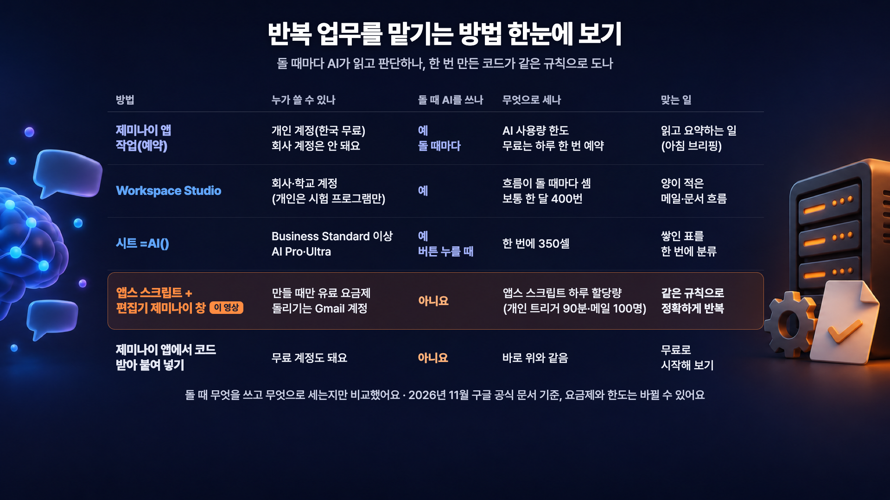
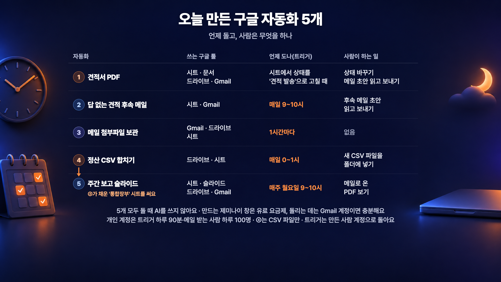

# 제미나이로 한 번만 만들면 끝! 노트북 꺼도 매일 무료로 도는 구글 자동화


이 가이드는 「제미나이로 한 번만 만들면 끝! 노트북 꺼도 매일 무료로 도는 구글 자동화」 영상에서 앱스 스크립트 편집기의 제미나이 창으로 견적서 PDF부터 주간 보고 슬라이드까지 구글 자동화 5개를 만든 과정과, 영상에서 쓴 요청문을 정리한 것입니다. 예시에 나오는 회사·고객 이름과 금액은 모두 연습용입니다.

---

## 목차

1. [매번 AI에게 시킬까, 한 번 만들어 둘까](#1-매번-ai에게-시킬까-한-번-만들어-둘까)
2. [시작 전 확인](#2-시작-전-확인)
3. [다섯 개 모두 같은 순서로 만듭니다](#3-다섯-개-모두-같은-순서로-만듭니다)
4. [견적서 PDF 자동으로 만들기](#4-견적서-pdf-자동으로-만들기)
5. [답 없는 견적에 후속 메일 초안](#5-답-없는-견적에-후속-메일-초안)
6. [메일 첨부파일 드라이브에 보관](#6-메일-첨부파일-드라이브에-보관)
7. [정산 CSV 하나로 합치기](#7-정산-csv-하나로-합치기)
8. [주간 보고 슬라이드 만들기](#8-주간-보고-슬라이드-만들기)
9. [멈췄을 때 알림과 하루 할당량](#9-멈췄을-때-알림과-하루-할당량)
10. [다섯 개 총정리](#10-다섯-개-총정리)
11. [참고 자료](#11-참고-자료)

---

## 1. 매번 AI에게 시킬까, 한 번 만들어 둘까



자동화 이야기를 하면 꼭 나오는 말이 **트리거**입니다. 앱스 스크립트에서 트리거는 정해 둔 때가 되면 구글 서버에서 코드가 저절로 돌게 하는 설정이에요. 코드가 구글 서버에서 돌기 때문에 내 노트북이 꺼져 있어도 됩니다.

AI에게 매일 일을 맡기는 방법은 이미 있습니다. 제미나이 앱의 작업 예약도 구글 클라우드에서 돌아서 기기를 꺼도 돼요. 다만 돌 때마다 AI가 새로 읽고 판단하기 때문에 AI 사용량 한도를 씁니다.

오늘 방법은 다릅니다. 제미나이는 코드를 처음 만들 때만 쓰고, 그다음부터는 트리거가 그 코드를 돌립니다. 이때는 AI 사용량이 아니라 앱스 스크립트의 하루 할당량(하루 실행 시간, 메일 보내는 수 같은 것)으로 셉니다.

| 이런 일이라면 | 맞는 방법 |
|---|---|
| 아침 브리핑처럼 매번 읽고 요약하고 판단해야 하는 일 | 제미나이 앱 작업 예약 |
| 견적 금액·정산 장부처럼 매번 같은 규칙으로 정확해야 하는 일 | 앱스 스크립트 + 제미나이 창 (이 가이드) |

그래서 회의록이나 메일 요약·답장처럼 기본 기능이나 제미나이 앱으로 이미 되는 일은 빼고, 코드만으로 되는 일 위주로 다섯 가지를 골랐습니다.

---

## 2. 시작 전 확인

**요금제**

- 편집기의 제미나이 창은 유료 요금제에서만 열립니다. 개인 계정은 Google AI Pro·Ultra, 회사 계정은 Business Standard 이상(또는 Gemini 애드온)이에요. 회사 계정은 관리자가 Gemini 기능을 켜 둬야 합니다.
- 유료 요금제가 필요한 건 만들 때뿐입니다. 만든 자동화를 돌리는 데는 Gmail 계정이면 충분해요.
- 무료로 해 보고 싶다면, 무료 제미나이나 ChatGPT에 앱스 스크립트 코드로 짜 달라고 한 뒤 편집기에 복사해 붙여 넣는 방법도 있습니다. 돌릴 때 드는 비용은 같아요.

**창이 안 보일 때**

- 제미나이 창은 구글 계정 언어가 영어(또는 기본값)일 때만 보입니다. 영상에서는 Manage your Google Account → Personal info → Language에서 Preferred language를 English로 바꿨어요. 창에는 영어로 표시되지만, 영상에서는 요청을 모두 한국어로 썼고 잘 알아들었어요.
- 구글이 이 기능을 계정마다 차례로 열고 있어서, 언어를 바꿔도 아직 창이 안 보이는 계정이 있을 수 있습니다.
- 한 브라우저에 구글 계정 여러 개로 로그인돼 있으면 창이 안 뜰 수 있습니다. 계정 하나만 로그인한 브라우저 프로필이나 시크릿 창에서 열어 보세요.

**시간대**

- 편집기 왼쪽 Project Settings의 General settings에서 Time zone을 서울(GMT+09:00)로 맞춰 두세요. 트리거의 '매일 9시', '매주 월요일'이 이 시간대를 기준으로 돕니다.

---

## 3. 다섯 개 모두 같은 순서로 만듭니다

1. 구글 시트에서 **Extensions → Apps Script**를 누르면 편집기가 열립니다. 오른쪽 위 **Ask Gemini** 아이콘을 누르면 제미나이 창이 나와요.
2. 자동화마다 왼쪽 Files 옆 **+**로 스크립트 파일을 하나씩 추가합니다. 파일 이름은 영어가 편해요(영상에서는 Quote, Followup, Attachment, Settlement, Slides).
3. 제미나이 창에서 새 대화를 열고 요청문을 붙여 넣습니다. `@[… 링크]` 자리에는 내 문서·폴더 링크를 넣어 주세요.
4. 코드는 거의 안 보셔도 됩니다. 오른쪽에 나오는 동작 요약이 내가 원한 대로인지 읽고, 맞으면 **Accept all** → 저장(Ctrl+S / Cmd+S).
5. 메인 함수를 골라 **Run**으로 한 번 실행해 결과를 확인합니다. 처음 실행하면 Gmail·드라이브·시트에 접근해도 되는지 묻는 권한 창이 뜨는데, 내 계정을 고르고 허용하면 됩니다. 개인 Gmail 계정이면 'Google hasn't verified this app'(Google에서 확인하지 않은 앱)이라는 화면이 나올 수 있어요. 내가 방금 만든 스크립트가 맞으면 Advanced(고급)를 눌러 계속 진행합니다.
6. 결과가 맞으면 `install…Trigger` 함수를 Run 해서 트리거를 등록합니다. 왼쪽 알람 시계 아이콘(Triggers)에서 등록된 트리거를 볼 수 있고, 연필 아이콘을 누르면 도는 시간과 실패 알림 설정을 확인할 수 있어요.

> 트리거는 항상 그 트리거를 만든 사람의 계정으로 돕니다. 동료가 시트를 고쳐서 돌더라도 메일은 내 계정에서 나가요.

---

## 4. 견적서 PDF 자동으로 만들기

**준비한 것**

| 무엇 | 내용 |
|---|---|
| '프로젝트' 시트 | 고객 · 품목 · 금액 · 납기 · 이메일 · 상태 · 발송일 · 공급자명 · 사업자등록번호 · 담당자명 · 연락처 열 |
| 견적서 템플릿 문서 | 값이 들어갈 곳에 `{{고객명}}`, `{{품목}}`, `{{금액}}` 같은 자리표시를 넣은 구글 문서 |
| 견적서 폴더 | 만든 문서와 PDF가 저장될 드라이브 폴더 |

**요청문**

```text
'프로젝트' 시트에서 '상태'를 '견적 발송'으로 바꾸면, @[견적서 템플릿 문서 링크]를 복사해서 자리표시를 그 줄 값으로 채우고 PDF로 만들어 @[견적서 폴더 링크]에 저장해 줘. 복사한 문서는 지우지 말고 남겨 줘.
{{고객명}}은 '고객' 열이고, {{품목}}·{{금액}}·{{납기}}·{{공급자명}}·{{사업자등록번호}}·{{담당자명}}·{{연락처}}는 이름이 같은 열이야. {{금액}}은 문서에 세 군데 있으니 모두 채워 줘.
그 PDF를 붙인 메일을 고객 이메일 앞으로 Gmail 임시보관함에 초안으로만 만들고, 그 줄 '발송일'에 오늘 날짜를 적어 줘. 금액은 시트에 쉼표가 있어도 숫자로 읽어서 천 단위 쉼표와 '원'을 붙이고, 날짜는 연-월-일 꼴로 넣어 줘.
트리거를 거는 함수는 installQuoteTrigger라는 이름으로 따로 만들어 줘.
```

**결과**

상태를 '견적 발송'으로 바꾸면 그 줄 발송일에 오늘 날짜가 찍히고, 견적서 폴더에 문서와 PDF가 생기고, Gmail 임시보관함에 PDF가 붙은 메일 초안이 들어옵니다. 메일은 보내지 않고 초안까지만 만드니, 읽어 보고 직접 보내면 돼요.

- 확인할 것: 금액 세 군데가 모두 채워졌는지, 금액에 쉼표와 '원'이 붙었는지, 초안 받는 사람이 그 고객 주소인지
- 메일 본문이 마음에 안 들면 코드 안에 들어 있는 본문 문장만 고치면 됩니다. 매번 같은 규칙으로 도는 코드라 고친 문장 그대로 나가요.
- 이 자동화는 시트를 고칠 때 도는 트리거입니다. 시간이 되면 도는 게 아니라 사람이 상태를 바꿔야 돌아요.

---

## 5. 답 없는 견적에 후속 메일 초안

**준비한 것**: 4번의 '프로젝트' 시트 그대로. 테스트하려고 한 줄의 발송일을 3일보다 전으로 바꿔 뒀어요.

**요청문**

```text
'프로젝트' 시트에서 상태가 '견적 발송'이고 '발송일'에서 3일이 지났는데 고객이 답장하지 않은 줄을 찾아 줘. 답장했는지는 Gmail에서 그 고객 이메일이 보낸 메일이 있는지로 봐.
찾은 고객마다 정중한 후속 메일을 임시보관함에 초안으로만 만들고, 같은 건으로 두 번 돌아도 초안은 하나만 남게 해 줘. 초안을 찾을 때는 그 고객과 제목으로만 찾아 줘.
나한테 '답 없는 견적 N건' 알림 메일을 한 통 보내 줘. 매일 아침 9시에 돌게 하고, 트리거 설치 함수 이름은 installFollowupTrigger로 해 줘.
```

**결과**

3일이 지난 A카페 건 하나에 후속 메일 초안이 생기고, 받은편지함에 '답 없는 견적 1건' 알림 메일이 옵니다. 등록한 트리거를 연필 아이콘으로 열어 보면 시간 기반으로 매일 오전 9~10시 사이에 돌게 돼 있어요. 앱스 스크립트는 '9시'라고 하면 9시에서 10시 사이 한 시각을 골라 매일 비슷한 시각에 돌립니다.

> 영상에서는 처음 실행했을 때 0건이 나왔어요. 연습용 고객 이메일이 제 계정 주소였는데, 제미나이가 '나에게 온 메일'은 빼도록 짰기 때문이에요. 실제 고객 주소로 쓰실 때는 해당하지 않습니다. 결과가 예상과 다르면 그 상황을 그대로 제미나이 창에 적고 고쳐 달라고 하면 됩니다.

---

## 6. 메일 첨부파일 드라이브에 보관

**준비한 것**

| 무엇 | 내용 |
|---|---|
| '프로젝트' 시트 '이메일' 열 | 자료를 보내 줄 고객 주소 |
| '파일기록' 시트 | 받은 날짜 · 보낸 사람 · 파일 이름 · 링크를 적을 시트 |
| 고객자료 폴더 | 그 아래에 고객 이름 폴더가 생기고 첨부파일이 들어갈 드라이브 폴더 |
| 테스트 메일 | 제목이 `[자료] A카페 로고·가이드`처럼 '[자료]'로 시작하는 첨부 메일 |

**요청문**

```text
Gmail에서 보낸 사람이 '프로젝트' 시트 '이메일' 열에 있는 주소 중 하나이고 제목이 '[자료]'로 시작하며 '저장완료' 라벨이 없는 최근 7일 메일의 첨부파일을 @[고객자료 폴더 링크] 아래 고객 이름 폴더에 저장해 줘. 보낸 사람은 표시 이름을 빼고 메일 주소만 비교해 줘. 고객 이름은 제목에서 '[자료]' 바로 뒤 첫 낱말이고(예: '[자료] A카페 로고·가이드'면 A카페), 그 폴더가 없으면 만들어 줘. 본문에 들어간 이미지는 빼 줘.
'파일기록' 시트에 받은 날짜·보낸 사람·파일 이름·링크를 한 줄씩 적고, 그 메일에 '저장완료' 라벨을 붙여 줘. 검색에도 보낸 사람 조건을 넣고, 조건에 안 맞는 메일은 본문·첨부를 읽지 말고 라벨도 붙이지 말고 건너뛰어 줘.
1시간마다 돌게 하고, 트리거 설치 함수 이름은 installAttachmentTriggers로 해 줘.
```

**결과**

메일 스레드 두 개를 찾아서, '파일기록' 시트에 파일마다 한 줄씩 링크까지 적고, 고객자료 폴더 아래 고객별 폴더를 만들어 첨부파일을 넣어 줍니다. 트리거는 1시간마다 돌아서, 고객이 자료를 언제 보내든 한 시간 안에 정리돼요.

- 확인할 것: 조건에 안 맞는 메일(다른 사람이 보낸 메일, '[자료]'로 시작하지 않는 메일)에는 '저장완료' 라벨이 붙지 않았는지

---

## 7. 정산 CSV 하나로 합치기

**준비한 것**

| 무엇 | 내용 |
|---|---|
| 정산 원본 폴더 | 판매 경로마다 내려받은 CSV를 넣는 폴더. 영상에서는 `2026-10-플랫폼A.csv`, `2026-11-직접계약.csv`처럼 경로 3개 × 두 달, 파일 6개 |
| 정산 처리 완료 폴더 | 처리가 끝난 CSV를 옮겨 둘 폴더 |
| '통합장부' 시트 | 날짜 · 고객 · 프로젝트 · 경로 · 총액 · 수수료 · 실수령 열 |
| '월별요약' 시트 | 월별·경로별 합계가 들어갈 시트 |

실제로 이런 데이터를 받으면 파일마다 열 이름도, 날짜·금액 쓰는 방식도 제각각이죠. 영상에서도 일부러 그렇게 만들었어요. 경로(직접계약·플랫폼A·플랫폼B)는 CSV 안에는 없고 파일 이름에만 있습니다.

**요청문**

```text
@[정산 원본 폴더 링크]에 정산 파일(CSV)이 새로 들어오면, 파일마다 열 이름과 날짜·금액 형식이 달라도 '통합장부' 시트의 공통 양식(날짜·고객·프로젝트·경로·총액·수수료·실수령)으로 바꿔서 이어 붙여 줘. 날짜는 2026-11-03 꼴, 금액은 숫자로 맞춰 줘.
같은 거래가 두 번 들어가지 않게 하고, '월별요약' 시트에 월별·경로별 합계를 다시 계산해 줘. 처리한 파일은 @[정산 처리 완료 폴더 링크]로 옮겨 줘.
매일 밤 12시에 돌게 해 줘.
```

**첫 실행에서 오류가 나면**

영상에서는 첫 테스트에서 "직접계약 CSV에서 총액·실수령을 찾지 못했다"는 오류가 났어요. 직접계약 파일은 금액 열 하나에 `"600,000원 (수수료 30,000원 포함)"`처럼 총액과 수수료가 같이 들어 있었거든요. 이럴 때는 오류 메시지를 그대로 붙여 넣고, 그 예외를 설명해 주면 그것까지 고려한 코드로 고쳐 줍니다. 아래는 그런 고치기 요청의 예시예요.

```text
[오류 메시지를 여기에 붙여 넣기]
이 오류가 났어. 파일마다 실제 머리글과 한 줄 예시는 이래. 경로는 파일 이름(2026-10-플랫폼A.csv 같은)에서 가져오고, 날짜는 텍스트 yyyy-MM-dd, 월은 텍스트 yyyy-MM로 저장해 줘.
플랫폼A: 거래일,고객,프로젝트,총액,수수료 / 2026.10.03,A카페,가을 신메뉴 쇼츠,"1,500,000원","150,000원"
플랫폼B: Date,Client,Project,Gross,Fee,Net / 10/4/2026,C쇼핑몰,택배 패키지 도안,900000,45000,855000
직접계약: 정산일자,거래처,건명,금액(수수료포함여부) / 20261006,A카페,스티커 도안,"600,000원 (수수료 30,000원 포함)" — '포함'이면 앞 숫자가 총액, '제외'면 앞 숫자가 실수령이고, 괄호 안 수수료는 따로 숫자로 읽어 줘. 일곱 값이 모두 같을 때만 중복으로 봐 줘.
매일 밤 12시에 도는 건 그대로 두고, 트리거 설치 함수 이름은 installSettlementTriggers로 해 줘.
```

**결과**

고친 뒤 다시 실행하면 파일 6개를 다 처리해서 '통합장부'에 쌓고, 원본 폴더의 CSV는 처리 완료 폴더로 옮겨집니다. 직접계약 파일처럼 한 열에 같이 들어 있던 금액도 총액·수수료·실수령으로 나뉘어 들어가요. 그다음 설치 함수를 Run 하면 매일 자정(0~1시 사이)에 돌고, 사람은 새 CSV를 정산 원본 폴더에 넣기만 하면 됩니다.

- 확인할 것: 행 수가 원본 CSV 줄 수와 맞는지, 경로 열이 비지 않았는지, 총액 − 수수료 = 실수령인지
- 날짜순 정렬 같은 것도 한 줄 더 요청하면 코드에 넣어 줍니다.

---

## 8. 주간 보고 슬라이드 만들기

7번에서 쌓은 '통합장부' 시트를 그대로 씁니다.

**준비한 것**

| 무엇 | 내용 |
|---|---|
| 주간 보고 슬라이드 템플릿 | `{{기간}}` · `{{총액}}` · `{{건수}}` 자리표시와, '경로 1'~'경로 3'·'합계' 줄이 있는 표를 넣은 구글 슬라이드 |
| 주간 보고 폴더 | 완성한 슬라이드가 저장될 드라이브 폴더 |

**요청문**

```text
매주 월요일 아침 9시에 '통합장부' 시트에서 지난주(월~일) 거래를 모아, @[주간 보고 슬라이드 템플릿 링크]를 복사해서 {{기간}}·{{총액}}·{{건수}}를 채워 줘. 기간은 연-월-일 ~ 연-월-일, 금액은 '총액' 열 합계에 천 단위 쉼표와 '원', 건수는 'N건' 꼴로.
슬라이드에 이미 있는 표는 새로 만들지 말고 글자만 바꿔 줘. '경로 1'~'경로 3' 줄에는 직접계약·플랫폼A·플랫폼B 차례로 경로 이름·건수·정산 금액·비중(소수 첫째 자리까지 %)을, '합계' 줄에는 전체 건수와 금액을 넣고, 비고와 합계의 100%는 그대로 둬. 거래가 없는 경로는 0건·0원으로 적어 줘.
완성한 슬라이드는 @[주간 보고 폴더 링크]에 두고, PDF로 만들어 나한테 메일로 보내 줘. 트리거 설치 함수 이름은 installWeeklyReportTriggers로 해 줘.
```

**결과**

영상에서 실행했을 때는 지난주(11월 16\~22일) 거래가 한 건, 70만 원이었어요. 주간 보고 폴더에 템플릿 모양 그대로 채운 슬라이드가 생기고, 같은 내용의 PDF가 메일로 옵니다. 설치 함수를 Run 하면 매주 월요일 오전 9\~10시 사이에 돌아요.

- 확인할 것: 메일로 온 PDF를 끝까지 열어서 글자가 겹치는 곳이 없는지, 경로별 금액을 더하면 합계와 같은지
- 템플릿이 아직 없다면, 지난번에 만든 보고서를 제미나이에게 주고 자리표시가 들어간 템플릿으로 바꿔 달라고 해도 됩니다. 디자인을 회사 양식에 맞게 다듬어 달라고 할 수도 있어요.

---

## 9. 멈췄을 때 알림과 하루 할당량

**멈추면 어떻게 아나**

코드가 예상하지 못한 데이터를 만나면 실행이 실패합니다. 편집기 왼쪽 **Executions**에서 실패한 실행에 Failed가 표시되고, 눌러 보면 오류 메시지를 볼 수 있어요. 트리거를 만들 때 실패 알림을 Notify me daily(하루에 한 번 모아서)나 immediately(바로)로 해 두면 실패한 내역이 메일로 옵니다. 그 오류 메시지를 제미나이 창에 붙여 넣고 고쳐 달라고 하면 돼요.

**하루 할당량**

| 항목 | 개인 계정 (gmail.com) | Google Workspace 계정 |
|---|---|---|
| 한 번 실행할 수 있는 시간 | 6분 | 6분 |
| 트리거로 도는 시간 합계 | 하루 90분 | 하루 6시간 |
| 메일 받는 사람 수 | 하루 100명 | 하루 1,500명 |

이 가이드의 다섯 가지는 모두 금방 끝나는 일이라 할당량을 걱정할 일이 거의 없어요. 정말 오래 걸리는 일이라면 6분 안에 끝나는 단계로 나눠서 단계마다 트리거를 걸면 됩니다. 할당량은 구글이 예고 없이 바꿀 수 있으니, 숫자는 아래 참고 자료의 공식 문서에서 한 번 더 확인해 주세요.

---

## 10. 다섯 개 총정리



다섯 가지 모두 돌 때 AI를 쓰지 않습니다. 사람이 하는 일은 상태 바꾸기, 초안 읽고 보내기, 새 파일 넣기 정도예요.

AI가 만든 첫 코드가 늘 맞지는 않습니다. 특히 예외가 많은 일은 처음에 틀릴 수 있어요. 그래서 트리거를 걸기 전에 메인 함수를 한 번 실행해 결과를 내가 아는 정답과 맞춰 보고, 틀리면 고쳐 달라고 한 다음에 트리거를 거세요.

---

## 11. 참고 자료

- [Apps Script 편집기에서 Gemini 쓰기 (Google 개발자 문서 · 영문)](https://developers.google.com/apps-script/guides/gemini)
- [Google 서비스 할당량 (Apps Script 문서)](https://developers.google.com/apps-script/guides/services/quotas?hl=ko)
- [설치 가능한 트리거 (Apps Script 문서)](https://developers.google.com/apps-script/guides/triggers/installable?hl=ko)
- [Gemini에서 작업 예약 만들기 및 관리하기 (Gemini 앱 고객센터)](https://support.google.com/gemini/answer/17094710?hl=ko)

---

## 클로드에게 정해진 시간마다 일을 맡기고 싶다면

매번 읽고 판단해야 하는 일은 코드보다 AI 예약 작업이 맞습니다. 클로드에게 정해진 시간마다 일을 맡기는 방법이 궁금하다면, [클로드코드 루틴으로 더 강력해진 자동화 기능! 직접 써봤습니다](https://www.youtube.com/watch?v=W-PmZZeiI2k) 영상에서 정해진 시간에 실행하는 방법과 외부 요청을 받아 작업하는 예시를 보실 수 있습니다.

생산성은 규모가 아닌 시스템에서 나옵니다
