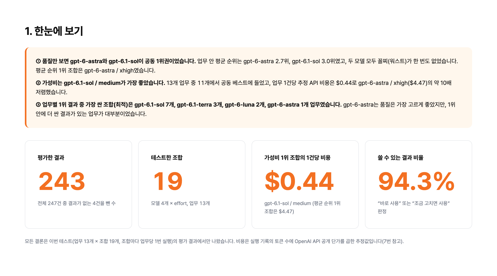
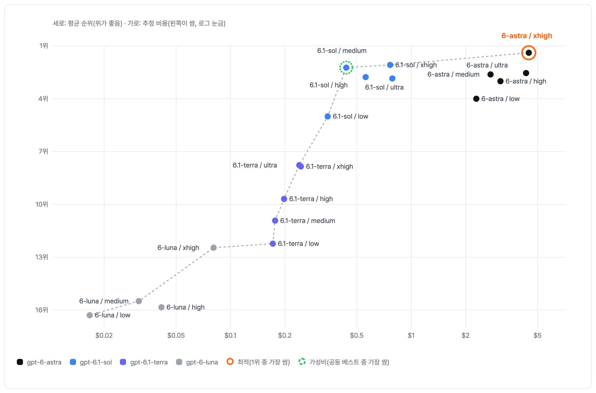
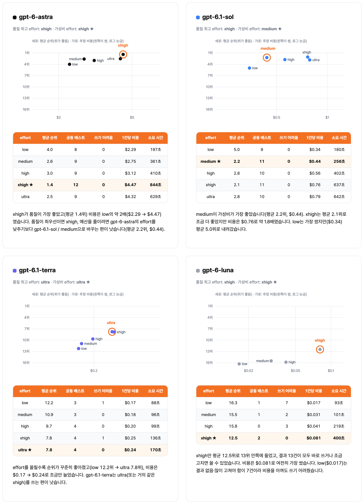
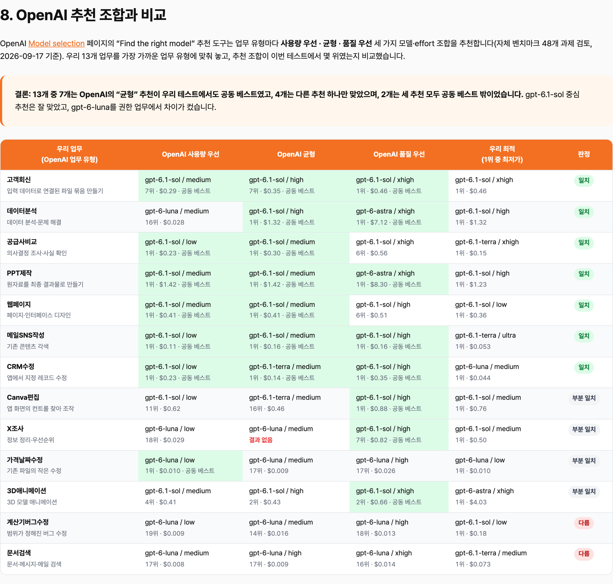

# 코덱스 모델·effort, 업무별로 이렇게 고르세요


이 가이드는 「코덱스 제일 높은 설정만 쓰면 손해입니다! 업무별로 이렇게 고르세요」 영상의 테스트 결과를 정리한 것입니다. Codex에서 GPT-6 Astra, GPT-6.1 Sol, GPT-6.1 Terra, GPT-6 Luna 네 모델과 effort를 조합한 19개 조합으로 업무 13개를 돌려 결과물 247개를 비교했고, 업무별로 어떤 조합을 쓰면 되는지와 내 업무로 직접 비교하는 방법까지 담았습니다.

---

## 목차

1. [먼저 결론](#1-먼저-결론)
2. [모델과 effort](#2-모델과-effort)
3. [이렇게 테스트했습니다](#3-이렇게-테스트했습니다)
4. [전체 순위와 비용](#4-전체-순위와-비용)
5. [업무별 추천 조합](#5-업무별-추천-조합)
6. [effort 고르는 법](#6-effort-고르는-법)
7. [OpenAI 추천과 비교](#7-openai-추천과-비교)
8. [내 업무로 직접 비교하는 법](#8-내-업무로-직접-비교하는-법)
9. [이번 결과를 볼 때](#9-이번-결과를-볼-때)
10. [참고 자료](#10-참고-자료)

---

## 1. 먼저 결론

업무 성격에 따라 이렇게 고르시면 됩니다.

① 판단·작성·제작이 섞인 업무 → Sol Medium (품질 우선이면 Extra High)
② 짧고 정답이 분명한 반복 업무 → Terra Ultra 또는 Extra High
③ 한 번에 맞아야 하는 결과물 → Astra Extra High
④ 사람이 검토하는 초안·대량 반복 → Luna Extra High (Light는 피하기)

## 2. 모델과 effort

모델은 직원이라고 보시면 됩니다. Astra는 몸값이 제일 비싼 시니어, Sol은 실력은 시니어에 가깝고 몸값은 훨씬 낮은 팀장급, Terra는 손이 빠른 실무자, Luna는 정해진 일을 싸고 빠르게 하는 신입에 가깝습니다. effort는 그 직원에게 주는 검토 시간입니다. 오래 붙잡을수록 꼼꼼해질 수 있지만 기다리는 시간과 사용량도 같이 늘어납니다.

effort 이름은 Codex 앱에 보이는 라벨 그대로 Light · Medium · High · Extra High · Ultra로 적었습니다. Ultra는 같은 모델이 더 오래 생각하는 단계가 아니라, 서브에이전트로 일을 나눠 처리하는 방식입니다(공식 문서 기준). Luna는 Ultra를 지원하지 않아서 Light부터 Extra High까지 네 단계만 비교했습니다.

## 3. 이렇게 테스트했습니다

- 실무에서 자주 맡기는 업무 13개를 Codex에서 모델·effort 조합 19개로 한 번씩 돌렸습니다. 결과물은 247개입니다.
- 업무는 교육 사업을 하는 가상 회사 자료로 만들었습니다. X 조사만 실제 X를 읽기 전용으로 검색했습니다.
- 채점은 실행에 참여하지 않은 Claude Code가 모델 이름을 가린 채 했습니다. 결과를 열기 전에 평가 기준부터 정해 두었습니다.
- 먼저 업무마다 정한 완료 조건을 채웠는지 보고, 입력과 맞는지 · 근거 없는 내용은 없는지 · 바로 업무에 쓸 수 있는지 · 사람이 얼마나 고쳐야 하는지를 각 5점씩, 20점 만점으로 매겼습니다.
- 비용은 토큰 사용량에 OpenAI API 공개 단가를 곱한 추정 비용입니다. ChatGPT 구독 요금과는 계산 방식이 달라서, 조합끼리 얼마나 무거운지 비교하는 기준으로 보세요.

## 4. 전체 순위와 비용



평균 순위 1위는 Astra Extra High(평균 1.4위 · 19.6점 · 1건당 추정 비용 $4.47 · 소요 시간 중앙값 844초)입니다. 그런데 3위 Sol Medium도 평균 2.2위 · 19.5점이고, 13개 중 11개 업무에서 공동 베스트였습니다. 추정 비용은 $0.44, 시간은 256초라서 가성비로는 Sol Medium이 1위입니다. Astra와 Sol은 상위권에서 차이가 거의 없어서 품질 1등은 정하지 않았습니다.



> 차트와 표에 나오는 low · medium · high · xhigh · ultra는 Codex 앱의 Light · Medium · High · Extra High · Ultra와 같습니다. 모델 이름 gpt-6-astra · gpt-6.1-sol · gpt-6.1-terra · gpt-6-luna는 이 가이드에서 Astra · Sol · Terra · Luna로 줄여 썼습니다.

순위가 낮은 조합도 못 쓰는 결과는 아니었습니다. 247건 중 94.3%가 바로 쓰거나 조금 고치면 쓸 수 있었고, '사용 불가' 판정은 0건이었습니다.

## 5. 업무별 추천 조합

추천 조합은 그 업무에서 1위를 한 결과 중 가장 싼 조합입니다.

| 업무 | 추천 조합 | 1건당 추정 비용 | 순위가 가장 낮았던 조합과 이유 |
|---|---|---|---|
| 고객 회신 | Sol Extra High | $0.46 | Terra Light — 회신에 2주차 환불 금액이 빠짐 |
| 데이터 분석 | Sol High | $1.32 | Luna Light — 대기 좌석 수를 잘못 적고, 질문에 대한 답이 사실상 없음 |
| PPT 제작 | Sol High | $1.23 | Luna Light — 꼭 내야 하는 PDF·PNG 파일을 내지 않고 꼬리말도 지움 |
| 웹페이지 | Sol Light | $0.36 | Luna High — 정상 이메일도 오류로 처리돼 신청 불가 |
| Canva 편집 | Sol Medium | $0.76 | Terra Light — 헤드라인 마지막 음절만 둘째 줄로 넘어감 |
| X 조사 | Sol Medium | $0.50 | Luna Light — 찾아온 게시물이 1~2건뿐 |
| 계산기 버그 수정 | Sol Light | $0.18 | Luna Light — 고친 내용은 맞지만 변경 기록·캡처를 내지 않음 |
| 공급사 비교 | Terra Extra High | $0.15 | Luna Light — 민감도 표·예산 판정이 원본 CSV와 어긋남 |
| 메일·SNS 작성 | Terra Ultra | $0.053 | Luna Medium — 고객 메일에 작업 메모가 섞임 |
| 문서 검색 | Terra Medium | $0.073 | Luna Light — 답은 맞지만 근거로 든 인용이 가장 부정확 |
| 가격·날짜 수정 | Luna Light | $0.010 | Luna Extra High — 엑셀을 통째로 다시 만들어 자동 필터·인쇄 설정이 사라짐 |
| CRM 수정 | Luna Medium | $0.044 | Luna High — 시작 상태 확인 기록 없음 |
| 3D 애니메이션 | Astra Extra High (가성비는 Sol Extra High $0.66) | $4.03 | Luna Medium — 영상과 확인용 캡처를 내지 않음 |

모델별로 묶으면 Sol 7개, Terra 3개, Luna 2개, Astra 1개입니다.

## 6. effort 고르는 법

제일 높은 effort가 늘 좋은 건 아니었습니다. 모델마다 가성비가 가장 좋은 effort는 이랬습니다.



| 모델 | 추천 effort | 평균 순위 | 1건당 추정 비용 | 메모 |
|---|---|---|---|---|
| Astra | Extra High | 1.4위 | $4.47 | Ultra(2.5위)보다 Extra High가 더 좋았음. 예산을 줄이려면 Astra effort를 낮추기보다 Sol Medium으로 바꾸는 편이 나음 |
| Sol | Medium | 2.2위 | $0.44 | Extra High 2.1위지만 추정 비용 약 1.8배($0.76). Light는 5.0위 |
| Terra | Ultra (또는 Extra High) | 7.8위 | $0.24 (Extra High $0.25) | 올릴수록 꾸준히 좋아짐(Light 12.2위 → Ultra 7.8위) |
| Luna | Extra High | 12.5위 | $0.081 | Extra High에서는 13건 모두 바로 쓰거나 조금 고치면 사용. Light는 결과 없음·많이 고쳐야 함이 7건 |

업무 성격으로 나누면 이렇습니다.

- **높을수록 확실히 좋아짐**: 공급사 비교 · 웹페이지 · Canva 편집 · 3D 애니메이션
- **중간이면 충분**: 데이터 분석 · X 조사 · CRM 수정
- **차이 거의 없음(모델 선택이 더 중요)**: 고객 회신 · PPT 제작 · 메일·SNS 작성 · 계산기 버그 수정
- **높은 effort가 오히려 나빴음**: 가격·날짜 수정 · 문서 검색

effort를 올리면 13개 업무 모두 시간이 더 걸렸지만, 품질이 같이 오른 업무는 일부였습니다.

## 7. OpenAI 추천과 비교

OpenAI 모델 선택 문서에는 업무 유형을 고르면 모델과 effort를 추천해 주는 도구가 있습니다. 이번 13개 업무에 맞춰 보면 7개에서 '균형' 추천이 공동 베스트였고, 4개는 다른 추천 하나만 맞았고, 2개(계산기 버그 수정·문서 검색)는 세 추천 모두 공동 베스트 밖이었습니다.



Sol 중심 추천은 잘 맞았고, Luna는 권한 업무에서 차이가 컸습니다. 정답은 맞혀도 기록·캡처·인용 정밀도가 약했기 때문입니다. 또 추천 도구는 비용을 계산하지 않아서, '균형' 추천이 맞은 업무 중 5개에서는 더 싼 1위가 따로 있었습니다(예: 메일·SNS 작성 Sol Medium $0.16 → Terra Ultra $0.053). OpenAI도 이 추천을 출발점으로 보고, 같은 입력으로 비교해 품질 기준을 넘는 가장 가벼운 설정을 쓰라고 권합니다.

## 8. 내 업무로 직접 비교하는 법

1. **자주 하는 업무 2~3개를 고르세요.** 매주 반복하는 일일수록 기준표를 만들어 두는 효과가 큽니다. 업무마다 입력 파일과 합격 기준을 먼저 정해 두세요.
2. **같은 입력으로 설정 2~3개를 돌리세요.** 위 결론 4줄에서 내 업무에 가까운 설정과, 그보다 한 단계 가볍거나 무거운 설정을 고르면 됩니다. 새 대화를 열 때마다 모델과 effort만 바꾸고, 아래 요청문을 그대로 붙여 넣으세요.
3. **기준을 넘는 가장 가벼운 설정을 기준표에 적으세요.** 다음부터는 고민하지 않고 그 설정으로 맡기면 됩니다.

대괄호 부분만 본인 업무로 바꿔서 쓰세요.

```text
같은 업무를 설정만 바꿔서 비교하려고 합니다. 지금 이 대화에서 고른 모델과 effort로 한 번 해 주세요.

업무: [자주 하는 업무 한 줄 설명]
입력 파일: [입력 파일 위치]
합격 기준: [결과물이 꼭 채워야 할 조건 2~3개]

1. 결과물은 compare/모델-effort/ 폴더(예: compare/Sol-Medium/)에 따로 저장해 주세요.
2. 입력 파일은 읽기만 하고 덮어쓰지 마세요. 고쳐야 하면 위 폴더에 사본을 만들어 고쳐 주세요.
3. 시작·끝 시각을 적어 걸린 시간을 남겨 주세요.
4. 끝나면 합격 기준을 하나씩 확인하고, 사람이 고쳐야 할 곳이 몇 군데인지 적어 주세요.
5. compare/ 폴더에 다른 설정의 결과가 있으면 compare/비교표.md에 설정 / 합격 기준 충족 여부 / 사람이 고칠 양 / 걸린 시간 표를 만들거나 이어서 채워 주세요.
```

## 9. 이번 결과를 볼 때

- 조합마다 1번씩 돌린 결과라 다시 돌리면 달라질 수 있습니다.
- 비용은 API 단가로 낸 추정 비용이고, 실패한 첫 시도 비용은 빠져 있습니다.
- 일부 업무(웹페이지·계산기 버그 수정·X 조사·Canva 편집)에는 브라우저 실행 실패 같은 환경 차이가 섞였을 수 있습니다.
- 13개 밖의 업무에서는 결과가 다를 수 있습니다.

## 10. 참고 자료

- [Codex 모델 공식 문서 (영문)](https://developers.openai.com/codex/models/)
- [OpenAI 모델 선택 가이드 (영문)](https://developers.openai.com/api/docs/guides/model-selection)

---

## 코덱스로 실제 업무 하나를 맡겨 보고 싶다면

기준표를 만들었다면 이제 실제 업무를 맡겨 보세요. 아래 영상에서는 클로드·코덱스에 데이터 분석부터 대시보드 시각화까지 한 번에 맡기는 과정을 보실 수 있습니다.

[아직 대시보드 직접 만드세요? 클로드·코덱스로 분석부터 시각화까지 한번에!](https://www.youtube.com/watch?v=yXt2Xxju5Rs)

생산성은 규모가 아닌 시스템에서 나옵니다
