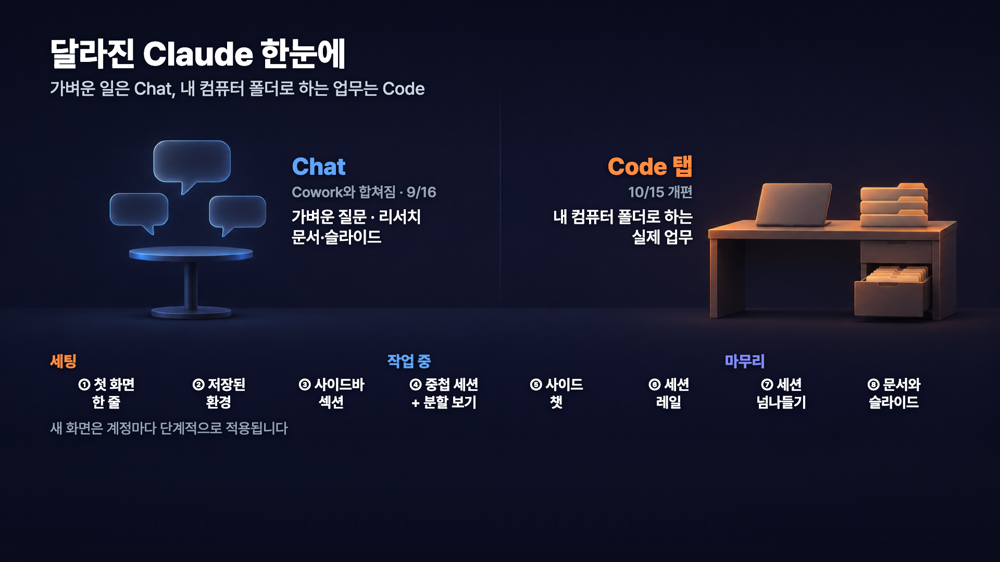
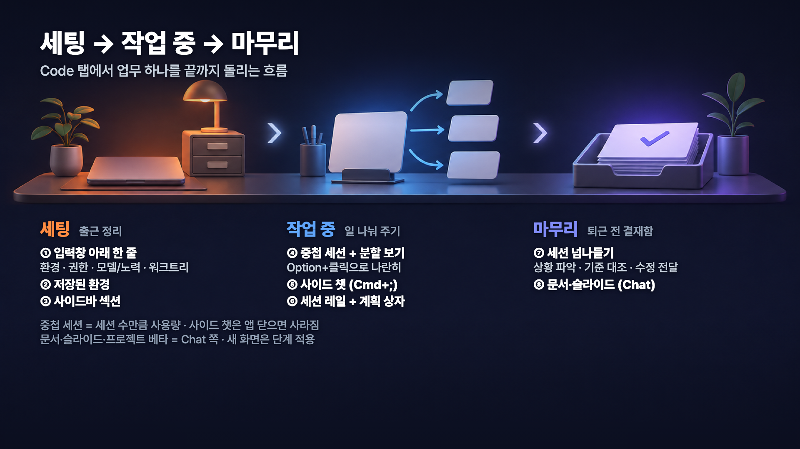
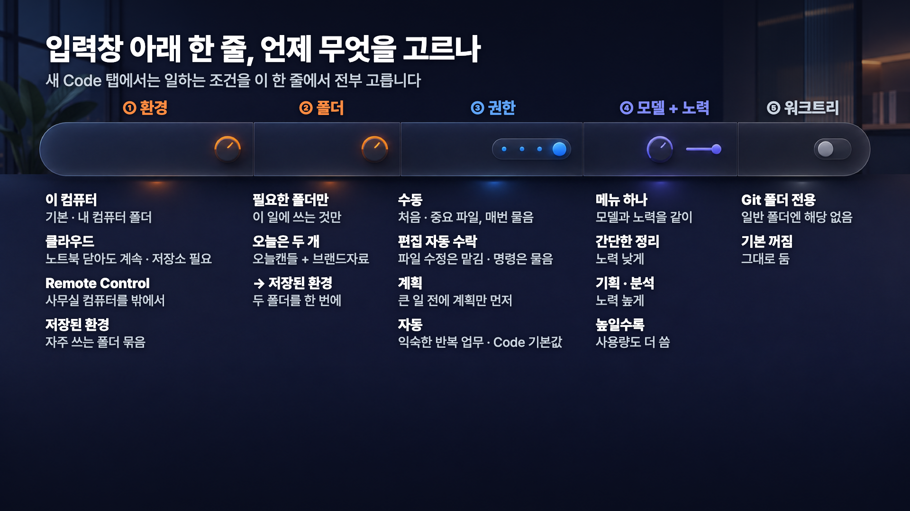
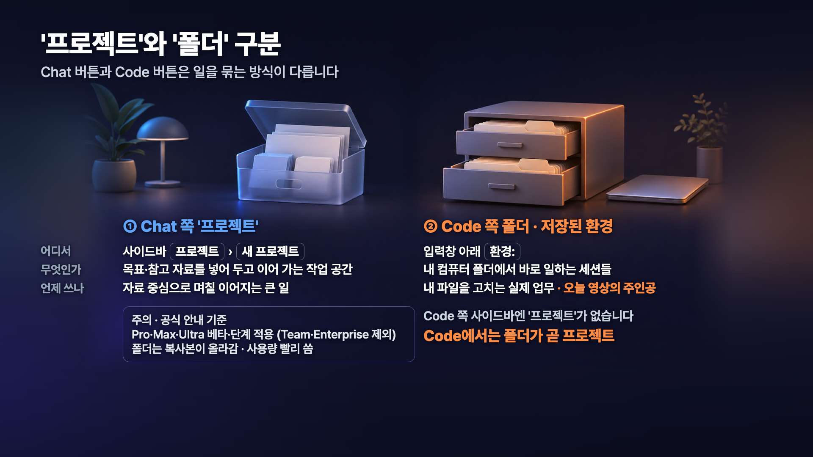
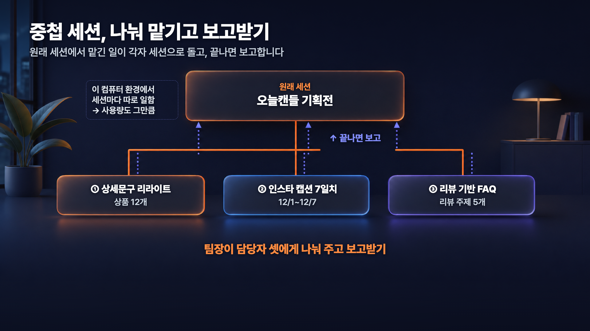

# 클로드 앱이 완전히 달라졌습니다! '2.0'이라 불리는 핵심 기능 8가지 업무 활용법


이 가이드는 「클로드 앱이 완전히 달라졌습니다」 영상에서 클로드 앱의 Code 탭으로 업무 하나를 세팅 → 작업 → 마무리까지 진행하며 보여 드린 기능 8가지와, 영상에서 쓴 요청문을 정리한 것입니다. 'Claude 2.0'은 공식 버전 이름이 아니라 AI 커뮤니티에서 부르는 별명입니다.

---

## 목차

1. [달라진 클로드 앱 한눈에](#1-달라진-클로드-앱-한눈에)
2. [시작 전 확인](#2-시작-전-확인)
3. [세팅: 일할 환경부터 저장하기](#3-세팅-일할-환경부터-저장하기)
4. [작업: 나눠 맡기고 한눈에 지켜보기](#4-작업-나눠-맡기고-한눈에-지켜보기)
5. [마무리: 세션을 넘나들며 검수하기](#5-마무리-세션을-넘나들며-검수하기)
6. [마무리: 결과물을 문서와 슬라이드로](#6-마무리-결과물을-문서와-슬라이드로)
7. [참고 자료](#7-참고-자료)

---

## 1. 달라진 클로드 앱 한눈에



9월부터 Chat과 Cowork가 하나의 대화로 합쳐졌습니다. 예전에 Cowork에서 하던 파일 작업도 이제 Chat에서 같이 할 수 있어요. 그래서 앱 왼쪽 위에는 Chat과 Code 두 버튼이 남았습니다.

| | Chat | Code |
|---|---|---|
| 이럴 때 | 가벼운 질문, 가벼운 문서 작업 | 내 컴퓨터 폴더의 파일로 하는 복잡한 업무 |
| 일하는 곳 | 대화 | 내가 고른 폴더(환경) |

Chat에서 하는 일도 Code 탭에서 대부분 할 수 있습니다. 그래서 아주 간단한 질문만 Chat에서 하고, 나머지는 Code 탭으로 하는 걸 추천드립니다. 영상에서도 Code 탭 하나로 업무를 끝까지 진행했습니다.

이번에 달라진 기능 8가지를 업무 순서대로 묶으면 이렇습니다.



| 단계 | 기능 | 이 가이드에서 |
|---|---|---|
| 세팅 | ① 새 세션 첫 화면 ② 저장된 환경 ③ 사이드바 섹션 | [3장](#3-세팅-일할-환경부터-저장하기) |
| 작업 | ④ 중첩 세션 + 분할 보기 ⑤ 사이드 채팅 ⑥ 세션 레일 + 계획 상자 | [4장](#4-작업-나눠-맡기고-한눈에-지켜보기) |
| 마무리 | ⑦ 세션 넘나들기 ⑧ 문서와 슬라이드 | [5장](#5-마무리-세션을-넘나들며-검수하기), [6장](#6-마무리-결과물을-문서와-슬라이드로) |

---

## 2. 시작 전 확인

- 앱을 최신 버전으로 업데이트하세요. 새 화면은 계정마다 순서대로 적용되고 있어서, 같은 요금제라도 아직 예전 화면이 보일 수 있습니다.
- Code 탭은 유료 요금제에서 쓸 수 있습니다. 앱 왼쪽 위에서 말풍선(Chat) 오른쪽에 있는 Code 버튼을 누르면 됩니다.

### 영상에서 쓴 예시 자료

영상에서는 캔들 쇼핑몰 '오늘캔들'을 혼자 운영한다고 가정하고 연말 기획전을 준비했습니다. 상호·상품·리뷰는 모두 지어낸 가상 데이터이고, 파일은 따로 제공하지 않습니다. 아래 구성을 참고해서 본인 업무 자료로 바꿔 보세요.

| 파일 | 영상에서 담은 것 | 내 업무라면 |
|---|---|---|
| `오늘캔들/기획전/holiday-brief.md` | 기획전 기간, 할인 규칙, 만들어야 할 산출물 4가지 | 이번 프로젝트 브리프 |
| `오늘캔들/상품/products.csv` | 상품 12개의 정가·원가·재고·지금 상세문구 | 상품·서비스 목록 |
| `오늘캔들/고객응대/reviews_2026-10.csv` | 10월 리뷰 45건 | 고객 후기·설문 |
| `오늘캔들/고객응대/inquiries_2026-10.md` | 10월 문의 10건과 답변 메모 (입점 제안 2건 포함) | 문의·상담 기록 |
| `브랜드자료/brand-guide.md` | 말투, 금지 표현, 이모지·해시태그 규칙 | 우리 회사 글쓰기 기준 |
| `브랜드자료/price-rules.md` | 원가율·할인가 계산, 포장·배송비, 입점 판매처 규칙 | 가격·운영 규칙 |

결과물은 `오늘캔들/기획전/결과물/` 폴더에 모았습니다. 브리프, 기준 문서, 원자료를 이렇게 나눠 두면 마지막에 "기준 문서와 다시 대조해 줘"처럼 검수를 맡기기 쉽습니다.

---

## 3. 세팅: 일할 환경부터 저장하기

출근하면 책상과 서랍부터 정리하죠. Code 탭도 일을 시키기 전에 어디서, 어떤 폴더로, 어디까지 맡길지부터 정해 둡니다.



### 3-1. 환경 고르기

Code 탭에서 **새로 만들기**를 누르면 업무 환경을 정하는 화면이 먼저 뜹니다. 환경 선택에서 **새 환경**을 누르면 클로드가 어디서 일할지 고를 수 있습니다.

| 환경 | 어디서 일하나 | 이럴 때 |
|---|---|---|
| 로컬 (내 컴퓨터) | 지금 앱을 켠 컴퓨터의 폴더 | 내 파일로 바로 일하고 결과도 내 컴퓨터에 저장할 때. 영상에서 쓴 방식 |
| 클라우드 | Anthropic 서버 | 노트북을 닫아도 계속 돌려야 할 때. 폴더 대신 GitHub 저장소를 연결해야 합니다 |
| SSH | 내가 관리하는 다른 컴퓨터 (VPS, 맥미니 등) | 그 컴퓨터에 있는 파일로 24시간 돌리고 싶을 때 |
| Remote Control | 일은 내 컴퓨터에서, 확인은 휴대폰에서 | 밖에서 진행 상황을 볼 때. 컴퓨터가 켜져 있어야 합니다 |

### 3-2. 저장된 환경 만들기

자주 하는 일은 환경을 저장해 두면 다음부터 고르기만 하면 됩니다.

1. 환경 선택에서 **새 환경**을 누릅니다.
2. 이름을 적습니다. (영상: `오늘캔들`)
3. 일할 폴더를 추가합니다. (영상: 오늘캔들 자료 폴더)
4. **환경 만들기**를 누릅니다.

다음부터는 **새로 만들기**에서 `오늘캔들`만 고르면 같은 폴더와 설정으로 바로 시작합니다. 참고로 Code 탭을 새 화면으로 처음 열면, 최근 한 달 동안 자주 쓴 폴더로 저장된 환경을 최대 8개 자동으로 만들어 줍니다.

### 3-3. 권한과 Remote Control

권한은 클로드가 어디까지 혼자 진행할지 정하는 설정입니다. 영상 화면에서는 **자동**이 기본으로 잡혀 있었고, 가벼운 명령은 바로 실행하고 중요한 것만 물어봅니다.

| 권한 | 동작 |
|---|---|
| 수동 | 파일 수정이나 명령 실행 전마다 물어봄 |
| 편집 자동 수락 | 파일 수정은 맡기고, 그 밖의 명령 실행은 물어봄 |
| 계획 | 파일을 바꾸지 않고 계획만 먼저 보여 줌 |
| 자동 | 묻지 않고 진행하되, 명령을 실행하기 전에 요청에 맞는 작업인지 따로 확인 |

승인 요청 없이 길게 계속 일하게 하고 싶다면 권한 우회 모드도 있습니다. **설정 → Claude Code → 세션에 권한 우회 모드 허용**을 켜야 선택지에 나타납니다(Team·Enterprise는 조직 정책을 따릅니다). 다만 공식 문서는 이 모드를 샌드박스 컨테이너나 가상 머신에서만 쓰라고 안내합니다. 실제 업무 파일이 있는 폴더에서는 보안 위험을 꼭 따져 보고 쓰세요.

같은 설정 화면 위쪽의 Remote Control 항목도 켜 두면 편합니다.

- 새 세션을 Remote Control에 연결
- 휴대폰에서도 세션 시작 허용
- Remote Control 사용을 위해 이 컴퓨터를 절전 모드로 전환하지 않음

이렇게 해 두면 새 세션이 자동으로 Remote Control 세션이 되어서, 밖에서도 PC에서 돌아가는 세션을 휴대폰으로 바로 확인할 수 있습니다. 세션마다 Remote Control을 따로 켤 필요가 없어요.

### 3-4. 모델과 노력 수준

10월부터 모델과 노력(effort) 수준을 고르는 메뉴가 하나로 합쳐졌습니다. 메뉴를 열면 모델 아래에 노력 수준이 있습니다. 노력을 높일수록 사용량도 더 씁니다.

### 3-5. 사이드바 섹션으로 세션 묶기

세션이 늘어나면 일 단위로 묶어 두세요. 왼쪽 사이드바의 옵션에서 **새 섹션**을 만들고, 세션을 그 섹션으로 옮기면 됩니다. 영상에서는 `오늘캔들 기획전` 섹션을 만들고 계획 세션부터 문서·슬라이드 대화까지 모두 넣었습니다.

### Chat의 '프로젝트'와는 다릅니다



Cowork가 Chat과 합쳐지면서 Chat 쪽에 **프로젝트**가 생겼습니다. 프로젝트 이름과 목표를 적고 참고할 폴더·지침·문서를 넣어 두면, 같은 자료로 반복하는 간단한 작업에 쓰기 좋습니다.

Code 쪽에는 프로젝트 메뉴가 없습니다. 환경에 넣은 폴더가 곧 프로젝트 역할을 하고, 세션은 섹션으로 나눠 관리한다고 생각하시면 됩니다.

---

## 4. 작업: 나눠 맡기고 한눈에 지켜보기

### 4-1. 계획부터 받기

먼저 파일은 만들지 말고 계획만 세워 달라고 했습니다.

```text
오늘캔들 연말 기획전을 준비하려고 해.
오늘캔들/기획전/holiday-brief.md를 먼저 읽고, 4번 '필요한 산출물' 네 가지를 만드는 계획을 세워 줘.
- 단계마다 어떤 파일을 읽는지 적어 줘 (오늘캔들/상품/products.csv, 오늘캔들/고객응대/reviews_2026-10.csv, 오늘캔들/고객응대/inquiries_2026-10.md, 브랜드자료/brand-guide.md, 브랜드자료/price-rules.md)
- 기획전 가격은 holiday-brief.md 3번 할인 규칙과 price-rules.md로 계산하는 단계를 따로 넣어 줘
- 결과물은 오늘캔들/기획전/결과물/ 폴더에 저장하는 걸로 잡아 줘
- 아직 파일은 만들지 말고 계획만 보여 줘
```

일하는 동안 대화 맨 끝에 **계획 상자**가 붙어서, 클로드가 지금 어느 단계를 하고 있는지 위로 올려 보지 않아도 확인할 수 있습니다. 작업이 한 번 끝나면 `이대로 진행해 줘` / `계획 먼저 수정`처럼 다음 할 일을 버튼으로 고르게 해 줄 때가 많습니다. 버튼이 뜨지 않을 때도 있습니다.

복잡한 일이라면 권한을 **계획**으로 두고 시작해서, 계획을 확인한 뒤 **편집 자동 수락**이나 **수동**으로 바꿔 진행하는 방법도 있습니다. 공식 문서도 복잡한 작업은 이 순서를 권합니다.

### 4-2. 중첩 세션으로 나눠 맡기기



상세문구, 인스타 캡션, FAQ는 서로 기다릴 필요가 없는 일이라 꼭 순서대로 할 필요가 없죠. 중첩 세션은 이런 일을 지금 세션 아래에 **하위 세션**으로 따로 만들어 동시에 돌리는 기능입니다. 지금 세션이 팀장이라면, 하위 세션은 그 밑의 팀원입니다.

예전에도 서브 에이전트로 병렬 작업을 할 수 있었지만 하나의 세션처럼 움직이지는 않았습니다. 중첩 세션은 아예 세션으로 만들어지기 때문에 중간에 들어가서 피드백을 주거나 멈출 수 있고, 모니터링도 쉽습니다. 일이 끝나면 하위 세션이 원래 세션으로 결과를 보고합니다.

```text
계획대로 진행해 줘. 아래 세 가지는 서로 기다릴 필요가 없으니 각각 따로 세션으로 동시에 진행하고, 끝나면 이 대화로 결과를 보고해 줘.

① 상품 상세문구 리라이트: 오늘캔들/상품/products.csv의 12개 상품 전부. 상품마다 2~3문장으로 쓰고, 브랜드자료/brand-guide.md의 톤과 금지 표현을 지켜 줘. 지금 문구에 금지 표현이 있으면 반드시 고쳐 줘.
② 인스타 캡션 7일치: 12/1~12/7 하루 1개씩, 날마다 다른 상품이나 주제로 써 줘. 가격은 holiday-brief.md 3번 할인 규칙과 price-rules.md로 계산한 기획전 가격으로 쓰고, 해시태그와 이모지는 brand-guide.md를 따라 줘.
③ 리뷰 기반 FAQ: 오늘캔들/고객응대/reviews_2026-10.csv에서 많이 나온 주제 5개와 inquiries_2026-10.md를 바탕으로 자주 묻는 질문과 답을 만들어 줘. 주제마다 리뷰 건수를 같이 적고, 예전 답변끼리 안 맞는 건 price-rules.md 기준으로 맞춰 줘.
```

요청을 보내면 사이드바의 원래 세션 아래에 하위 세션 3개(상세문구·캡션·FAQ)가 붙고, 계획 상자에서 세션마다 진행 상태가 보입니다.

쓰기 전에 두 가지만 알아 두세요.

- 하위 세션은 각각 따로 일하는 세션이라, 동시에 돌리는 만큼 같은 시간에 사용량도 더 많이 씁니다. 요금제에 맞춰 골라 쓰세요.
- 중첩 세션과 다음 장의 세션 넘나들기는 앱이 직접 돌리는 로컬·SSH 세션에서 됩니다. 클라우드 세션은 해당되지 않습니다.

### 4-3. 분할 보기로 동시에 지켜보기

macOS는 **Option**, Windows는 **Alt**를 누른 채 사이드바의 세션을 클릭하면 화면이 나뉘어 세션이 나란히 보입니다. 세션을 오른쪽 클릭하고 **Open in → Split view**를 골라도 됩니다. 메인 세션과 하위 세션들이 일하는 모습을 한 화면에서 지켜보다가, 필요 없으면 X를 눌러 나오면 됩니다.

### 4-4. 사이드 채팅으로 따로 묻기

일하다 보면 "어, 이거 어떻게 된 거지?" 싶은 게 생기죠. 그런데 메인 세션에 물어보면 그 질문과 답이 메인 컨텍스트에 그대로 쌓입니다. 이럴 때는 오른쪽 위 보기 옵션에서 **사이드 채팅**을 여세요. 단축키는 macOS `Cmd + ;`, Windows `Ctrl + ;`이고, 입력창에 `/btw`를 쳐도 열립니다.

```text
OC-007 시나몬 애플 캔들은 원가율이 딱 45%인데, 이번 기획전 할인 대상 맞아? 맞으면 기획전 가격도 알려 줘.
```

사이드 채팅은 메인 세션 내용을 읽고 답하지만, 메인 대화에는 아무것도 남기지 않습니다. 앱을 닫으면 사이드 채팅은 저장되지 않으니, 남겨야 할 답은 따로 옮겨 두세요.

### 4-5. 세션 레일로 상태와 결과물 보기

오른쪽 위 **세션 레일 표시**를 켜면 세션 옆에 카드가 모여 보입니다.

| 카드 | 보여 주는 것 |
|---|---|
| 환경 | 지금 일하는 환경, Remote Control 켜짐 여부 |
| 컨텍스트 | 쓴 비율과 남은 공간, MCP 도구·메모리 파일·커스텀 에이전트 |
| 커넥터 | 연결된 커넥터, 다시 연결해야 하는 커넥터 |
| 결과물 | 이 세션에서 만든 파일. 눌러서 바로 열어 봄 |
| 변경 사항 | 추가·삭제된 줄 수 |

결과물 카드가 특히 쓸모 있습니다. 결과물은 결국 사람이 보고 검증해야 하는데, 만든 파일을 알아서 모아 주니 바로 열어 보고 피드백을 줄 수 있습니다. 지금 대화에서 만든 파일은 여기 뜨고, 하위 세션이 만든 파일은 그 세션에 들어가면 보입니다.

입력창 아래 **링**을 누르면 사용량도 바로 볼 수 있습니다. 5시간 제한과 주간 제한이 얼마나 남았는지 나오니, 중첩 세션을 여러 개 돌릴 때 같이 확인하세요.

---

## 5. 마무리: 세션을 넘나들며 검수하기

### 5-1. 메인 세션에서 정하면 하위 세션 결과물까지 반영

하위 세션이 끝나면 메인 세션이 결과를 모아 보고하고, 사람이 정해야 할 것을 버튼으로 묻습니다. 영상에서는 "배송비 무료 기준 5만 원은 어느 금액으로 볼까요?"에 `할인 후 결제 금액`을 골랐습니다. 이렇게 메인 세션에서 정하면 하위 세션이 만든 파일까지 바로 고쳐 줍니다. 영상에서는 클로드가 이때 정한 내용과 이유를 결정 기록 파일로 따로 정리해 줬습니다.

하위 세션에 직접 말을 걸 수도 있습니다. 영상에서는 FAQ 세션에서 이렇게 물었습니다.

```text
메인세션에서 수정한 FAQ관련 내용 체크하고 요약해줘.
```

그러면 메인 세션과 주고받은 내용을 확인해서 답합니다. 세션들이 각자 따로 노는 게 아니라, 팀장과 팀원처럼 서로 피드백을 주고받습니다.

### 5-2. 오늘 한 일 리캡 받기

세부 세션에서 따로 추가 작업을 했다면, 마지막에 메인 세션에서 한 번 모아 보는 게 좋습니다.

```text
오늘 오늘캔들 기획전 일로 돌린 세션들을 확인해 줘. 오늘 한 작업 리캡을 하고 싶어.
- 세션마다 무슨 일을 했고 어떤 파일을 만들었는지 한 줄씩 정리해 줘
- 아직 안 끝났거나 내 확인을 기다리는 세션이 있으면 알려 줘
```

한 줄 요약, 세션별 정리, 지금 상태, 내 확인을 기다리는 것까지 모아서 보여 줍니다.

### 5-3. 기준 문서와 대조하고, 만든 세션에 고쳐 달라고 전하기

```text
오늘캔들/기획전/결과물/ 폴더의 파일들을 브랜드자료/brand-guide.md, 브랜드자료/price-rules.md, 오늘캔들/기획전/holiday-brief.md 기준으로 다시 대조해 줘.
기준과 다른 곳만 표로 보여 줘. (파일 · 위치 · 문제 · 고칠 내용)
고칠 게 있으면 그 파일을 만든 세션에 고쳐 달라고 전해 줘.
```

메인 세션이 결과물을 기준 문서와 처음부터 다시 대조하고, 고칠 곳이 있으면 그 파일을 만든 하위 세션에 수정을 요청합니다. 하위 세션에는 보낸 세션 이름이 붙은 메시지가 도착하고, 수정이 끝나면 다시 메인 세션으로 보고가 올라옵니다.

굳이 하위 세션에 보내는 이유는 세션마다 컨텍스트가 따로이기 때문입니다. 세션 레일에서 보면 메인 세션이 컨텍스트를 훨씬 많이 쓰고 있죠. 검증은 메인 세션에서 하고, 실제 수정은 그 파일을 맡은 세션에서 하면 컨텍스트를 더 효율적으로 관리할 수 있습니다.

결과물을 받으면 이것만은 직접 확인하세요.

- 금지 표현이 남아 있지 않은지
- 가격이 할인 규칙대로 계산됐는지 (특히 기준선에 딱 걸리는 상품)
- 리뷰 건수와 순서가 원자료와 맞는지
- 자료에 없는 기준을 클로드가 임의로 채우지 않았는지

---

## 6. 마무리: 결과물을 문서와 슬라이드로

지금까지 만든 결과물은 대부분 마크다운 파일입니다. 다른 사람과 같이 보거나 밖에 공유하려면 형태를 바꾸고 싶을 때가 있죠. 사이드바 **아티팩트**에 들어가면 **문서, 슬라이드, 디자인, 대시보드**를 바로 만들 수 있습니다. 공식 도움말 기준으로 문서·슬라이드·디자인은 베타입니다. 대시보드는 아래 [마지막 영상 안내](#대시보드도-아티팩트로-만들어-보세요)를 참고하세요.

### 6-1. 문서

아티팩트에서 **문서**를 누르면 입력창에 **Claude Docs**가 선택된 상태가 됩니다. 이 상태로 요청하면 오른쪽에 문서가 열리고, 클로드가 뼈대부터 채워 나갑니다.

```text
오늘캔들/고객응대/inquiries_2026-10.md의 문의 8, 9번 입점 제안 두 건을 비교하는 한 장짜리 문서를 만들어 줘.
- 두 곳의 조건 (수수료, 상품, 가격, 기간)
- 우리 가격 규칙(브랜드자료/price-rules.md)과 부딪히는 점
- 받을지 말지 판단할 때 볼 점
```

구글 문서 같은 문서를 클로드 안에 넣었다고 생각하시면 됩니다.

| 하고 싶은 것 | 방법 |
|---|---|
| 직접 고치기 | 서식, 표, 이미지를 넣어 바로 편집 |
| 한 부분만 고쳐 달라고 하기 | 해당 문단을 눌러 댓글로 클로드에게 수정 요청 |
| 공유하기 | 이메일로 초대 |
| 내보내기 | Word, PDF, Markdown 파일로 받거나 Google Docs, Notion으로 보내기 |
| 밖에서 보기 | 휴대폰에서도 아티팩트로 바로 열기 |

### 6-2. 슬라이드와 디자인 시스템

슬라이드는 **디자인 시스템**을 골라서 만들 수 있습니다. 예전에는 디자인 기준을 `DESIGN.md` 같은 파일로 만들어 참고하게 했다면, 그걸 앱 안에 시스템으로 넣어 둔 겁니다. 디자인 시스템이 없으면 **새 디자인 시스템 만들기**로 먼저 하나 만드세요. 영상에서는 미리 만들어 둔 `오늘캔들` 디자인 시스템을 골랐습니다.

```text
오늘캔들/기획전/결과물/ 폴더의 파일들과 방금 만든 입점 제안 문서로 '오늘캔들 연말 기획전 한눈에' 슬라이드 5장을 만들어 줘.
1장 기획전 개요(기간·할인 규칙), 2장 할인 상품과 기획전 가격, 3장 인스타 캡션 일정, 4장 고객 FAQ 핵심, 5장 입점 제안 판단.
디자인은 디자인 시스템 참고하고, 말투는 브랜드자료/brand-guide.md를 따라 줘.
```

오른쪽에 슬라이드 편집 화면이 열리고 제작이 진행됩니다. 장마다 댓글을 달아 고쳐 달라고 할 수 있고, 발표 화면으로 넘겨 보거나 PowerPoint로 내보낼 수 있습니다.

예전에도 클로드에게 문서나 슬라이드를 코드로 만들어 달라고 할 수는 있었습니다. 달라진 점은 디자인 기준을 골라 만들고, 그 자리에서 고치고, 공유하는 흐름이 앱 안에 들어왔다는 겁니다.

---

## 7. 참고 자료

- [Claude Code 데스크톱 앱 공식 문서](https://code.claude.com/docs/ko/desktop)
- [Remote Control 공식 문서](https://code.claude.com/docs/ko/remote-control)
- [Claude Cowork과 chat이 하나의 Claude가 되다 (Claude 도움말)](https://support.claude.com/ko/articles/16761823)
- [Claude 데스크톱 앱 변경 기록 (영문)](https://claude.com/docs/cowork/changelog)

---

## 대시보드도 아티팩트로 만들어 보세요

이번 영상에서 다루지 않은 아티팩트 대시보드가 궁금하다면, [아직 대시보드 직접 만드세요? 클로드·코덱스로 분석부터 시각화까지 한번에!](https://www.youtube.com/watch?v=yXt2Xxju5Rs) 영상에서 데이터를 단계별로 물어 대시보드로 만들고 공유하는 과정을 이어서 보실 수 있습니다.

생산성은 규모가 아닌 시스템에서 나옵니다
