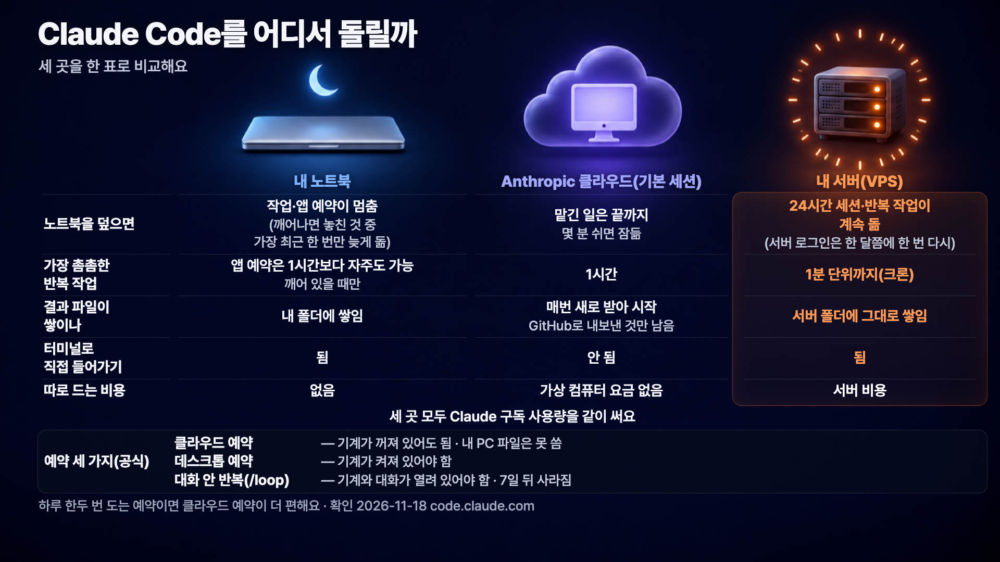

# Claude Code 24시간 서버 셋업 가이드 — Hostinger VPS에 올리고 휴대폰으로 일 시키기


Claude Code에 일을 걸어 두고 노트북을 덮었다가, 다시 열어 보니 일이 그대로 멈춰 있던 적 있으시죠? 노트북은 잠들고, 들고 다니고, 꺼지기도 해서 24시간 일을 맡기기엔 불안합니다.

이 가이드는 영상에서 보여 드린 것처럼 **늘 켜져 있는 내 서버(Hostinger VPS)에 Claude Code를 올리고, 휴대폰 Claude 앱이나 텔레그램으로 언제든 일을 시킬 수 있게 만드는 과정**을 정리한 문서입니다. 셋업은 이 폴더의 [SETUP.md](./SETUP.md)를 Claude에게 주면, Claude가 한 단계씩 물어보면서 대신 진행합니다. 여러분은 질문에 답하고, 노트북·텔레그램에서 몇 가지만 직접 하면 됩니다([7번 표](#7-직접-해야-하는-일)).

무엇을 어디서 하는지는 이렇게 나뉩니다.

| 어디 | 하는 일 |
|---|---|
| Hostinger VPS의 Claude Code | 24시간 켜져서 일을 합니다 |
| 노트북 Claude 데스크톱 앱 | 서버를 셋업하고 관리합니다 |
| 휴대폰 Claude 앱 · 텔레그램 | 밖에서 서버의 Claude에게 일을 시킵니다 |

> 🎁 영상 링크
>
> ※ 가이드에 해당하는 영상은 Hostinger의 지원을 받아 제작되었습니다.
>
> ※ 아래 Hostinger 링크·쿠폰코드는 제휴 링크·코드로, 이용하시면 수수료가 지급될 수 있습니다.
>
> Hostinger VPS 시작하기: https://hostinger.com/citizendev9cvps
>
> 할인 쿠폰 코드: **CITIZENDEV9C** (결제할 때 쿠폰 칸에 직접 입력해 주세요)

---

## 목차

1. [끝나면 이렇게 됩니다](#1-끝나면-이렇게-됩니다)
2. [Claude Code를 어디서 돌릴까](#2-claude-code를-어디서-돌릴까)
3. [준비물](#3-준비물)
4. [Hostinger에서 서버 만들기](#4-hostinger에서-서버-만들기)
5. [노트북 Claude 앱에서 서버 연결하기](#5-노트북-claude-앱에서-서버-연결하기)
6. [가이드 한 줄로 셋업 맡기기](#6-가이드-한-줄로-셋업-맡기기)
7. [직접 해야 하는 일](#7-직접-해야-하는-일)
8. [비밀 값 규칙](#8-비밀-값-규칙)
9. [24시간 세션 쓰기](#9-24시간-세션-쓰기)
10. [매일 쓰는 명령](#10-매일-쓰는-명령)
11. [쓰면서 챙길 것 세 가지](#11-쓰면서-챙길-것-세-가지)
12. [파일 구성](#12-파일-구성)
13. [참고 자료](#13-참고-자료)

---

## 1. 끝나면 이렇게 됩니다

- Hostinger VPS에서 Claude Code가 24시간 돕니다. 내 노트북을 꺼도 계속 돕니다.
- 휴대폰 텔레그램으로 서버의 Claude에게 일을 시킬 수 있습니다.
- 앱에서 `/24h 아이디 이름`이라고 치면(텔레그램으로 부탁해도 됩니다), 그 이름의 24시간 세션이 서버에 새로 생기고 휴대폰 Claude 앱 Code 목록과 claude.ai/code에 뜹니다. 일할 폴더는 새로 만들거나, 내 GitHub 저장소를 그대로 가져올 수 있습니다.
- 결과 파일은 서버 폴더에 그대로 쌓입니다. 터미널로 직접 들어가 열어 보거나 프로그램을 설치할 수도 있습니다.
- 서버는 열쇠(SSH 키)로만 들어갈 수 있게 잠기고, 방화벽이 필요 없는 문을 닫습니다. 원하면 Tailscale로 한 겹 더 숨깁니다.
- 서버가 다시 켜져도 세션이 저절로 다시 뜹니다.
- 마지막에 원하면, 오늘 한 설정과 고장 났을 때 되돌리는 법을 서버의 `/root/projects/SERVER-NOTES.md` 문서로 남겨 둡니다. 나중에 Claude에게 "서버 노트 보여 줘"라고 하면 됩니다.

---

## 2. Claude Code를 어디서 돌릴까



Claude Code를 돌릴 수 있는 곳은 크게 세 군데입니다.

| | 내 노트북 | Anthropic 클라우드(기본 세션) | 내 서버(VPS) |
|---|---|---|---|
| 노트북을 덮으면 | 작업·앱 예약이 멈춤 | 맡긴 일은 끝까지, 몇 분 쉬면 잠듦 | 24시간 세션·반복 작업이 계속 돎 |
| 가장 촘촘한 반복 작업 | 앱 예약은 1시간보다 자주도 가능, 깨어 있을 때만 | 1시간 | 1분 단위까지(크론) |
| 결과 파일 | 내 폴더에 쌓임 | 매번 새로 받아 시작, GitHub로 내보낸 것만 남음 | 서버 폴더에 그대로 쌓임 |
| 터미널로 직접 들어가기 | 됨 | 안 됨 | 됨 |
| 따로 드는 비용 | 없음 | 가상 컴퓨터 요금 없음 | 서버 비용 |

세 곳 모두 Claude 구독 사용량을 같이 씁니다. 서버의 1분 단위 반복 작업(크론)은 이 셋업에 들어 있지 않아서, 필요할 때 서버 Claude에게 "매일 아침 9시에 ○○ 해 줘"처럼 부탁해 설정합니다.

- **하루 한두 번 도는 예약이면** Anthropic 클라우드 예약이 더 편합니다. 내 기계가 꺼져 있어도 돌기 때문입니다.
- **24시간 켜 둔 세션에 언제든 일을 시키고, 결과 파일을 바로 열어 보고 싶다면** 내 서버가 맞습니다. 한 번 셋업해 두면 내 컴퓨터를 쓰는 것과 거의 같아서, 비개발자 입장에서는 오히려 더 편하게 느끼실 수 있습니다.
- 대신 서버 비용이 들고, 서버 관리는 내가 해야 합니다. 그래서 셋업이 쉬운지, 관리가 쉬운지, 비용이 괜찮은지를 보고 서버를 고르시면 됩니다.

---

## 3. 준비물

- Hostinger VPS (운영체제 'Ubuntu 24.04 with Claude Code' 템플릿, 영상에서는 KVM 2)
- Claude 구독(Pro·Max 등) — 서버에서 도는 Claude도 같은 사용량을 씁니다. Team·Enterprise 요금제는 관리자가 원격 연결(Remote Control)과 채널 기능을 먼저 켜 줘야 합니다. 텔레그램 연결(채널)은 아직 연구 미리보기 기능입니다
- 노트북의 Claude 데스크톱 앱 (맥·윈도우. Claude가 처음에 어느 쪽인지 묻고 그에 맞는 명령만 알려 줍니다.)
- 휴대폰 Claude 앱, 텔레그램

---

## 4. Hostinger에서 서버 만들기

1. 위 링크로 들어가 VPS 요금제를 고릅니다. 처음이면 **KVM 2** 정도가 무난합니다. 기간은 길게 고를수록 한 달 요금이 내려갑니다.
2. 서버 위치는 한국에서 가까운 곳을 고릅니다.
3. 운영체제는 일반 OS가 아니라 **애플리케이션 → Claude Code**를 고릅니다. 이게 Claude Code가 미리 설치된 원클릭 템플릿입니다.
4. 결제 화면에서 쿠폰 칸에 `CITIZENDEV9C`를 넣고, 계정 로그인·결제를 마칩니다.
5. 서버 설정 화면에서 무료로 주는 옵션(악성 코드 검사 등)만 켭니다.
6. **root 비밀번호**를 만들고 비밀번호 관리자에 저장합니다. 나중에 다시 필요할 수 있습니다.
7. 서버가 준비되면 왼쪽 위 **개요**에서 SSH 접속 명령(`ssh root@서버IP`)을 복사해 둡니다.

> ⚠️ 이미 Hostinger VPS를 쓰고 있다면 **OS 및 패널 → 운영체제 → 애플리케이션 → Claude Code**로 바꿀 수도 있습니다. 다만 운영체제를 바꾸면 그 서버에서 돌리던 프로그램과 파일이 모두 지워지고 새로 시작합니다. 쓰던 서버를 그대로 두고 싶다면 운영체제는 바꾸지 말고, 그 서버에 Claude Code만 직접 설치하세요([SETUP.md](./SETUP.md) 1단계가 Claude Code가 없으면 설치해 줍니다). 이때는 셋업 4단계에서 비밀번호 접속이 꺼지고 방화벽이 SSH 말고 다른 문을 닫습니다. Claude가 방화벽을 켜기 전에 "이미 돌리던 서비스가 있어요?"라고 물으니, **그 서버에서 돌리던 서비스(웹사이트 등)를 알려 주고 필요한 포트를 열어 달라고** 하세요.

---

## 5. 노트북 Claude 앱에서 서버 연결하기

Claude 데스크톱 앱에서 Code 탭 → 입력창 아래 **환경** → **새 환경(New environment)** → **SSH** 탭 → **SSH 연결 추가(Add SSH connection)**.

- 이름: 알아보기 쉬운 이름 (예: `hostinger-claude-code`)
- SSH host: 아까 복사한 명령에서 `ssh `를 뺀 `root@서버IP`
- SSH key: 비워 둡니다 (처음엔 root 비밀번호로 붙고, 셋업 중에 열쇠로 바꿉니다)
- 지문 확인 창이 뜨면 **신뢰하고 연결(Trust and connect)**, 비밀번호를 물으면 root 비밀번호를 넣습니다. **비밀번호는 대화창이 아니라 이 연결 창에만** 넣습니다.
- 폴더는 `/root`를 고르고 **환경 만들기(Create environment)**.

이제 이 대화에서 시키는 일은 노트북이 아니라 Hostinger 서버에서 실행됩니다. 오른쪽 위 아이콘으로 여는 **Terminal 창**도 서버 터미널입니다(`root@…`로 뜹니다).

---

## 6. 가이드 한 줄로 셋업 맡기기

연결된 대화에 이 한 줄을 보냅니다.

```text
https://github.com/citizendev9c/yt-assets/blob/main/automation/claude-code/claude-code-vps-24h-26-11-25/SETUP.md 를 읽고, 그대로 나를 한 단계씩 안내하면서 이 서버를 셋업해 줘.
```

주소는 이 폴더의 셋업 지시서 [SETUP.md](./SETUP.md)입니다. 서버에 설치할 도구 파일도 같은 폴더에 있어서, Claude가 2단계에서 폴더째 서버로 받아 설치합니다([12번](#12-파일-구성)).

그다음부터는 Claude가 묻는 대로 답하면 됩니다. 순서는 이렇습니다.

| 단계 | Claude가 하는 일 | 여러분이 하는 일 |
|---|---|---|
| 1·2 확인·설치 | 서버 상태 확인, 필요한 도구 설치 | 노트북이 맥인지 윈도우인지 고르기 |
| 3 서버 로그인 | 왜 서버에도 로그인이 필요한지 설명 | Terminal 창에서 `claude auth login` → 브라우저에서 승인 → 코드 붙여 넣기 |
| 4 서버 잠그기 | 열쇠 등록, 비밀번호 접속 끄기, 방화벽 켜기 | 노트북 터미널에서 열쇠 만들기(패스프레이즈), 공개 키 한 줄 붙여 넣기, 앱 연결을 열쇠로 바꾸기 |
| 5 Tailscale(선택) | 할지 묻고, 하면 안내 | 기본은 '아니요'로 넘어가도 됩니다 |
| 6 텔레그램 | 일할 폴더 준비, 플러그인 설치, 페어링, 로그인 끝나기 전 알림·긴 대화 정리 설정 | BotFather로 봇 만들기, Terminal 창에서 토큰 넣기, 폴더 믿기 승인, 페어링 코드 알려 주기, 알림·대화 정리 질문에 답하기(기본 '예') |
| 7 24시간 세션 | `/24h` 명령 준비, 첫 세션 띄우기 | `/24h main 메인 작업실` 같은 한 줄 보내기 |
| 8 재부팅 시험(선택) | 서버를 다시 켜고 세션이 돌아오는지 확인 | 텔레그램으로 "세션 목록 보여 줘" |
| 9·10 정리·서버 노트 | 오늘 한 설정 요약, 원하면 서버 노트 작성 | "응" 한마디 |

**왜 서버에 한 번 더 로그인하나요?** 앱에서 연결한 대화는 노트북 앱의 로그인을 빌려 씁니다. 그래서 노트북이 꺼지면 언제 멈출지 모릅니다. 24시간 세션은 서버 자기 로그인으로 돌아야 노트북과 상관없이 계속 돕니다.

**Tailscale은 꼭 해야 하나요?** 아닙니다. 열쇠 + 비밀번호 접속 끄기 + 방화벽이면 기본은 충분합니다. Tailscale을 켜면 서버의 SSH 접속이 인터넷에서 아예 보이지 않고, Tailscale에 로그인한 내 기기에서만 서버에 들어갈 수 있습니다. 오래 쓰면서 한 겹 더 안전하게 하고 싶을 때 켜세요. 대신 노트북에서도 Tailscale이 늘 켜져 있어야 하고, Tailscale 계정이 곧 서버 접속 권한이 되니 그 계정에 2단계 인증을 켜 두세요.

---

## 7. 직접 해야 하는 일

Claude가 대신할 수 없는 일은 아래와 같습니다. 그때마다 Claude가 무엇을 어디서 할지 알려 줍니다.

| 언제 | 무엇을 | 어디서 |
|---|---|---|
| 시작 전 | VPS 결제, root 비밀번호 정하기 | Hostinger |
| 시작 전 | 앱의 SSH 연결 만들기 | Claude 데스크톱 앱 |
| 셋업 중 | 서버 Claude 로그인 승인 | 앱의 Terminal 창 + 브라우저 |
| 셋업 중 | 노트북에서 열쇠 만들기, 열쇠로 들어가지는지 확인(`KEY-OK`가 뜨면 성공) | 노트북 터미널(맥) / PowerShell(윈도우) |
| 셋업 중 | 앱 연결을 열쇠로 바꾸고, 새 연결로 대화를 열어 "이어서 해 줘" 보내기 | Claude 데스크톱 앱 |
| 텔레그램 | 봇 만들기, 토큰 넣기, 폴더 믿기 승인, 페어링 코드 알려 주기 | 텔레그램 BotFather, 앱의 Terminal 창 |
| 비공개 저장소를 쓸 때 | GitHub 로그인 승인 | 앱의 Terminal 창 + 브라우저 |

> 💡 열쇠 경로처럼 헷갈리는 칸이 있으면, 기존 연결 대화를 지우지 말고 그 대화에서 Claude에게 "여기 뭐라고 넣어야 해?"라고 물어보세요. 가이드를 읽은 Claude가 내 이름에 맞춰 알려 줍니다.

---

## 8. 비밀 값 규칙

- root 비밀번호, 로그인 코드, 텔레그램 봇 토큰은 **대화창에 붙여 넣지 않습니다.** 대화 기록에 그대로 남기 때문입니다.
- 토큰은 Claude가 알려 주는 명령(`vps-secret set telegram`)을 **앱의 Terminal 창**에서 직접 쳐서 넣습니다. 붙여 넣어도 화면에 보이지 않습니다.
- 공개 키(`.pub`로 끝나는 파일 내용)와 텔레그램 페어링 코드는 비밀이 아니라서 대화창에 붙여 넣어도 됩니다. `.pub`가 없는 파일(개인 키)은 절대 보내지 않습니다.
- 텔레그램 봇은 페어링이 끝나면 **허용 목록(allowlist)**으로 잠깁니다. 내 계정이 보낸 말에만 답합니다.

---

## 9. 24시간 세션 쓰기

앱 대화나 텔레그램에서 이렇게 보냅니다.

```text
/24h main 메인 작업실
/24h research 리서치 https://github.com/내아이디/내저장소
```

- 첫 단어(`main`)는 영문 아이디, 그다음은 화면에 보일 이름입니다. 끝에 폴더 이름이나 GitHub 주소를 붙이면 그 폴더에서 일합니다. 비워 두면 아이디 이름으로 새 폴더를 만듭니다. 텔레그램 세션이 쓰는 폴더는 다른 세션에 쓸 수 없고, 세션마다 다른 폴더를 쓰는 게 좋습니다.
- 만든 세션은 **휴대폰 Claude 앱 → Code 목록**과 **claude.ai/code**에 뜹니다. 노트북에서는 브라우저로 claude.ai/code를 여세요. **데스크톱 앱 사이드바에는 보이지 않는 게 정상입니다.**
- 텔레그램 세션도 같은 목록에 '텔레그램'으로 뜹니다. 밖에서는 둘 중 편한 쪽으로 일을 시키면 됩니다.
- 꼭 텔레그램이나 `/24h`로만 일을 시킬 필요는 없습니다. 서버에 직접 들어가 Claude Code를 열어도 됩니다. `/24h`는 휴대폰에서도 이어 쓸 수 있는 세션을 편하게 여는 방법입니다.

---

## 10. 매일 쓰는 명령

| 하고 싶은 것 | 앱 대화·텔레그램에서 | 서버 명령 |
|---|---|---|
| 24시간 세션 새로 만들기 | `/24h 아이디 이름 [폴더 또는 GitHub 주소]` | `vps-session new <아이디> "<이름>" [--dir 폴더 \| --git 주소]` |
| 세션 목록 | "세션 목록 보여 줘" | `vps-session list` |
| 세션 화면 잠깐 보기 | "○○ 세션 화면 보여 줘" | `vps-session peek <아이디>` |
| 세션에 직접 들어가기 | (Terminal 창에서) | `vps-session attach <아이디>` → 나올 때 Ctrl+B, D |
| 세션 끄기 / 다시 켜기 | "○○ 세션 꺼 줘" | `vps-session stop <아이디>` / `start` |
| 상태 점검(로그인 끝나는 날 포함) | "서버 점검해 줘" | `vps-session doctor` |
| 긴 대화 정리 시점 바꾸기(단위는 토큰, 셋업 기본 50만) | "대화 정리를 30만 토큰에서 하게 해 줘" | `vps-session autocompact <값\|auto> [아이디]` → `restart` |
| 서버 노트 보기 | "서버 노트 보여 줘" | `cat /root/projects/SERVER-NOTES.md` |

---

## 11. 쓰면서 챙길 것 세 가지

**1) 한 달쯤에 한 번 서버 로그인을 다시 합니다.** 서버의 Claude 로그인에는 끝나는 날이 있고, 써도 늘어나지 않습니다. 셋업 때 알림을 켜 두면 끝나기 3일 전부터 매일 아침 텔레그램으로 알려 줍니다. 알림이 오면 앱의 Terminal 창에서 `claude auth login` 한 줄만 다시 치면 됩니다. 그 뒤에도 답이 없는 세션은 `vps-session restart <아이디>`.

**2) 사용량을 관리합니다.** 서버에서 24시간 돌리다 보면 Claude 구독 사용량이 생각보다 빨리 닳을 수 있습니다. 세션마다 일에 맞는 모델과 노력 수준(effort)을 골라 두세요.

**3) 서버와 계정을 지킵니다.** 보안을 더 단단히 하고 싶으면 Tailscale을 켜거나, 서버 노트를 보면서 Claude와 상의해 관리하세요. Hostinger 계정이 뚫리면 웹 콘솔로 서버에 들어갈 수 있으니, **Hostinger 계정 → 보안에서 2단계 인증**을 꼭 켜 두세요.

> 💡 서버에 못 들어가게 됐을 때: 열쇠는 노트북에만 있어서, 노트북을 바꾸거나 잃으면 앱이 서버에 못 붙습니다. 그럴 땐 **Hostinger → 서버 → Web Console**로 들어가 서버 노트(`/root/projects/SERVER-NOTES.md`)의 되돌리는 법을 따르거나, 새 노트북에서 Claude에게 "열쇠 다시 등록해 줘"라고 부탁하세요.

---

## 12. 파일 구성

셋업 지시서와 서버에 설치하는 도구 파일이 모두 이 폴더에 있습니다. 이름을 누르면 내용을 볼 수 있습니다.

- [SETUP.md](./SETUP.md) — Claude에게 주는 셋업 지시서(이 순서대로 안내)
- [install.sh](./install.sh) — 아래 도구를 서버에 설치
- [bin/vps-session](./bin/vps-session) — 24시간 세션 만들기·목록·끄기, 서버 잠그기(비밀번호 끄기·방화벽)
- [bin/vps-secret](./bin/vps-secret) — 토큰을 화면에 안 보이게 서버 파일에 넣기
- [bin/vps-notify](./bin/vps-notify) — 허용한 내 텔레그램으로 짧은 알림 보내기(로그인 만료 알림에 씀)
- [bin/claude-session-run](./bin/claude-session-run) — 세션이 꺼지면 다시 켜 주는 실행기
- [systemd/claude-session@.service](./systemd/claude-session@.service) — 서버가 다시 켜져도 세션을 띄우는 서비스
- [systemd/claude-login-check.service](./systemd/claude-login-check.service) · [.timer](./systemd/claude-login-check.timer) — 매일 아침 로그인 끝나는 날 확인
- [skills/24h/SKILL.md](./skills/24h/SKILL.md) — 앱 대화·텔레그램에서 `/24h`로 부르는 스킬
- [01-where-to-run.png](./01-where-to-run.png) — 2번의 비교 그림

---

## 13. 참고 자료

| 자료 | 링크 |
|---|---|
| Claude Code Remote Control 공식 문서 | https://code.claude.com/docs/ko/remote-control |
| Claude Code 채널(텔레그램 연결) 공식 문서 | https://code.claude.com/docs/ko/channels |
| Claude Code 예약 작업 비교 공식 문서 | https://code.claude.com/docs/ko/scheduled-tasks |
| Hostinger VPS 시작 링크 | https://hostinger.com/citizendev9cvps |

---

서버가 생겼다면, 이제 회사 데이터를 맡겨 볼 차례입니다. 고객 명단이나 주문 내역처럼 개인정보가 든 파일을 원본 없이 Claude Code로 분석하는 방법은 이 영상에서 볼 수 있습니다. 오늘 만든 서버에서 그대로 따라 해 보세요.

▶ [회사 데이터, AI에 그냥 올려도 될까? 원본 없이 Claude Code로 분석](https://www.youtube.com/watch?v=nXpInKYlRfs)
