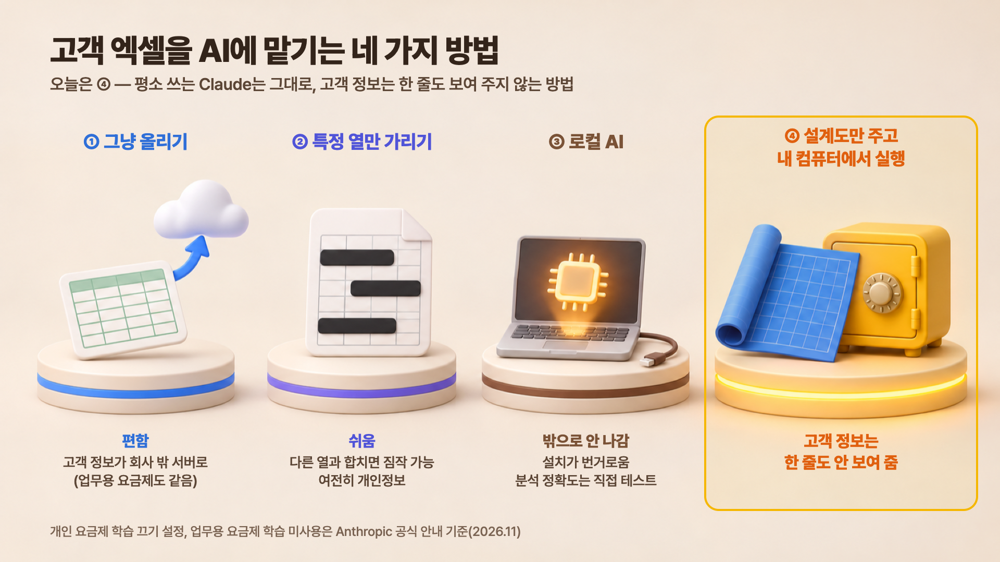
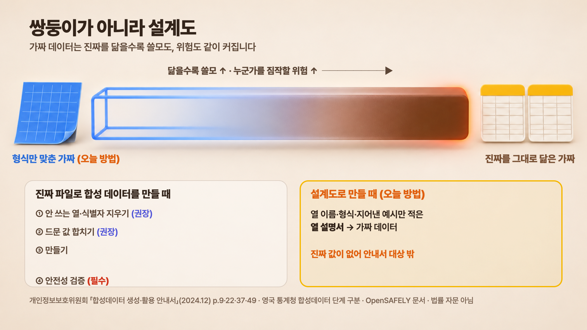
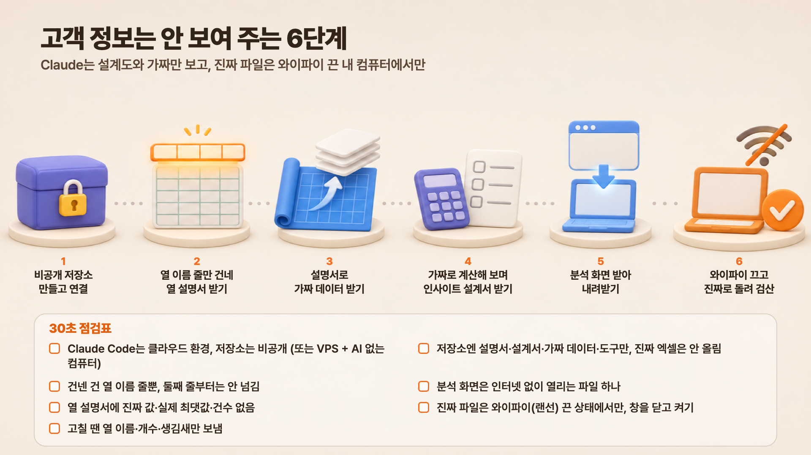
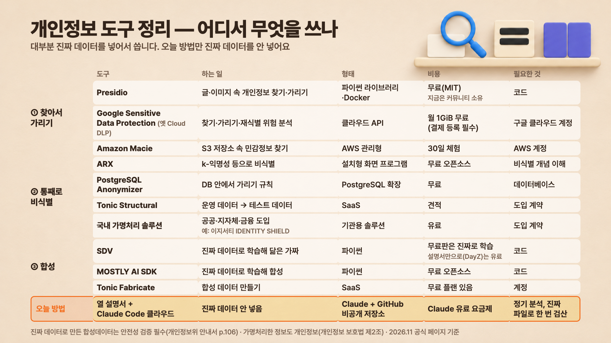

# 회사 데이터, AI에 그냥 올려도 될까? 원본 없이 Claude Code로 분석


이 가이드는 「회사 데이터, AI에 그냥 올려도 될까?」 영상에서 고객·주문 엑셀 원본을 Claude에 한 줄도 보여 주지 않고, 열 이름과 가짜 데이터만으로 분석 화면을 만든 과정을 정리한 것입니다. 영상에서 쓴 요청문 5개를 그대로 옮기고, 내 데이터로 바꿔 쓸 때 확인할 점을 함께 적었습니다. 엑셀·CSV·구글 시트 같은 표 데이터에 쓰는 방법입니다.

---

## 목차

1. [고객 데이터를 AI에 맡기는 네 가지 방법](#1-고객-데이터를-ai에-맡기는-네-가지-방법)
2. [쌍둥이가 아니라 설계도](#2-쌍둥이가-아니라-설계도)
3. [시작 전 준비: 비공개 저장소와 클라우드 세션](#3-시작-전-준비-비공개-저장소와-클라우드-세션)
4. [따라 하기: 열 이름부터 진짜 파일 검산까지](#4-따라-하기-열-이름부터-진짜-파일-검산까지)
5. [진짜 데이터를 꼭 넣어야 할 때: 개인정보 도구 정리](#5-진짜-데이터를-꼭-넣어야-할-때-개인정보-도구-정리)
6. [참고 자료](#6-참고-자료)

---

## 1. 고객 데이터를 AI에 맡기는 네 가지 방법



고객 명단이나 주문 내역을 AI로 분석하고 싶을 때 보통 떠올리는 방법은 세 가지입니다. 오늘 영상은 네 번째 방법을 보여 드렸어요.

| 방법 | 좋은 점 | 걸리는 점 |
|---|---|---|
| ① 파일을 그냥 올리기 | 가장 편함 | 개인 요금제(Free·Pro·Max)는 학습 허용을 켜 두면 대화가 모델 개선에 쓰이고 최대 5년 보관, 꺼도 30일 보관됩니다. 업무용 요금제는 학습에 쓰지 않지만, 고객 정보가 회사 밖 서버로 나가는 건 같습니다 |
| ② 이름 같은 열만 가리고 올리기 | 쉬움 | 주소·메모·주문 기록을 합치면 누군지 짐작할 수 있습니다. 이름만 바꾼 정보도 법에서는 여전히 개인정보입니다 |
| ③ 내 컴퓨터에서 로컬 AI 돌리기 | 원본이 밖으로 안 나감 | 설치가 번거롭고, 표 분석을 얼마나 잘하는지는 직접 시험해야 합니다. 좋은 모델일수록 장비 부담도 커집니다 |
| **④ 설계도만 주고, 실행은 내 컴퓨터에서** | **평소 쓰는 Claude 그대로, 고객 정보는 한 줄도 안 보여 줌** | 진짜 파일에서 한 번은 직접 검산해야 합니다 |

④번은 AI에게 **분석 결과가 아니라 분석 도구를 만들어 달라고** 하는 방식입니다. 도구를 만드는 데는 "홍길동"이라는 실제 이름이 필요 없어요. 이름 열이 있고, 주문일은 날짜 형식이고, 금액은 숫자라는 **데이터의 모양**만 알면 됩니다.

---

## 2. 쌍둥이가 아니라 설계도



이 방식은 실제로 쓰이고 있습니다. 영국의 의료 데이터 연구 플랫폼 OpenSAFELY에서는 연구자가 진짜 환자 기록을 보지 않고, 형식에 맞춰 만든 가짜 데이터로 분석 코드를 짭니다. 그 코드는 진짜 기록이 있는 안전한 곳에서 돌아가고요. 재미있는 건 이 가짜 데이터가 진짜 분포를 보고 만든 게 아니라, 형식만 맞춰 무작위로 만든다는 점입니다.

가짜 데이터는 진짜를 닮을수록 쓸모가 커지지만, 누군가를 다시 짐작할 위험도 같이 커집니다.

| | 진짜 파일로 합성 데이터를 만들 때 | 설계도로 만들 때 (오늘 방법) |
|---|---|---|
| 재료 | 진짜 고객 데이터 | 열 이름·형식·지어낸 예시만 적은 열 설명서 |
| 해야 할 일 | 안 쓰는 열·식별자 지우기(권장) → 드문 값 합치기(권장) → 만들기 → **안전성 검증(필수)** | 열 설명서로 가짜 데이터 만들기 |
| 안내서 적용 | 개인정보보호위원회 「합성데이터 생성·활용 안내서」 대상 | 개인정보가 없는 원본으로 만든 데이터라 안내서 대상 밖 |

그래서 오늘은 진짜 파일에서 합성 데이터를 뽑지 않고, **진짜 값이 하나도 들어가지 않은 열 설명서만으로** 가짜 데이터를 만들었습니다.

> 이 가이드는 법률 자문이 아닙니다. 회사에서 개인정보 처리 기준이 따로 있다면 그 기준을 먼저 따르세요.

---

## 3. 시작 전 준비: 비공개 저장소와 클라우드 세션

### 왜 클라우드 세션인가요?

Claude Code를 내 컴퓨터에서 돌리면, 기본 설정에서 일부 읽기 명령은 작업 폴더 밖의 파일도 묻지 않고 읽을 수 있습니다. 진짜 엑셀이 같은 컴퓨터에 있다면 신경 쓰이는 부분이죠.

그래서 영상에서는 Claude Code를 **클라우드 환경**에서 돌렸습니다. 클라우드 세션은 Anthropic이 관리하는 별도의 가상 컴퓨터에서 돌아서, 내 컴퓨터의 파일을 기본적으로 볼 수 없습니다. 대신 만든 파일은 GitHub 저장소로 주고받습니다.

다만 "아무것도 밖으로 안 나간다"는 뜻은 아닙니다. 열 이름과 업무 규칙은 Claude에게 갑니다. 그래서 열 이름에도 개인정보가 들어 있다면(예: 열 이름이 고객 이름인 경우) 바꿔서 넘기세요.

| 확인할 것 | 내용 |
|---|---|
| 요금제 | Pro·Max·Ultra·Team (Enterprise는 해당 좌석). 추가 비용 없이 요금제 사용량에 같이 잡힙니다 |
| 계정 | GitHub 계정 |
| 어디서 | 영상에서는 Claude 앱의 Code 탭을 썼습니다. 브라우저의 claude.ai/code에서 시작해도 같은 클라우드 환경을 씁니다 |

### 1단계: 비공개 저장소 만들고 연결하기

영상에서 한 순서 그대로입니다.

1. **클라우드 환경 고르기**: Claude 앱의 Code 탭에서 새 세션을 열고, 입력창 아래 환경 선택에서 **내 컴퓨터** 대신 **클라우드**를 고릅니다. 클라우드 환경이 없으면 새 환경을 하나 만들면 됩니다. 영상에서는 '개인정보 클라우드'라는 이름으로 기본 설정 그대로 만들었습니다.
2. **GitHub 연결**: 저장소를 고르는 칸에서 GitHub이 아직 연결되지 않았다면 연결(Connect)부터 합니다.
3. **비공개 저장소 만들기**: GitHub 사이트에서 새 저장소를 만들고, 공개 범위(visibility)를 **Private**으로 둔 뒤 Create repository를 누릅니다.
4. **세션에 연결하기**: 만든 저장소의 git 주소를 복사해 세션에 붙여 넣고 "이 저장소를 연결해 줘"라고 요청합니다. 오른쪽 위에 저장소 이름이 보이면 연결된 것입니다.

영상에서는 처음에 Claude에게 비공개 저장소를 만들어 달라고 해 봤는데, 세션이 미리 설정된 저장소에만 접근할 수 있어서 만들지 못했습니다. 저장소는 GitHub 사이트에서 직접 만드는 게 가장 간단합니다.

진짜 엑셀을 열 브라우저와 Claude를 쓰는 창을 나눠 두면 헷갈리지 않습니다. 예를 들어 Claude·GitHub은 크롬, 내려받은 분석 화면과 진짜 엑셀은 사파리에서 여는 식입니다.

> **더 확실하게 하고 싶다면**: 컴퓨터를 아예 나누는 방법도 있습니다. Claude Code는 Hostinger 같은 VPS(내가 빌려 쓰는 원격 서버)에서 돌리고, 진짜 파일은 AI 도구를 하나도 깔지 않은 컴퓨터에서 와이파이를 끄고 엽니다. 작업 파일도 GitHub이 아니라 내가 관리하는 서버에 남습니다. 이 셋업은 다음에 따로 다뤄 보겠습니다.
>
> [Hostinger VPS 시작하기](https://hostinger.com/citizendev9c) · 쿠폰 코드 **CITIZENDEV9C**
>
> 링크로 들어가도 쿠폰은 자동으로 적용되지 않습니다. 결제할 때 쿠폰 칸에 `CITIZENDEV9C`를 직접 입력해 주세요. 제휴 링크·코드라서 이 링크·코드로 가입하시면 채널에 일정 수수료가 지급될 수 있습니다.

---

## 4. 따라 하기: 열 이름부터 진짜 파일 검산까지



1단계(저장소 연결)는 위에서 끝냈습니다. 나머지 다섯 단계는 모두 **같은 클라우드 세션**에서 이어 갑니다.

### 영상에서 쓴 예시 자료

영상에서는 원두 쇼핑몰 '새벽원두'를 가정했습니다. 상호·고객·주문은 모두 지어낸 가상 데이터이고, 파일은 따로 제공하지 않습니다. 아래 구성을 보고 내 파일로 바꿔 보세요.

| 시트 | 영상에서 담은 것 | 내 업무라면 |
|---|---|---|
| 고객명단 | 고객번호·이름·휴대폰·이메일·생년월일·성별·주소·가입일·가입경로·정기구독·마케팅수신동의·메모 | 회원·거래처 명단 |
| 주문결제 | 주문번호·주문일시·고객번호·상품명·수량·상품금액·할인금액·결제금액·결제수단·결제상태·환불금액·배송지·배송메모 등 | 주문·매출·상담 기록 |

일부러 날짜를 글자로 적은 칸, 금액 앞에 '₩'를 붙인 칸처럼 형식이 들쭉날쭉한 칸도 섞어 두었습니다. 실제 회사 파일이 대개 그렇거든요.

### 2단계: 열 이름 줄만 건네고 열 설명서 받기

진짜 엑셀은 그 자리에 두고, 각 시트의 **첫 줄(열 이름 줄)만** 복사합니다. 둘째 줄부터는 진짜 고객 값이라 넘기지 않습니다. 붙여 넣은 뒤 보내기 전에 첫 줄만 들어갔는지 한 번 확인하세요.

```text
우리 원두 쇼핑몰 고객·주문 엑셀의 열 이름만 붙여 넣을게. 값은 하나도 없어.
고객명단: (고객명단 시트 첫 줄 붙여 넣기)
주문결제: (주문결제 시트 첫 줄 붙여 넣기)
이걸로 이 저장소에 열설명서.md를 만들어 줘. 열마다 형식, 지어낸 예시 하나, 매출·재구매·단골 분석에 쓸지 뺄지를 표로 적고, 시트끼리 잇는 열도 적어 줘.
이름·휴대폰은 단골 명단에 보여 주는 데만 쓰고, 나머지 개인정보 열은 '뺌'으로 둬. 범위와 범주는 원두 쇼핑몰에서 흔한 값으로 채우되, 내가 답해야 정해지는 건 맨 아래 질문으로 모아 줘.
```

`원두 쇼핑몰`과 분석 목적(매출·재구매·단골)은 내 업종과 목적에 맞게 바꾸세요.

열 설명서 맨 아래에 Claude의 질문이 모여 있습니다. 영상에서는 "질문은 문서에 넣지 말고 이 세션에서 물어봐 줘"라고 했더니, 보기를 고르는 방식으로 하나씩 물어봐 줬어요. "한 주문에 상품이 여러 개면 어떻게 기록되나요?", "배송비는 결제금액에 들어가나요?" 같은 질문입니다. 이런 **업무 규칙**은 개인정보가 아니니 답해 주면 열 설명서가 더 정확해집니다.

답할 때 지키면 좋은 기준이 있습니다.

- 진짜 값, 실제 최댓값, 실제 건수는 적지 않습니다. 범위만으로도 누군가가 드러날 수 있어요.
- 범주(가입경로, 결제수단 같은 목록)는 업무에서 쓰는 이름 그대로 알려 줘도 됩니다. 다만 한두 명만 해당하는 드문 값은 누군지 짐작될 수 있으니 빼거나 '기타'로 묶으세요.

Claude가 작업을 마치면 저장소의 새 브랜치에 올리고 PR을 만듭니다. 같은 세션에서 "PR 머지해 줘"라고 하면 반영해 줍니다(GitHub에서 직접 Merge해도 됩니다). 머지해 둬야 나중에 저장소에 들어왔을 때 최신 파일을 볼 수 있습니다.

### 3단계: 열 설명서로 가짜 데이터 받기

인사이트를 정하기 전에 가짜 데이터부터 만듭니다. 손에 잡히는 데이터가 있어야 다음 단계에서 인사이트를 실제로 계산해 보면서 정할 수 있거든요.

```text
열설명서.md만 보고 같은 시트·열 구성의 가짜 엑셀을 이 저장소에 만들어 줘. 이름·연락처·날짜·금액은 전부 지어내 줘.
고객은 원두 쇼핑몰에서 흔한 유형이 골고루 섞이게 해 줘. 꾸준히 사는 단골, 한 번 사고 끝난 고객, 단골이었다가 최근 끊긴 고객, 정기구독 고객, 할인 때만 사는 고객, 가끔 크게 사는 기업 고객 같은 식으로.
형식이 들쭉날쭉한 칸을 얼마나 섞을지는 알아서 정해 줘.
```

고객 유형을 골고루 넣어 달라고 한 건, 그래야 "최근 끊긴 단골" 같은 인사이트가 제대로 걸리는지 시험할 수 있어서입니다. 이 유형도 진짜 파일을 보고 정한 게 아니라 업종에서 흔한 손님을 떠올려 지어낸 것이에요. 내 업종에 흔한 고객 유형으로 바꿔 쓰세요.

만들어진 가짜 엑셀은 저장소에서 내려받아 열어 보고, 형식이 마음에 안 들면 같은 세션에서 고쳐 달라고 하면 됩니다.

### 4단계: 가짜로 계산해 보며 인사이트 설계서 받기

바로 분석 화면을 만들어 달라고 하면 합계·평균·가장 많이 팔린 상품 정도가 나오기 쉽습니다. 그건 엑셀 피벗으로도 볼 수 있는 숫자죠. 그래서 화면보다 먼저, **어떤 인사이트를 어떤 규칙으로 뽑을지**부터 정합니다.

```text
생성한 엑셀은 원두 쇼핑몰 대표가 매달 보는 파일이야. 열설명서.md와 가짜 엑셀을 보고, 다음 달 할 일을 정하는 데 쓸 인사이트 목록을 인사이트설계.md로 만들어 줘.
월별 순매출(결제금액-환불금액), 두 번 이상 산 고객 비율, 누적 구매액 상위 20명 중 10월 31일 기준 최근 90일 주문이 없는 단골 명단은 꼭 넣고, 나머지는 커머스에서 흔히 보는 지표(재주문 간격, 구독, 첫 구매 상품, 매출 쏠림 같은 것) 중 이 열로 계산되는 것만 골라 줘.
인사이트마다 계산 규칙, 무엇과 비교하는지, 결과에 따라 보여 줄 문장과 할 일, 고객이 너무 적으면 숨기는 조건을 적어 줘. 평균이나 1위만 말하는 건 빼고, 예측이 아니라 규칙으로 계산해 줘.
가짜 엑셀로 인사이트마다 한 번씩 계산해 보고, 계산이 안 되거나 아무도 안 걸리는 건 이유를 같이 적어 줘.
```

지표를 다 정해 주지 않고 좋은 인사이트의 기준만 줬습니다.

- 무엇과 비교하는지가 있을 것
- 할 일로 이어질 것
- 고객이 너무 적으면 숨길 것

영상에서는 꼭 넣은 3개와 Claude가 고른 8개, 모두 11개가 나왔습니다. 회사에서 이미 보고 있는 지표가 있다면 "꼭 넣어 줘" 자리에 그 지표를 적으세요. `10월 31일 기준`은 분석할 기준일로 바꿉니다.

### 5단계: 분석 화면 받아 내려받기

같은 세션에서 분석 화면을 만들어 달라고 합니다.

```text
인사이트설계.md대로, 진짜 엑셀을 넣으면 인사이트 카드와 월별 순매출 차트, 단골 명단을 보여 주는 분석 화면을 인터넷 없이 더블클릭으로 여는 HTML 파일 하나로 이 저장소에 만들어 줘.
엑셀 읽기는 SheetJS, 차트는 Chart.js를 파일 안에 넣고, 밖으로 연결하는 건 막고, 넣은 파일은 브라우저에 저장하지 마.
읽지 못한 칸은 값 없이 열 이름과 개수만 보여 주고, 다 만들면 가짜 엑셀로 인사이트 카드가 설계대로 뜨는지 확인해 줘.
```

SheetJS는 브라우저에서 엑셀을 읽는 공개 라이브러리입니다. 파일 안에 넣어 달라고 한 건, 인터넷에서 불러오는 코드가 있으면 와이파이를 끄는 순간 화면이 돌지 않기 때문이에요.

**SheetJS를 못 받아 오면**: 클라우드 세션의 기본 환경은 정해진 사이트에만 접속할 수 있는데, SheetJS 공식 배포처(cdn.sheetjs.com)는 기본 허용 목록에 없습니다. 영상에서도 여기서 한 번 막혔어요. 세션 제목 옆 캐럿(⌄) → **Edit cloud environment**에서 네트워크 액세스를 SheetJS 배포처에 닿을 수 있게 바꾼 뒤 다시 요청하면 됩니다.

**CSV로 넣을 거라면**: 영상에서는 처음 만든 화면이 엑셀은 읽었지만 CSV 두 개는 읽지 못해서 고쳐 달라고 했습니다. CSV로 넣을 계획이면 요청에 "CSV 파일도 읽게 해 줘"를 미리 붙이세요.

다 만들어지면 머지한 뒤 저장소에서 HTML 파일을 내려받습니다.

### 6단계: 와이파이 끄고 진짜 파일로 돌려 검산하기

1. 와이파이를 끕니다. 랜선을 꽂아 쓰고 있다면 랜선도 뺍니다.
2. 내려받은 HTML을 더블클릭해 열고, 진짜 엑셀을 넣습니다.
3. 인사이트 카드·차트·단골 명단이 나오는지, **읽지 못한 칸**이 몇 개인지 봅니다.
4. 확인이 끝나면 HTML 창과 엑셀을 **완전히 닫고**(맥은 ⌘Q) 와이파이를 켭니다. 창이 열린 채로 인터넷을 켜면 그때부터는 장담할 수 없어서, 창을 다 닫은 뒤 켭니다.

가짜 데이터는 진짜보다 깔끔해서, 진짜 파일에서만 나오는 예외가 꼭 있습니다. 영상에서도 처음 돌렸을 때 읽지 못한 칸이 204개 나왔어요(가입경로 172개, 결제금액 32개). 엑셀에서 그 열을 정렬해 보면 모양이 다른 칸을 찾을 수 있습니다.

클라우드 세션은 창을 닫아도 이어지니까, 와이파이를 켠 뒤 같은 세션에 이렇게 알려 줍니다.

```text
진짜 파일로 돌려 보니 엑셀 행은 1,618개인데 화면 기준일까지 주문 1586행 · 고객 324명, 읽지 못한 칸은 결제금액	32이야.
그 칸들은 ₩숫자, ₩##,### 이런 식으로 생겼어.
이런 형식도 읽게 고쳐 주고, 고친 뒤에도 못 읽는 칸은 지금처럼 열 이름과 개수만 보여 줘.
```

숫자와 칸 모양은 내 화면에 나온 값으로 바꿔 쓰세요. 보내는 건 **열 이름, 개수, 칸의 생김새**뿐이고 진짜 값은 보내지 않습니다. 오류 메시지 원문을 그대로 붙여 넣으면 진짜 값이 섞일 수 있으니 피하세요. 가입경로처럼 업무에서 쓰는 범주 이름은 개인정보가 아니라서(드문 값은 빼고), 영상에서는 "띄어쓰기가 달라도 같은 가입경로로 읽어 줘"처럼 알려 주고 고쳤습니다.

고친 HTML을 다시 받아 같은 순서로 돌려 보고, 읽지 못한 칸이 0개가 될 때까지 몇 번 오가면 됩니다. 영상에서는 두 번째에 0개가 됐고, 인사이트 카드와 평소보다 늦은 상위 단골 6명, 이번 달 할 일까지 정리돼 나왔습니다.

### 다음 달부터는

열 설명서, 인사이트 설계서, 한 번 검산한 분석 HTML만 저장소에 남겨 두면, 열 구성이 같은 다음 달 파일은 와이파이를 끄고 같은 HTML에 넣어 보면 됩니다. 이때도 읽지 못한 칸과 주문 수는 매번 확인하세요. 기준일(요청문의 `10월 31일 기준`)이 화면에 고정돼 있다면 화면에서 바꿀 수 있게 고쳐 달라고 하면 됩니다. 분석을 더 넣고 싶을 때도 가짜 데이터와 클라우드 세션에서 고친 뒤 다시 받으면 돼요.

### 30초 점검표

- [ ] Claude Code는 클라우드 환경, 저장소는 비공개 (또는 VPS + AI 도구 없는 컴퓨터)
- [ ] Claude에게 건넨 건 열 이름 줄뿐, 둘째 줄부터는 넘기지 않았다
- [ ] 열 설명서에 진짜 값·실제 최댓값·실제 건수가 없다
- [ ] 고칠 때는 열 이름·개수·칸 생김새만 보냈다
- [ ] 저장소에는 열 설명서·인사이트 설계서·가짜 데이터·분석 HTML만 있고, 진짜 엑셀은 올리지 않았다
- [ ] 분석 화면은 인터넷 없이 열리는 파일 하나다
- [ ] 진짜 파일은 와이파이(랜선)를 끈 상태에서만 열고, 창을 닫은 뒤 켰다

---

## 5. 진짜 데이터를 꼭 넣어야 할 때: 개인정보 도구 정리



개인정보를 다루는 방법은 오늘 방법 말고도 여러 가지가 있습니다. 다만 아래 도구들은 대부분 **진짜 데이터를 넣어서** 씁니다. 그래서 개인정보를 관리하는 입장에서는 챙길 게 더 많아요.

| 이럴 때 | 살펴볼 도구 |
|---|---|
| 파일이나 글 속 개인정보를 찾아서 가리고 싶다 | Presidio, Google Sensitive Data Protection(옛 Cloud DLP), Amazon Macie |
| 파일 자체를 비식별해서 밖으로 내보내야 한다 | ARX, PostgreSQL Anonymizer, Tonic Structural, 국내 가명처리 솔루션 |
| 진짜 데이터를 닮은 합성 데이터가 필요하다 | SDV, MOSTLY AI SDK, Tonic Fabricate |

알아 두면 좋은 점 두 가지입니다.

- 가명처리한 정보도 개인정보 보호법에서는 여전히 개인정보입니다(제2조).
- 진짜 데이터로 만든 합성 데이터는 안전성 검증이 필수입니다(개인정보보호위원회 안내서).

진짜 데이터를 꼭 Claude에 보내서 분석해야 하는 상황이라면 이 도구들을 먼저 검토해 보세요. 분석 도구를 만드는 게 목적이라면, 오늘 방법이 가장 간단합니다.

---

## 6. 참고 자료

| 자료 | 링크 |
|---|---|
| Claude Code 클라우드 세션 공식 문서 | https://code.claude.com/docs/ko/claude-code-on-the-web |
| Claude Code 클라우드 환경 구성 공식 문서 | https://code.claude.com/docs/ko/cloud-environments |
| Claude Code 권한 설정 공식 문서 | https://code.claude.com/docs/ko/permissions |
| 개인정보보호위원회 「합성데이터 생성·활용 안내서」(2024.12) | https://www.pipc.go.kr/np/cop/bbs/selectBoardArticle.do?bbsId=BS217&mCode=D010030000&nttId=10915 |
| 개인정보 보호법 | https://www.law.go.kr/법령/개인정보보호법 |
| OpenSAFELY 더미 데이터 설명 (영문) | https://docs.opensafely.org/ehrql/explanation/dummy-data/ |
| SheetJS 단독 설치 안내 (영문) | https://docs.sheetjs.com/docs/getting-started/installation/standalone/ |

---

클로드 앱의 Code 탭에서 환경(내 컴퓨터·클라우드)을 고르는 화면이 아직 낯설다면, 환경 메뉴와 새로 생긴 기능을 먼저 정리한 이 영상을 같이 보시면 좋습니다.

▶ [클로드 앱이 완전히 달라졌습니다! '2.0'이라 불리는 핵심 기능 8가지 업무 활용법](https://www.youtube.com/watch?v=lYCIvhvFkXg)

생산성은 규모가 아닌 시스템에서 나옵니다
