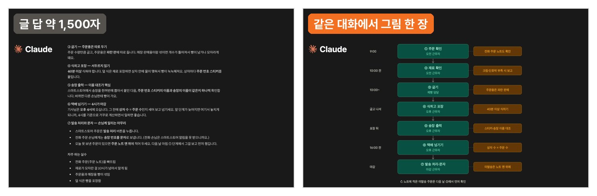
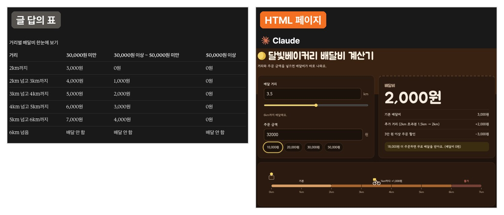
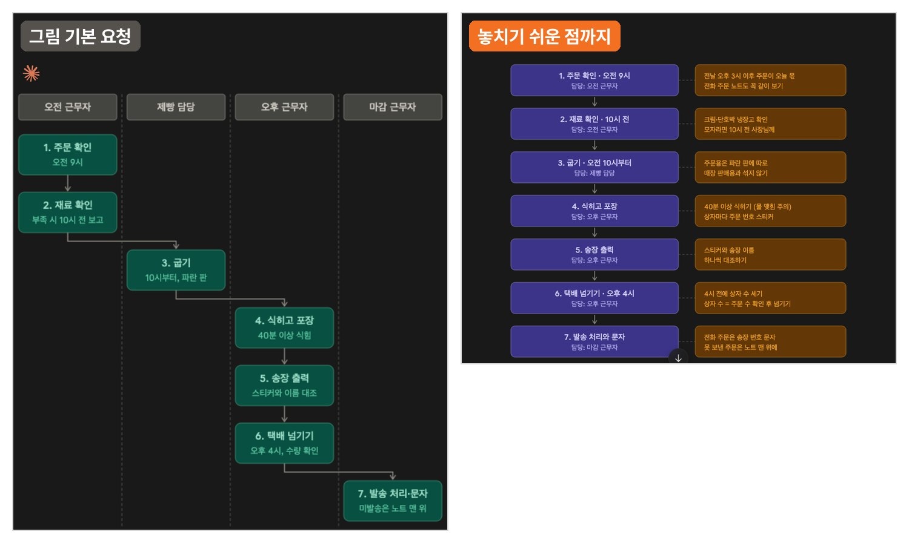

# AI 답, 글로만 말고 그림·웹페이지로도 받기 (Claude)

긴 AI 답을 같은 내용 그대로 그림 한 장이나, 값을 넣어 보는 웹페이지로 받는 요청문입니다. 앤트로픽 AI 연구자 · OpenAI 공동 창업자 안드레이 카파시가 X 글에서 권한 방법을 Claude에서 업무 자료로 해 봤습니다.

## 결론부터

- **순서와 담당자가 있는 일은 그림으로.** 글로 약 1,500자였던 업무 순서가 담당자별 그림 한 장이 됐습니다. 같은 자료로 다섯 번 그려 다섯 번 다 일곱 단계가 들어갔습니다.
- **숫자를 따지는 규칙은 웹페이지로.** "HTML 페이지로 만들어 줘"라고 하면 값을 넣는 대로 답이 나오는 계산기가 왔고, 미리 계산해 둔 주문 세 개가 다 맞았습니다.
- **조심할 것: 그림엔 세부 내용이 빠질 때가 있습니다.** 요청 끝에 "놓치기 쉬운 점도 그림 안에 넣어 줘"를 붙이면 단계마다 주의할 점이 들어갔습니다.
- **따로 설치할 것은 없습니다.** 요청 한 줄을 바꾸는 것뿐이고, 사용량은 쓰는 요금제의 한도에서 나갑니다.

## 전과 후

**업무 순서: 글 답 → 같은 대화에서 그림 한 장.** 왼쪽 글 답을 받은 뒤 "방금 답을 그림 한 장으로 다시 그려 줘"라고만 보냈습니다. 시간, 단계, 담당자, 주의할 점이 한 장에 들어왔습니다.



**배달비 규칙: 글 답의 표 → HTML 페이지.** 글로 받으면 표에서 내 거리와 금액이 만나는 곳을 찾아야 합니다. 웹페이지는 3.5km, 32,000원을 넣자 바로 2,000원이 나오고 계산 근거도 줄마다 보입니다.



**한 줄 더 붙이면: 놓치기 쉬운 점까지.** 왼쪽은 "단계와 담당자가 보이게"까지만, 오른쪽은 "놓치기 쉬운 점도 그림 안에"를 더한 요청입니다. 단계마다 주의할 점이 두 줄씩 붙었습니다.



## 준비: 켜 둘 것

설치할 것은 없습니다. [claude.ai](https://claude.ai) 웹이나 Claude 데스크톱 앱에 로그인하면 됩니다.

- **웹페이지(아티팩트)를 받으려면 파일 만들기 기능이 켜져 있어야 합니다.** 설정 > 기능(Capabilities)의 'Create and edit files'(예전 이름 'Code execution and file creation')입니다. 꺼져 있으면 켜고 새 대화에서 요청하세요. 아티팩트는 Claude가 대화 옆 창에 따로 만들어 주는 결과물(웹페이지, 문서, 그림 등)입니다.
- **그림은 대화 안에 바로 그려지고, 웹페이지는 오른쪽 창에 열립니다.** 웹페이지는 값을 바꾸면 결과가 바로 바뀝니다.
- 우리는 claude.ai 웹에서, 유료 계정으로만 해 봤습니다.

## 쓰기: 요청문 3개

자료(업무 매뉴얼, 규정, 계산 규칙 등)를 붙여 넣거나 파일로 올린 뒤, 아래 요청을 붙여 넣으세요. 대괄호 [ ] 부분만 내 것으로 바꾸면 됩니다.

**1. 그림으로 받기.** 순서, 담당자, 경우가 나뉘는 규칙을 한눈에 보고 싶을 때.

```
이 내용을 글 대신 그림 한 장으로 그려 줘. 단계와 담당자가 보이게.
```

> [!TIP]
> 이미 긴 글 답을 받았다면 같은 대화에서 `방금 답을 그림 한 장으로 다시 그려 줘.`라고만 보내도 됩니다. 위 첫 번째 그림이 그렇게 받은 것입니다.

**2. 웹페이지로 받기.** 거리, 금액, 수량처럼 값에 따라 결과가 달라지는 규칙일 때.

```
이 규칙을 HTML 페이지로 만들어 줘. [거리와 주문 금액]을 넣으면 [배달비]가 바로 나오게.
```

- 바꿔 쓰는 예: `[장수와 옵션]을 고르면 [견적]이`, `[근무 시간]을 넣으면 [급여]가`
- 확인 요령: 답을 이미 아는 값 하나를 넣어 맞는지 먼저 보세요.

**3. 꼼꼼하게: 놓치기 쉬운 점까지.** 새로 온 사람에게 줄 그림처럼 빠지면 안 되는 주의가 많을 때.

```
이 내용을 글 대신 그림 한 장으로 그려 줘. 단계와 담당자, 그리고 놓치기 쉬운 점도 그림 안에 넣어 줘.
```

> [!WARNING]
> 그림과 웹페이지는 받은 그대로 쓰기 전에 원문과 한 번 맞춰 보세요. 단계 수를 세어 보고, 계산기는 아는 값 하나를 넣어 보면 됩니다.

---

여기까지만 읽어도 됩니다.

## 써 보니 이랬습니다

| 자료 | 받은 꼴 | 결과 |
|---|---|---|
| 업무 순서(일곱 단계, 담당자 넷) | 글 | 약 1,500자. 일곱 단계 다 있고, 자료에서 애매한 점까지 짚음 |
| 같은 업무 순서 | 그림 | 다섯 번 그려 다섯 번 다 일곱 단계와 담당자가 맞음 |
| 휴가 규정(규칙 여덟 가지) | 그림 | 일곱 가지는 그대로, 한 가지는 반쯤('팀장에게' 낸다는 말이 빠짐). 틀린 숫자는 없음 |
| 배달비 규칙 | 글 | 1,291자. 계산은 맞지만 표에서 내 경우를 찾아야 함 |
| 같은 배달비 규칙 | 웹페이지 | 세 번 만들어 세 번 다, 미리 계산한 주문 세 개가 맞음 |
| 명함 견적 규칙 | 웹페이지 | 주문 세 개 모두 맞음(500장·양면·고급·당일 → 74,480원) |

좋았던 점
- 순서와 담당자가 한 장에 보여서, 벽에 붙이거나 새 직원에게 바로 보여 줄 수 있는 꼴로 왔습니다.
- 웹페이지는 숫자를 바꿔 가며 확인할 수 있고, 기본요금, 추가 요금, 할인이 줄마다 보입니다.
- 메모리(지난 대화 기억)를 끈 새 대화에서도 결과가 같았습니다.

아쉬운 점
- 글 답이 짚어 준 '자료에서 애매한 점'이 그림에서는 빠졌습니다.
- 휴가 규정처럼 경우가 나뉘는 규칙은, 그림에서 승인 순서가 헷갈리게 놓인 곳이 한 군데 있었습니다.
- 규칙에 없는 경우(100장 단위가 아닌 장수, 부가세)는 AI가 정해서 채웠습니다. 어떻게 정했는지는 답 글에 적어 줬으니 읽어 보세요.

## 글로만 받을 때와 다른 점

글 답이 틀린 것은 아닙니다. 두 자료 모두 글 답도 내용과 계산이 맞았고, 자료의 빈틈을 먼저 짚어 주는 건 오히려 글 쪽이었습니다. 차이는 읽는 양입니다. 글은 끝까지 읽거나 표에서 찾아야 하고, 그림은 한 장으로 보이고, 웹페이지는 값 두 개만 넣으면 됩니다. 그래서 글 답을 버리기보다, 글로 받은 뒤 그림이나 웹페이지로 한 번 더 받는 쪽을 권합니다.

## 카파시 글에서 가져온 것

2026년 10월 2일 X 글의 첫 줄은 이렇습니다.

> "We'll be spending a lot more time trying to understand the outputs of language models."
> (앞으로 우리는 AI가 내놓은 답을 이해하는 데 훨씬 더 많은 시간을 쓰게 될 겁니다.)

그래서 답을 이해하기 쉬운 꼴로 받는 법을 차례로 들었습니다.

- 그림: "Instead of writing, ask your LLM to create a diagram. These can be a lot easier to process, parse, and understand." (글 대신 그림을 그려 달라고 하세요. 훨씬 쉽게 읽히고 이해됩니다.)
- 웹페이지: "Ask for output "in HTML" to get a beautiful, interactive webpage." ("HTML로" 달라고 하면 눌러 볼 수 있는 웹페이지가 됩니다.)

글을 버리라는 말은 아닙니다. 같은 글의 첫 팁은 글 자체를 읽기 쉽게 받는 법(항공우주 정비 문서용으로 만든 영어 쓰기 규칙 ASD-STE100에 맞춰 설명해 달라기)이고, 그림과 웹페이지는 그다음에 "even better"로 이어집니다.

## 써 본 사람들은 뭐라고 하나

- **그림이 더 빨리 들어온다.** 긴 글을 읽는 것보다 그림 한 장을 보는 쪽이 훨씬 빨리 이해된다는 의견입니다.
- **글로 받을 거면 문체를 정해 준다.** 한 문장에 한 가지만, 짧게, 꾸밈 없이, 숫자와 조건은 그대로. 규칙을 80%쯤만 맞춰 달라고 하는 게 요령이라는 말도 있습니다.
- **아예 설정에 넣어 둔다.** 답이 길어지면 보고서나 그림 꼴로 달라고 개인 맞춤 설정에 적어 두는 사람도 있습니다. 이 방법은 우리가 돌려 보지 않았습니다.

## 쓰기 전에 알아 둘 것

따로 내려받거나 실행하는 프로그램이 없는 Claude 기본 기능이라 설치에 따른 위험은 없습니다.

- **개인정보는 빼고 붙여 넣기.** 손님 이름, 전화번호, 주소 같은 것은 지우거나 가짜로 바꿔도 그림과 계산기는 똑같이 나옵니다.
- **공유 버튼은 확인하고 누르기.** 아티팩트는 링크로 다른 사람과 나눌 수 있습니다. 우리는 공유·게시를 누르지 않았습니다.
- **받은 결과는 원문과 한 번 맞춰 보기.** 그림은 단계 수, 계산기는 아는 값 하나면 됩니다.

## 자주 묻는 것

**어느 요금제에서 되나요?**
[공식 도움말](https://support.claude.com/en/articles/9487310-what-are-artifacts-and-how-do-i-use-them)과 [요금제 표](https://claude.com/pricing)에는 아티팩트 만들기가 Free를 포함한 개인·팀 요금제 모두에 있다고 적혀 있습니다. 우리는 유료 계정으로만 해 봤습니다. 요금제마다 사용량 한도가 다릅니다.

**휴대폰 앱에서도 되나요?**
공식 도움말에는 iPhone·Android 앱에서도 요청하고 결과를 볼 수 있다고 적혀 있습니다. 우리는 웹에서만 해 봤습니다.

**ChatGPT나 Gemini에서도 되나요?**
우리는 Claude에서만 해 봤습니다. 쓰시는 AI 앱이 그림이나 웹페이지를 만들어 바로 보여 주는 기능을 갖고 있다면 위 요청문을 그대로 넣어 보세요. 어느 앱이든 받은 결과는 원문과 한 번 맞춰 보는 게 좋습니다.

**그럼 글 답은 안 받아도 되나요?**
아닙니다. 글 답은 자료의 빈틈과 자주 하는 실수를 먼저 짚어 줬습니다. 글로 한 번 받고, 같은 대화에서 그림이나 웹페이지로 다시 받으면 둘 다 얻습니다.

**HTML이 뭔지 몰라도 되나요?**
됩니다. 웹페이지를 만드는 글자라는 뜻이고, 요청에 그 낱말만 넣으면 Claude가 페이지를 만들어 옆 창에 띄워 줍니다. 코드를 읽을 필요는 없습니다.

## 확인 정보

- 시험: 2026년 11월 22·23일, Claude 웹(유료 계정). 직접 만든 가상 업무 자료 네 가지로 업무 순서 그림 5번, 배달비 계산기 3번, 휴가 규정 그림과 명함 견적 계산기 각 1번 받았고, 대부분 새 대화에서 했습니다.
- 원문: [안드레이 카파시 X 글(2026년 10월 2일)](https://x.com/karpathy/status/2105819303471976479)
- 카파시 소속: [Reuters, 2026년 5월 19일 — 카파시 앤트로픽 합류](https://www.reuters.com/business/autos-transportation/former-tesla-ai-executive-openai-founding-member-andrej-karpathy-joins-anthropic-2026-05-19) (2026년 11월 24일 다시 확인)
- 공식 안내: [아티팩트란](https://support.claude.com/en/articles/9487310-what-are-artifacts-and-how-do-i-use-them) · [파일 만들기 설정](https://support.claude.com/en/articles/12111783-create-and-edit-files-with-claude) · [요금제](https://claude.com/pricing) (2026년 11월 23일 확인)

## 더 보기

Claude 아티팩트로 할 수 있는 일을 더 보려면 [클로드 아티팩트 2.0 총정리! 사무업무, 이제 클로드 안에서 다 끝내세요](https://youtu.be/WwxqgxdLg-E)를 보세요. 이런 따라 하는 요청문을 쇼츠로 계속 올립니다. 채널을 구독하고 알림을 켜 두세요.
