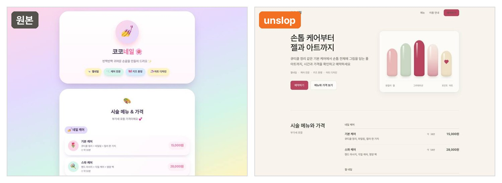
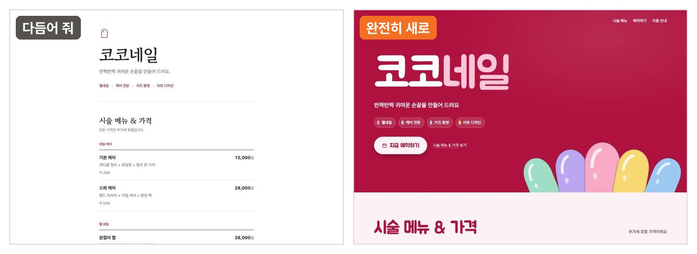
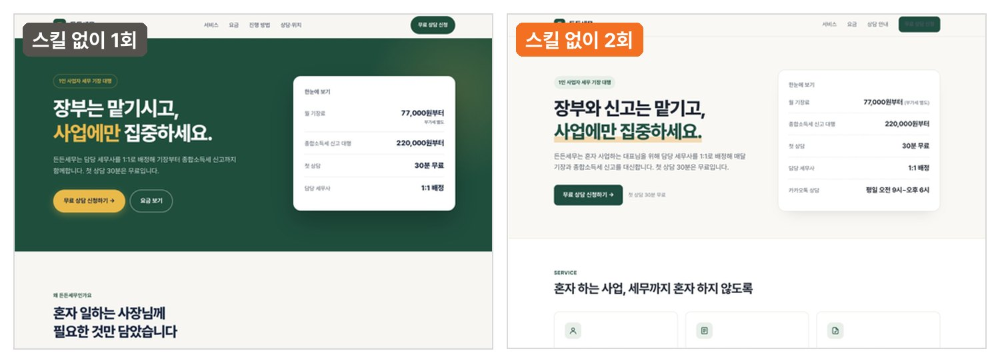
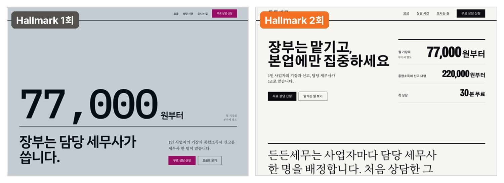
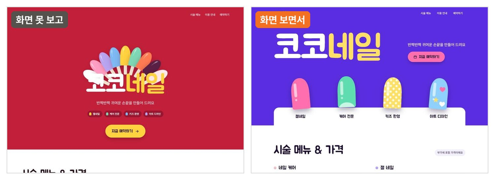

# 디자인 스킬 3개, 언제 뭘 쓸까: unslop · Impeccable · Hallmark

AI로 만든 웹페이지를 다듬거나 새로 만들 때 쓰는 Claude Code용 디자인 스킬 세 가지를, 언제 무엇을 쓰면 좋은지 정리했습니다. 스킬은 AI에게 넣어 주는 작업 설명서 묶음입니다. 연습용 가상 화면으로 103회 직접 테스트해 봤습니다.

## 결론부터

- **AI 티 나는 화면을 통째로 맡기려면 unslop.** 그 사이트에 맞는 그림까지 그려 넣습니다. 대신 문구와 숫자를 바꿀 때가 있어 확인이 필요합니다.
- **내용은 그대로 두고 얼마나 바꿀지 내가 정하려면 Impeccable.** "다듬어 줘"와 "완전히 새로 해 줘"에 따라 바뀌는 정도가 크게 다릅니다.
- **새 페이지를 만들려면 Hallmark.** 만들 때마다 다른 디자인이 나옵니다. 편차가 있으니 여러 번 뽑아 고르세요.
- **세 스킬 모두 무료입니다.** Claude Code 사용료는 따로 듭니다. 화면 하나에 2&#126;5분 걸렸습니다.

| 이런 상황 | 이 스킬 | 꼭 확인할 것 |
|---|---|---|
| AI 티 나는 화면을 통째로 맡길 때 | unslop | 문구와 숫자가 그대로인지 |
| 내용은 그대로 두고, 얼마나 바꿀지 내가 정할 때 | Impeccable | 크게 바꿀 땐 AI가 화면을 보게 하기, 사용 기록 전송 끄기 |
| 새 페이지를 만들 때 | Hallmark | 들어간 사진의 출처, 여러 번 뽑아 고르기 |
| 대시보드 고치기, 점검만 받기 | 스킬 없이도 됨 | 숫자가 바뀌지 않았는지 |

## 전과 후

모두 연습용으로 만든 가상 화면입니다.

**unslop: 파스텔 네일숍 화면.** 이모지를 걷어 내고 손톱 색 견본 그림을 새로 그려 넣었습니다.



**Impeccable: 같은 네일숍, 요청만 바꿈.** 왼쪽은 "다듬어 줘", 오른쪽은 "완전히 새로 해 줘"(AI가 화면을 보면서 만든 판)입니다.



**새 페이지: 스킬 없이와 Hallmark.** 같은 세무 대행 페이지를 두 번씩 만들었습니다. 스킬 없이 만든 두 개는 제목 문구와 배치가 거의 같고, Hallmark로 만든 두 개(사진 없이)는 서로 다릅니다.





## 1. unslop: AI 티 나는 화면을 통째로

보라색 그라데이션, 이모지, 느낌표 많은 문구 같은 AI 티를 찾아 지우고, 그 사이트에 맞는 그림을 그려 넣는 스킬입니다. 무료, CC BY 4.0.

**설치.** Claude Code를 열고 아래를 그대로 붙여 넣으세요. 설치를 AI가 대신 해 줍니다.

```
https://github.com/heydamir/unslop
이 저장소의 unslop 스킬을 Claude Code에서 쓸 수 있게 설치해 줘. 끝나면 어디에 무엇을 뒀는지 알려 줘.
```

<details>
<summary>터미널에서 직접 설치하려면</summary>

```bash
git clone https://github.com/heydamir/unslop
mkdir -p ~/.claude/skills && cp -r unslop/skills/unslop ~/.claude/skills/
```

한 프로젝트에서만 쓰려면 `~/.claude/skills/` 대신 그 프로젝트 안의 `.claude/skills/`에 복사합니다.

</details>

**요청문.** 고칠 화면이 있는 폴더에서 Claude Code를 열고 붙여 넣으세요.

```
/unslop this page. 물어보지 말고 그냥 끝까지 해 줘. 단, 글(문구·숫자·가격)은 그대로 두고 디자인만 바꿔 줘. 새 내용을 지어 넣거나 외부 글꼴을 불러오지는 마.
```

"글은 그대로" 한 줄이 핵심입니다. 이 줄을 붙여 다시 돌린 화면들에서는 글이 바뀌지 않았습니다.

**조심할 것**

- **문구와 숫자를 바꿀 때가 있습니다.** 이 한 줄 없이 맡긴 보라색 랜딩 페이지는 3번 모두 제목을 새로 쓰고, 원본에 없던 매출 숫자가 든 예시 화면을 그려 넣었습니다. 끝나면 원본과 대조하세요.
- **파일을 그 자리에서 고칩니다.** 시작 전에 폴더를 통째로 복사해 두세요.
- **남의 사이트 주소를 줄 때는 믿을 수 있는 곳만.** AI가 그 페이지의 글을 그대로 읽습니다.

## 2. Impeccable: 얼마나 바꿀지 내가 정할 때

요청에 따라 바꾸는 정도가 달라지는 디자인 도구 상자입니다. 명령이 24개 있고, 명령 하나는 한 가지 일을 합니다. 무료, Apache 2.0.

**설치.** README의 "Manual copy"(스킬 폴더만 복사) 방법을 권합니다. 공식 설치기(`npx impeccable install`)는 편집할 때마다 자동으로 도는 검사(훅)를 함께 권하는데, 이 훅은 Claude Code의 명령 승인 밖에서 돕니다. 스킬 폴더만 복사하면 훅이 생기지 않습니다.

```
https://github.com/pbakaus/impeccable
이 저장소를 임시 폴더에 내려받아서, README의 Manual copy 방법대로 .claude/skills/impeccable 폴더만 지금 프로젝트의 .claude/skills/ 에 복사해 줘. npx 설치기는 쓰지 말고 훅도 켜지 마. 그리고 이 프로젝트에 .impeccable/config.json 파일을 만들어 {"telemetry": false, "updateCheck": false} 를 넣어 줘. 끝나면 어디에 무엇을 뒀는지 알려 줘.
```

<details>
<summary>터미널에서 직접 설치하려면</summary>

저장소를 내려받은(clone) 폴더 안에서 README의 명령을 실행합니다. `your-project`는 내 프로젝트 폴더 경로로 바꿉니다.

```bash
mkdir -p your-project/.claude/skills && cp -r .claude/skills/impeccable your-project/.claude/skills/
```

사용 기록 전송을 끄려면 내 프로젝트 폴더에 `.impeccable/config.json`을 만들고 아래를 넣습니다.

```json
{"telemetry": false, "updateCheck": false}
```

</details>

**요청문: 강도별 셋.** `page.html` 자리에 내 파일 이름을 넣으세요. 결과를 `after.html`에 따로 저장하게 해서 원본이 남습니다.

다듬기: 지금 화면의 틀과 글을 지키며 정돈합니다. 우리 테스트에서 Impeccable은 이 요청에 스스로 `polish`(지키며 다듬기) 명령을 골랐습니다.

```
page.html은 AI로 만든 웹페이지야. AI가 만든 티가 안 나게 디자인을 다듬어서 after.html로 저장해 줘. page.html은 고치지 말고, 물어보지 말고 끝까지 해 줘. impeccable 스킬을 써서 해 줘.
```

완전히 새로: 내용은 그대로 두고 디자인을 과감하게 바꿉니다. 셋 중 가장 크게 바뀌니, AI가 결과 화면을 볼 수 있게 해 주세요(아래 "크게 바꿀 땐 AI가 화면을 볼 수 있게").

```
page.html은 AI로 만든 웹페이지야. 내용(글, 가격, 숫자)은 그대로 두고 디자인을 완전히 새로 해 줘. 결과는 after.html로 저장하고 page.html은 고치지 마. 물어보지 말고 끝까지 해 줘. impeccable 스킬을 써서 해 줘.
```

한 가지만: 명령 하나로 한 가지만 고칩니다.

```
impeccable 스킬의 quieter 명령을 page.html에 써 줘. 결과는 after.html로 저장하고 page.html은 고치지 마. 물어보지 말고 끝까지 해 줘.
```

`quieter` 자리에 아래 명령을 넣으면 됩니다. 우리가 써 보고 이름대로 동작한 다섯 개입니다.

| 명령 | 이럴 때 | 써 보니 |
|---|---|---|
| `quieter` | 화면이 너무 요란할 때 | 느낌표와 형광 강조를 빼고 색을 차분하게 |
| `clarify` | 문구가 과장되거나 모호할 때 | 날짜와 조건이 든 문구로 다시 씀(글이 바뀜) |
| `distill` | 군더더기가 많을 때 | 배지와 숫자 카드를 덜어 냄 |
| `colorize` | 회색뿐이라 밋밋할 때 | 표의 상태 칸에 색을 넣음 |
| `adapt` | 휴대폰에서 깨질 때 | 모바일에서 깨지던 표를 고침 |

명령마다 한 번씩만 써 봤습니다. `bolder`, `overdrive`, `delight`는 AI 티를 지우지는 않았습니다.

**조심할 것**

- **쓸 때마다 자기 프로그램을 실행합니다.** 약 19MB짜리 프로그램(엔진)을 실행하고, 없으면 처음 한 번 GitHub에서 내려받아 `~/.impeccable/bin/`에 둡니다. 내려받은 파일은 정해 둔 해시값과 맞을 때만 실행합니다.
- **기본으로 사용 기록을 보냅니다.** 업데이트 확인을 하고, 새 디자인을 만들 때는 어떤 디자인 방향을 보여 주고 골랐는지 익명 기록을 impeccable.style로 보냅니다. 위 설치 요청에서 `config.json`에 넣은 두 설정이 이것을 끕니다. 다만 새 디자인을 시작할 때 디자인 방향 목록을 받아 오는 요청은 꺼도 갑니다. 프로젝트 이름, 파일, 코드는 보내지 않는다고 README에 적혀 있습니다.
- **내려받은 저장소 폴더를 Claude Code로 열지 마세요.** 그 폴더에는 편집할 때마다 프로그램을 돌리는 훅 설정이 들어 있습니다.
- `live` 모드는 써 보지 않았습니다. README에 따르면 경우에 따라 다른 AI 도구를 권한 확인 없이 실행하니, 쓰기 전에 README의 Live mode 절을 읽으세요.

## 3. Hallmark: 새 페이지를 만들 때

테마 50개 가운데 요청에 맞는 것을 뽑아 페이지를 통째로 디자인하는 스킬입니다. 연달아 만들어도 겹치지 않게 설계돼 있습니다. 무료, MIT.

**설치.** README에 있는 Claude Code 플러그인 방법을 권합니다. Claude Code 입력창에 한 줄씩 넣으세요.

```
/plugin marketplace add nutlope/hallmark
```

```
/plugin install hallmark@hallmark
```

두 번째 줄을 넣으면 설치 범위를 묻습니다. 이 프로젝트에서만 쓰려면 "Install for you, in this repo only"를 고르세요. 이렇게 받은 플러그인은 기본으로 자동 업데이트되지 않습니다(Claude Code 공식 문서).

<details>
<summary>README가 맨 먼저 안내하는 명령은 무엇을 하나요</summary>

```
npx skills add nutlope/hallmark -g
```

- 저장소에 없는 별도 프로그램(`skills`, npm 패키지)을 그 자리에서 내려받아 실행합니다. 이 프로그램은 기본으로 익명 사용 통계를 보냅니다(`DISABLE_TELEMETRY=1` 또는 `DO_NOT_TRACK=1`로 끔).
- 버전을 고정하지 않고 그날의 최신판을 받습니다.
- `-g`를 붙이면 모든 프로젝트용으로 `~/.claude/skills/hallmark`와 공용 폴더 `~/.agents/skills/hallmark`에 씁니다. 공용 폴더는 Codex, Cursor, Gemini CLI 같은 다른 AI 도구도 같이 읽습니다. `-g`를 빼면 지금 프로젝트에만 설치합니다.
- 훅은 넣지 않습니다. Node 18 이상이 필요합니다.

</details>

**요청문.** 새 폴더에서 Claude Code를 열고, 가게 정보만 내 것으로 바꿔 붙여 넣으세요. 우리가 테스트에 쓴 요청입니다.

```
동네 필라테스 스튜디오 '숨결 필라테스'의 홈페이지 첫 화면을 index.html 한 파일로 만들어 줘. 넣을 내용: 소그룹 기구 필라테스(정원 4명), 첫 체험 수업 15,000원, 1개월 주 2회 180,000원, 3개월 주 2회 480,000원, 평일 오전 7시~오후 10시, 토요일 오전 9시~오후 3시, 일요일 휴무, 서울 마포구 달맞이길 12 2층, 체험 예약 버튼. 여기 없는 숫자나 후기는 지어내지 마. 물어보지 말고 끝까지 해 줘. hallmark 스킬을 써서 만들어 줘. 사진은 넣지 말고 만들어 줘.
```

> [!TIP]
> 마지막 "사진은 넣지 말고 만들어 줘"를 꼭 붙이세요. 사진을 주지 않으면 Hallmark는 위키미디어 공용(Wikimedia Commons)의 공개 사진을 대신 넣고 페이지 아래에 출처를 적는데, 대부분 출처 표시가 필요한 라이선스입니다. 내 사진이 있으면 파일 경로를 알려 주세요.

**여러 번 뽑아 고르기.** 결과의 폭이 큽니다. 새 폴더에서 같은 요청을 두세 번 돌려 마음에 드는 것을 고르세요.

**조심할 것**

- **사진.** 이 한 줄 없이 만든 새 페이지 5개에는 모두 위키미디어 사진이 들어갔고, 필라테스 3개에는 업종과 맞지 않는 빈집 사진이 들어갔습니다. 한 줄을 붙인 4회는 사진 없이 만들어졌습니다.
- **가끔 깨집니다.** 한 번은 첫 화면의 제목과 버튼이 배경에 묻혀 안 보였습니다. AI가 화면을 보면서 만들게 하면 크게 깨진 것이 없었습니다(아래).
- **이미 있는 화면에는 이름을 불러야 동작합니다.** 우리 테스트에서는 그때도 통째로 다시 디자인했고, 깔끔한 블로그를 고치게 했을 때 한 번은 글 목록이 사라졌습니다.
- **가장 오래 걸렸습니다.** 고치기 기준으로 다른 스킬의 2배쯤(4분 반 안팎)입니다.
- Together AI의 API 키(`TOGETHER_API_KEY`)를 설정해 둔 컴퓨터에서는 유료 이미지 생성 단계로 이어질 수 있습니다.

## 스킬 없이도 되는 것

- **대시보드 고치기.** 스킬 없이 "AI 티가 안 나게 다듬어 줘"라고만 해도 세 스킬과 결과가 비슷했습니다. 숫자가 든 화면은 고친 뒤 원본과 숫자를 대조하세요. 스킬 없이 고친 한 번은 차트 숫자가 바뀌었습니다.
- **점검만 받기.** 고치지 않고 문제만 받아 보려면 아래처럼 시키세요. 스킬 없이 받은 보고서가 짧은 실무 점검표라 비개발자에게 가장 쓸모 있다는 평가였습니다. 가장 꼼꼼한 것은 unslop의 보고서였습니다.

```
page.html은 AI로 만든 웹페이지야. 디자인에서 고쳐야 할 점을 찾아 우선순위를 매겨 정리해 줘. 고치지는 말고, 결과를 report.md로 저장해 줘. 물어보지 말고 끝까지 해 줘.
```

새 페이지는 반대입니다. 스킬 없이 만들면 서로 비슷한 흔한 서비스 소개 틀이 나왔습니다. 새로 만들 땐 셋 중 무엇이든 쓰는 편이 낫습니다.

## 크게 바꿀 땐 AI가 화면을 볼 수 있게

같은 네일숍 화면에 "내용은 그대로 두고 디자인을 완전히 새로 해 줘"를 시켰습니다. AI가 결과 화면을 못 보고 만든 2회는 Impeccable이 그린 손톱 그림이 로고를 가렸고, 화면을 보면서 만든 2회는 가림이 없었습니다. Hallmark도 화면을 못 볼 때는 첫 화면 가운데가 비거나 낱말이 중간에서 끊겼고, 볼 때는 크게 깨진 것이 없었습니다. 과제 하나에 조건마다 2회라 경향으로만 봐 주세요.



Claude Code에서 AI가 화면을 보게 하는 방법은 세 가지입니다(Claude Code 공식 문서 기준). 우리 테스트에서는 스크린샷을 찍어 주는 명령을 따로 붙여 두고 "화면은 이 명령으로 볼 수 있어"라고만 알렸는데, 시키지 않아도 스스로 화면을 찍어 봤습니다. 아래 2, 3번 기능으로는 테스트하지 않았습니다.

1. **누구나: 스크린샷을 붙여 주기.** 결과 화면을 캡처해서 Claude Code 창에 끌어다 놓거나, 복사해서 `Ctrl+V`로 붙여 넣으세요(Windows는 `Alt+V`). 이미지 파일 경로를 알려 줘도 됩니다. 그리고 "이 화면에서 글자가 가려지거나 깨진 곳을 찾아 고쳐 줘"라고 하면 됩니다.
2. **Claude Code 데스크톱 앱: 브라우저 창.** 앱 안의 브라우저 창(Browser pane)에서 Claude가 결과를 띄워 확인합니다. 고친 뒤 스스로 스크린샷을 찍어 확인하는 기능(Auto-verify)이 기본으로 켜져 있습니다. 채팅에 나온 HTML 파일 경로를 눌러 직접 열어 볼 수도 있습니다.
3. **터미널: Chrome 연결.** Chrome(또는 Edge)에 "Claude in Chrome" 확장 프로그램을 설치하고 `claude --chrome`으로 시작합니다. 연결 상태는 `/chrome`으로 확인합니다. Anthropic에 직접 결제한 요금제(Pro, Max, Ultra, Team, Enterprise)로 `/login` 해야 합니다. 내 브라우저의 로그인 상태를 같이 쓰므로, Claude가 내가 로그인한 사이트에 들어갈 수 있다는 점을 알아 두세요.

2, 3번을 쓸 때는 요청 끝에 이렇게 붙이면 됩니다.

```
다 만들면 화면을 직접 띄워 보고, 글자가 그림에 가려지거나 비어 보이는 곳이 있으면 고쳐 줘.
```

---

여기까지만 읽어도 쓸 수 있습니다. 아래는 더 궁금한 분을 위한 내용입니다.

## 써 보니 이랬습니다

점수보다 반복해서 보인 특성으로 정리했습니다.

| | 반복해서 보인 특성 | 아쉬웠던 점 |
|---|---|---|
| unslop | 그 사이트에 맞는 그림을 그려 넣음(네일숍 7회 모두 손톱 그림, 필라테스 3회 모두 기구 그림). 무엇을 시켜도 결과가 비슷함 | 문구를 고쳐 쓰고 없던 숫자를 넣을 때가 있음 |
| Impeccable | "다듬어 줘"면 원래 틀과 글을 지킴. "완전히 새로"면 셋 중 가장 과감함. 명령 하나는 한 가지만 함 | 다듬기 결과는 단정하지만 개성은 덜함. 크게 바꿀 때 화면을 못 보면 그림이 글자를 가림 |
| Hallmark | 늘 통째로 다시 디자인하고, 매번 방향이 다름 | 결과 폭이 큼. 사진을 기본으로 넣음. 가장 오래 걸림 |
| 스킬 없이 | 기존 화면 고치기는 무난함 | 새로 만들면 서로 비슷한 흔한 틀. 고칠 때 소개 문구를 새로 씀 |

- Impeccable의 다듬기 결과는 "원본보다 나아졌나"를 물은 평가 24건 중 23건에서 "낫다"였습니다.
- Impeccable과 Hallmark는 원래 글을 거의 그대로 뒀습니다. 고쳐 쓰거나 지운 글줄이 unslop과 스킬 없이 고친 경우의 3분의 1쯤이었습니다.

## 시험 조건과 한계

- Claude Code(Opus 모델)로 103회 직접 테스트했습니다. 과제마다 1&#126;3회씩입니다.
- 화면은 모두 연습용 가상 화면입니다. 네일숍, 보라색 랜딩, 대시보드, 블로그, 재고 표, 강의 랜딩을 고치고, 필라테스와 세무 대행 페이지를 새로 만들었습니다.
- 결과는 스킬 이름을 가리고 섞은 뒤 AI 평가자가 화면 그림만 보고 채점했습니다. 사람이 보면 다를 수 있습니다.
- 103회 중 91회는 AI가 작업 중에 화면을 볼 수 없는 조건이었습니다.
- 스킬 폴더만 넣고 돌렸습니다. Impeccable은 사용 기록 전송과 외부 서버 요청을 막았고, Hallmark는 설치기, 훅, 화면 캡처, 유료 이미지 생성 스크립트를 뺐습니다. 실제로 쓸 때와 결과가 다를 수 있습니다.
- 다른 모델이나 다른 AI 도구에서는 재 보지 않았습니다.

## 자주 묻는 것

- **무료인가요?** 세 스킬 모두 무료입니다. Claude Code 사용료는 따로 듭니다.
- **셋 다 깔아도 되나요?** 세 스킬 모두 "디자인해 줘" 같은 일반 요청에도 나서도록 설명이 적혀 있어, 같이 깔면 어느 것이 나설지 알 수 없습니다. 우리는 한 번에 하나만 넣고 요청에 스킬 이름을 넣어 테스트했습니다. 요청문에 스킬 이름을 꼭 넣으세요.
- **Claude Code에서만 되나요?** 만든 사람 설명으로는 unslop은 Codex와 Google Antigravity, Impeccable은 Cursor와 Codex 등 여러 도구, Hallmark는 Codex와 Cursor, OpenCode에서도 됩니다. 우리는 Claude Code로만 써 봤습니다.
- **PPT나 이미지도 되나요?** 아니요. 웹페이지와 앱 화면(코드로 된 화면)용입니다.
- **결과가 마음에 안 들면요?** 위 요청문처럼 결과를 `after.html`에 따로 저장했다면 원본은 그대로입니다. Hallmark는 같은 요청을 다시 돌려 다른 안을 받아 보세요.

## 확인 정보

- unslop: [heydamir/unslop](https://github.com/heydamir/unslop) · 만든 사람 Damir Sokolovsky(@heydamir) · CC BY 4.0(쓰거나 고쳐서 나눌 때 만든 사람과 저장소 링크를 표기해야 함) · GitHub 별 약 1.6만(2026-11-15 확인)
- Impeccable: [pbakaus/impeccable](https://github.com/pbakaus/impeccable) · 만든 사람 Paul Bakaus · Apache 2.0 · GitHub 별 약 11만(2026-11-15 확인)
- Hallmark: [Nutlope/hallmark](https://github.com/Nutlope/hallmark) · README 표기 "Made by Together AI" · MIT · GitHub 별 약 5.5만(2026-11-15 확인). 사진 라이브러리의 사진은 각 사진의 라이선스를 따릅니다.
- 스킬 파일을 살펴본 날짜: unslop 2026-11-11, Impeccable과 Hallmark 2026-11-14. 세 저장소의 README는 2026-11-15에 다시 확인했습니다.
- AI가 화면을 보게 하는 방법과 플러그인 설치 범위: Claude Code 공식 문서 [이미지 다루기](https://code.claude.com/docs/en/common-workflows), [Chrome 연결](https://code.claude.com/docs/en/chrome), [데스크톱 앱](https://code.claude.com/docs/en/desktop), [플러그인 설치](https://code.claude.com/docs/en/discover-plugins) (2026-11-15 확인)
- 이 문서의 결과는 Claude Code(Opus)로 가상 화면에 103회 직접 테스트한 것입니다. 화면과 모델이 다르면 결과도 달라질 수 있습니다.

## 더 보기

더 많은 AI 자동화 노하우는 유튜브 **시민개발자 구씨** 채널에서 다룹니다. 구독과 알림 설정을 해 두시면 새 가이드를 바로 받아 보실 수 있습니다.
