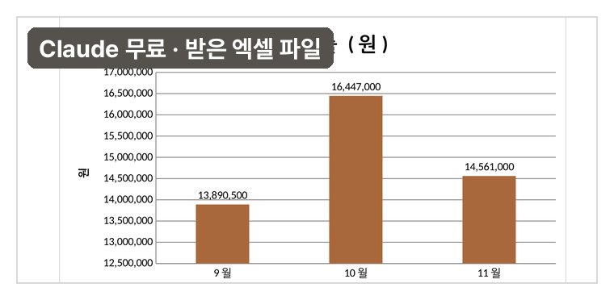
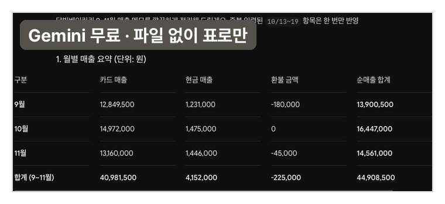

# 무료 AI 3대장, 일마다 뭘 맡길까: ChatGPT · Gemini · Claude

ChatGPT, Gemini, Claude를 돈 내지 않는 무료 계정 그대로 써서, 가게 일에서 자주 나오는 일 네 가지를 일마다 두 번 이상씩 똑같이 시켜 봤습니다. 여기엔 그대로 복사해 쓰는 요청문 네 개와, 틀린 답을 막아 준 한 줄을 담았습니다.

쇼츠: https://www.youtube.com/shorts/eAyPdnkvAGk

## 결론부터

- **그림은 ChatGPT나 Gemini, 나머지는 Claude.** 종합 1등은 Claude였습니다. ChatGPT만큼 정확했고 더 빨랐습니다.
- **사진을 표로 옮기기, 긴 계약서에서 조건 찾기는 셋 다 정확했습니다.** 흐린 사진에서도 틀린 숫자가 없었습니다.
- **차이는 새로 만드는 일에서 났습니다.** 포스터는 ChatGPT와 Gemini가 한글까지 정확했고, 차트가 든 엑셀 파일은 Claude와 ChatGPT만 줬습니다.
- **조심할 것은 합계입니다.** Gemini는 매출 합계를 두 번 다 틀렸는데, 요청 끝에 한 줄(아래 4번)을 붙이자 두 번 다 맞았습니다.
- **비용은 0원, 답 하나에 길어야 2분쯤 걸렸습니다.** 다만 무료는 사용량 한도가 서비스마다 다릅니다(아래 표).

| 이런 일 | 맡길 AI | 꼭 확인할 것 |
|---|---|---|
| 영수증·명세서 사진을 표로 | 셋 다 됨 (Claude가 가장 빠름) | 합계 숫자부터 맞춰 보기 |
| 긴 계약서에서 조건 찾기 | 셋 다 됨 (Claude가 가장 빠름) | 답에 적힌 쪽수를 열어 보기 |
| 홍보 포스터 그림 | ChatGPT 또는 Gemini | 안 시킨 글자가 들어가지 않았는지 |
| 메모를 정리해 엑셀 파일로 | Claude 또는 ChatGPT | 엑셀로 열어 월 합계 다시 보기 |

Claude 한도가 차면 ChatGPT로 넘어가면 됩니다. ChatGPT 무료는 파일 올리기가 하루 3개입니다.

## 결과 그림

**포스터: ChatGPT와 Gemini.** 같은 요청으로 만든 포스터입니다. 가게 이름과 문구 세 줄이 둘 다 글자까지 정확합니다.


**엑셀 파일: Claude가 준 파일.** 월 합계 세 개가 정답과 같고 막대 차트가 들어 있습니다.



## 시작하기

설치할 것은 없습니다. 아래 세 곳에 무료 계정으로 로그인하면 됩니다.

- ChatGPT: [chatgpt.com](https://chatgpt.com)
- Gemini: [gemini.google.com](https://gemini.google.com)
- Claude: [claude.ai](https://claude.ai)

우리는 세 곳 모두 메모리(지난 대화 기억)와 맞춤 지시를 끄고, 매번 새 대화에서 시험했습니다.

## 쓰기: 요청문 4개

새 대화를 열고 붙여 넣으세요. 대괄호 [ ] 부분만 내 것으로 바꾸면 됩니다.

**1. 사진 → 엑셀 표.** 영수증·명세서 사진을 함께 올리고 붙여 넣으세요.

```
이 사진을 엑셀에 붙여 넣을 수 있는 표로 옮겨 줘. 열은 [품목, 수량, 단가, 금액]으로.
```

- 맡길 AI: 셋 다 됩니다. 빨리 받으려면 Claude.
- 확인 요령: 표의 합계 숫자부터 사진 속 합계와 맞춰 보세요. Gemini는 합계 줄을 빼고 줬으니, 없으면 합계도 넣어 달라고 하세요.

**2. 가게 포스터.**

```
우리 가게 홍보 포스터를 세로로 만들어 줘. 가게 이름은 '[가게 이름]'. 들어갈 문구는 딱 이 세 줄이야: [첫째 줄] / [둘째 줄] / [셋째 줄]. [따뜻한 겨울] 느낌으로. 가게 이름과 이 세 줄 말고 다른 글자(영어 포함)는 넣지 마.
```

- 맡길 AI: ChatGPT나 Gemini. Claude 무료는 그림을 그리지 않고 PDF·HTML 디자인 파일로 대신 줍니다.
- 확인 요령: 포스터 글자를 요청문과 한 줄씩 대조하고, 안 시킨 글자(영어 가게 이름 등)가 들어갔는지 보세요.

> [!TIP]
> 마지막 문장(다른 글자는 넣지 마)은 Gemini가 영어 가게 이름을 덧붙였을 때 붙여 본 한 줄입니다. 붙인 뒤에는 덧붙인 글자가 없었습니다(한 번 시험).

**3. 긴 계약서에서 조건 찾기.** 계약서 PDF를 올리고 붙여 넣으세요. 질문은 내 계약서에 맞게 바꾸세요.

```
첨부한 계약서를 읽고 아래 질문에 답해 줘. 답마다 근거가 된 조항과 쪽수를 같이 적어 줘.
1) 이 계약은 언제부터 언제까지인가요?
2) 물건값은 납품하고 며칠 안에 받나요?
3) 물건이 늦게 오면, 하루에 얼마를 지체상금으로 받나요?
4) 계약을 중간에 끝내려면 상대에게 며칠 전에 알려야 하나요?
5) [하자가 있으면 언제까지 책임지나요?]
```

- 맡길 AI: 셋 다 됩니다. 빨리 받으려면 Claude.
- 확인 요령: 답에 적힌 쪽수를 직접 열어 보세요. 계약서 끝의 부칙·특약이 앞 조항의 숫자를 바꾸는 경우가 있습니다.

**4. 매출 메모 → 엑셀 파일.** 메모는 내 것을 그대로 붙이세요.

```
아래는 우리 가게 [기간] 매출 메모야. 월별 매출 합계를 정리하고, 월별 막대 차트가 들어간 엑셀 파일로 만들어 줘.

[여기에 메모를 그대로 붙여 넣기]

먼저 메모를 한 줄씩 원 단위 숫자로 바꾼 표를 보여 주고(같은 줄이 두 번 적힌 건 한 번만, 환불은 빼기), 그 표로 월별 합계를 다시 계산해서 맞는지 확인해 줘.
```

- 맡길 AI: Claude나 ChatGPT. 이번 시험에서 엑셀 파일을 받은 곳은 이 둘뿐이었습니다.
- 확인 요령: 받은 파일을 엑셀로 열어 월 합계를 다시 보세요. ChatGPT 파일은 계산식만 들어 있어서 미리보기에서는 빈 곳으로 보일 수 있습니다.

> [!TIP]
> 마지막 문장이 핵심입니다. 이 문장 없이 시킨 Gemini는 두 번 다 월 합계를 틀렸고, 붙이자 두 번 다 맞았습니다. 내 메모에 뺄 줄이 다르면 괄호 안을 바꿔 적으세요.

## 무료로 쓰면: 모델과 사용량

2026년 11월 각 서비스 공식 안내 기준입니다. 한도와 모델은 자주 바뀝니다.

| | ChatGPT 무료 | Claude 무료 | Gemini 무료 |
|---|---|---|---|
| 모델 | GPT-6 Luna (화면엔 모델 이름이 안 뜸, 공식 가격표 기준) | Sonnet 5.5 (화면에 표시됨) | 자동 선택(Auto, 질문마다 고름). 대부분 Flash-Lite |
| 일 맡기기 모드 | Work는 데스크톱 앱에서만 조금 됨 (웹·휴대폰은 Plus부터) | Cowork는 유료 전용 | Task 모드(홈 화면 위쪽에서 Chat → Task로 전환)는 Gemini 4 Hydrogen. 하루 몇 번인지는 공개 안 함 |
| 글 대화 | 일상 대화 무제한 | 5시간마다 초기화 + 주간 한도 | 5시간마다 초기화 + 주간 한도 |
| 파일 올리기 | 하루 3개 | 대화 하나에 20개까지 | 메시지 하나에 10개까지 |
| 그림 만들기 | 됨 (따로 한도) | 안 됨 (디자인 파일로 대신) | 됨 |
| 엑셀 파일 만들기 | 됨 | 됨 | 공식으로는 됨 (이번 시험에선 못 받음) |

Claude와 Gemini는 한도를 메시지 몇 개로 정해 두지 않고, 긴 대화나 큰 파일일수록 빨리 줄어듭니다. 한도가 차면 화면에 나온 시각까지 기다려야 합니다.

---

여기까지만 읽어도 됩니다.

## 써 보니 이랬습니다

일마다 1·2·3등에 3·2·1점을 주고, 정확도가 같으면 빨리 끝낸 쪽을 앞에 뒀습니다(시험 전에 정한 규칙).

| | 사진 → 표 | 포스터 | 계약서 | 엑셀 파일 | 합계 |
|---|---|---|---|---|---|
| **Claude** | 3 | 1 | 3 | 3 | **10** |
| ChatGPT | 1 | 3 | 1 | 2 | 7 |
| Gemini | 2 | 2 | 2 | 1 | 7 |

- **Claude:** 채점한 답에서 틀린 숫자·글자가 없었고, 사진 → 표와 계약서는 10초 안팎에 끝났습니다. 엑셀 파일을 줄 때 메모 속 이상한 날짜까지 짚어 줬습니다. 그림은 못 그립니다.
- **ChatGPT:** 네 가지 일을 모두 해냈고 포스터 글자도 정확했습니다. 대신 세 가지 일에서 가장 느렸습니다(흐린 사진 → 표 56초, Claude는 10초).
- **Gemini:** 포스터를 6&#126;9초 만에 그려 가장 빨랐고, 사진 → 표와 계약서도 정확했습니다. 엑셀 파일은 받지 못했고 월 합계를 두 번 다 틀렸습니다.

정확도만 보면 ChatGPT와 Claude는 비슷했습니다. 1등은 속도에서 갈렸습니다.

## 한 줄을 붙이면 달라진 것

요청문 4번 끝의 확인 문장 없이 두 번 시키면 Gemini는 두 번 다 파일을 주지 않았고, 월 합계도 두 번 다 틀렸습니다. 1번째는 세 달 모두, 2번째는 9월이 1만 원 틀렸습니다(9월 정답 13,890,500원). 같은 요청에 확인 문장을 붙이자 두 번 다 세 달 합계가 맞았습니다. 파일은 그때도 주지 않았습니다.



## 쓰기 전에 알아 둘 것

- **실제 서류를 올리기 전에 설정부터.** 거래처 서류나 계약서를 올릴 때는 각 서비스의 대화 기록·학습 설정을 먼저 확인하세요. 세 곳 모두 기록을 남기지 않는 대화 방식(임시 채팅·시크릿 모드)이 있습니다.
- **합계만이라도 직접 맞춰 보기.** 이번엔 셋 다 사진 속 숫자를 정확히 옮겼지만, 합계를 맞춰 보는 데는 10초면 됩니다.
- **빈 답이 오면 새 대화에서 다시.** ChatGPT는 첫날 계약서 PDF에 두 번 빈 답을 줬고, 다시 하니 세 번 모두 정답이었습니다.

## 자주 묻는 것

**Gemini는 엑셀 파일을 못 만드나요?**
공식 안내로는 엑셀 파일 만들기를 지원합니다. 이번 시험 두 번에서는 받지 못했습니다. 파일이 꼭 필요하면 Claude나 ChatGPT가 확실했습니다.

**Claude 한도가 차면 어떻게 하나요?**
화면에 나온 시각까지 기다리거나 ChatGPT로 넘어가세요. 이번 시험에서 ChatGPT도 정확도는 같았고 엑셀 파일도 줬습니다. 다만 ChatGPT 무료도 파일 올리기는 하루 3개입니다.

**사진이 흐려도 되나요?**
기울고 흐리고 합계 위에 도장이 찍힌 사진으로도 셋 다 틀린 숫자가 없었습니다. 그래도 사람 눈에 글자가 안 읽힐 만큼 흐리면 다시 찍는 게 낫습니다.

## 무료로 부족해지면: 구독은 이 순서로

답이 아쉽거나 한도에 자주 걸리기 시작하면, 막힌 곳 하나만 먼저 구독하세요. 2026년 11월 22일 한국 공식 가격표 기준입니다.

| 순서 | 이럴 때 | 구독 | 월 가격 | 무료와 달라지는 것 |
|---|---|---|---|---|
| 1 | Claude에 맡기던 일이 한도에 자주 막힐 때 | **Claude Pro** | 웹 결제 $22 (부가세 포함, 원화로 3만 원대) · iPhone 앱 결제 33,000원 | 5시간마다 쓸 수 있는 양이 무료의 5배 이상, 더 좋은 모델 Opus 5.5, 일을 맡기고 예약까지 |
| 2 | 그림까지 한 곳에서 다 하고 싶을 때 | **ChatGPT Plus** | 29,000원 | 모델이 GPT-6 Sol로 올라가고, 그림·파일 올리기 한도가 늘고, 웹·휴대폰에서 Work를 씀 |
| 3 | Gmail·Drive를 같이 쓰고 저장공간도 필요할 때 | **Google AI Plus** | 7,500원 (저장공간 400GB) | 사용량이 무료의 2배, Hydrogen을 직접 고름, Gmail 안에서 Gemini |

- **왜 Claude가 먼저인가.** 위 표대로 "나머지는 Claude"로 쓰면 가장 많은 일이 Claude로 가서, 한도에도 Claude가 먼저 닿습니다. Claude는 유료여도 그림을 그리지 않으니, 포스터는 계속 ChatGPT나 Gemini 무료로 맡기면 됩니다.
- **그림이나 파일 올리기 한도만 걸린다면** ChatGPT Go(13,000원)로 충분합니다. 대화 모델은 무료와 같은 GPT-6 Luna이고, 그림·파일·분석 한도만 늘어납니다.
- **이미 하나를 구독 중이라면** 구독은 하나로 두고, 그 AI가 못 하는 일만 다른 두 곳 무료로 맡기세요.
- 월 10만 원이 넘는 상위 요금제(Claude Max, ChatGPT Pro, Google AI Ultra)는 매일 일을 맡기다 위 구독의 한도가 매주 막힐 때 봅니다.

## 확인 정보

- 시험: 2026년 11월 18일·20일, 각 서비스 웹의 무료 계정, 같은 요청문, 일마다 두 번(ChatGPT 계약서는 첫날 빈 답 두 번 뒤 세 번 더). 자료는 모두 직접 만든 가상 자료(거래명세서 사진 두 장, 18쪽 계약서, 석 달 매출 메모)입니다.
- 시험 때 화면에 보인 모델: ChatGPT는 'Free'만 표시, Claude는 'Sonnet 5.5', Gemini는 'Auto'.
- 무료 조건 원문: [ChatGPT 요금제](https://chatgpt.com/pricing/) · [ChatGPT 무료 안내](https://help.openai.com/en/articles/9275245-chatgpt-free-tier-faq) · [ChatGPT 파일 올리기](https://help.openai.com/en/articles/8555545-uploading-files-and-audio-to-chatgpt) · [Claude 요금제](https://claude.com/pricing) · [Claude 파일 올리기](https://support.claude.com/en/articles/8241126-upload-files-to-claude) · [Claude 파일 만들기](https://support.claude.com/en/articles/12111783-create-and-edit-files-with-claude) · [Claude 이미지 안내](https://support.claude.com/en/articles/9002504-can-claude-produce-images) · [Gemini 사용량 한도](https://support.google.com/gemini/answer/16275805?hl=ko) · [Gemini 모델 안내](https://support.google.com/gemini/answer/18648722?co=GENIE.Platform%3DDesktop&hl=ko) · [Gemini 파일 올리기](https://support.google.com/gemini/answer/14903178?hl=en) (2026년 11월 21일 확인)
- 유료 요금제 원문: [ChatGPT 한국 요금제](https://chatgpt.com/ko-KR/pricing/) · [ChatGPT Go 안내](https://help.openai.com/en/articles/11989085-what-is-chatgpt-go) · [Claude 요금제](https://claude.com/ko/pricing) · [Google AI 요금제(한국)](https://gemini.google/kr/subscriptions/?hl=ko) · [Google One 요금제](https://one.google.com/about/plans?hl=ko&gl=KR) (2026년 11월 22일 확인)

## 더 보기

이런 비교와 따라 하는 요청문을 쇼츠로 계속 올립니다. 채널을 구독하고 알림을 켜 두세요.
