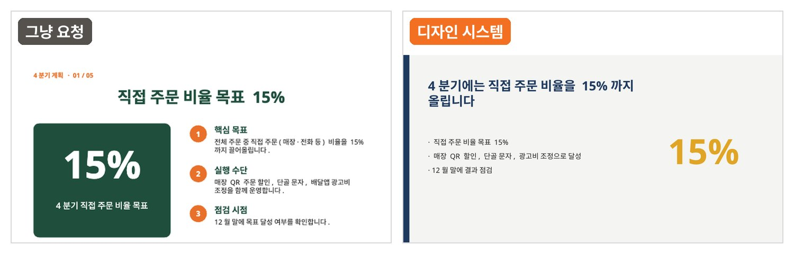
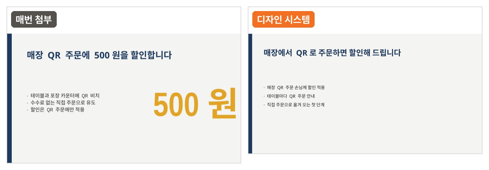
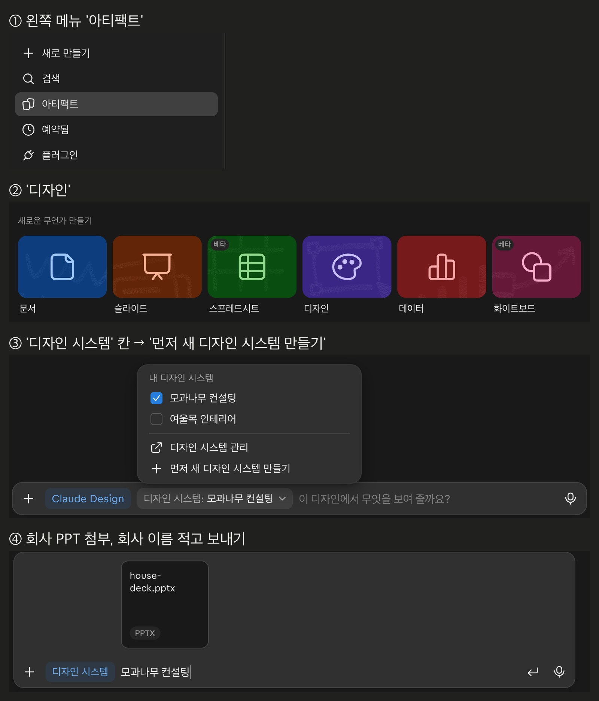

# AI PPT를 처음부터 회사 양식으로: Claude 디자인 시스템 쓰는 법

회사에서 쓰던 PPT 파일을 Claude의 '디자인 시스템'에 한 번 올려 두면, 다음부터는 디자인 시스템 칸에서 회사 이름만 고르고 평소처럼 시켜도 회사 양식으로 슬라이드가 나옵니다. 만드는 법, 쓰는 법, 고치는 곳, 다른 방법과 견준 결과를 담았습니다.

## 결론부터

- **회사 양식을 자주 쓴다면 효과가 큽니다.** 회사 디자인 규칙 10개 중 그냥 시키면 한두 개만 지켰는데, 디자인 시스템을 고르면 거의 다 지켰습니다(가상 회사 둘, 네 번).
- **한두 번만 쓸 거면** 회사 PPT를 첨부하는 것으로도 됩니다. 다만 아래 한 줄을 꼭 붙이세요. 안 붙이면 예전 자료의 숫자가 섞였습니다.
- **조심할 것은 글꼴과 로고입니다.** 회사 글꼴이 없는 PC에서는 다른 글꼴로 바뀌고, 로고는 그림 파일을 따로 올려야 들어갑니다.
- **비용:** 유료 요금제(Pro부터)에서 쓰는 베타 기능입니다. 처음 한 번 만들어 두면 다음부터는 고르기만 하면 됩니다.

## 전과 후

**같은 요청, 같은 내용.** 왼쪽은 그냥 시킨 것, 오른쪽은 디자인 시스템을 고르고 시킨 것입니다. 오른쪽은 올린 회사 PPT처럼 회색 바탕, 왼쪽 남색 띠, 겨자색 큰 숫자 하나로 나왔습니다.



**요청에 없던 숫자.** 할인 금액을 알려 주지 않고 'QR 주문 할인' 장을 만들게 했습니다. 회사 PPT를 첨부한 쪽은 그 파일에 있던 '500원'을 그대로 가져왔고, 디자인 시스템 쪽은 숫자 자리를 비워 두고 "할인율을 말씀해 주지 않으셔서 큰 숫자를 비워 두었습니다"라고 알려 줬습니다.



## 만들기 (처음 한 번)

설치할 것은 없습니다. [claude.ai](https://claude.ai)에서 합니다.

1. 왼쪽 메뉴에서 **아티팩트**를 누릅니다.
2. '새로운 무언가 만들기'에서 **디자인**을 누릅니다. 입력창에 **디자인 시스템** 칸이 생깁니다.
3. **디자인 시스템** 칸을 눌러 목록 맨 아래 **먼저 새 디자인 시스템 만들기**를 고릅니다. 이 줄은 Claude Code 화면의 목록에 있습니다(아래 TIP).
4. 입력창 왼쪽 **+** 로 회사 PPT 파일을 첨부하고, 입력창에 회사 이름을 적어 보냅니다. 우리는 3장짜리 PPT 파일 하나를 그대로 올리고 '모과나무 컨설팅'이라고만 적었습니다. 적은 이름이 나중에 목록에 뜹니다.



> [!TIP]
> 일반 대화 화면에서는 입력창 **+** 메뉴에도 '디자인 시스템'이 있습니다. 하지만 Claude Code 화면의 **+** 에는 없습니다. **아티팩트 → 디자인**으로 들어가면 Claude Code 화면과 일반 대화 화면 둘 다 디자인 시스템 칸이 나옵니다. 새로 만들기는 Claude Code 화면에서 해 봤습니다. 일반 대화 화면의 칸 목록에는 **먼저 새 디자인 시스템 만들기** 줄이 없고 **디자인 시스템 관리**로 끝났습니다.

다 만들면 Claude가 올린 PPT에서 뽑은 것을 정리한 페이지를 보여 줍니다. 우리 시험에서는 색 네 가지(색 코드까지), 글자 크기 단계, 간격, 슬라이드 모양(결론 제목, 글머리 셋, 큰 숫자 하나), 글 쓰는 규칙까지 나왔습니다. 로고 그림이 없으면 글자로 적었다는 것, 글꼴이 없는 PC에서는 바뀐다는 것도 먼저 알려 줬습니다.

## 쓰기

**1. 추천: 디자인 시스템을 고르고 평소처럼.** **아티팩트** → **디자인**에서 입력창의 **디자인 시스템** 칸을 눌러 회사 이름을 고릅니다. 칸에 '디자인 시스템: 회사 이름'이 보이면 된 것입니다. 파일은 첨부하지 않습니다.

```
[4분기 계획 보고서]를 파워포인트 파일 [다섯] 장으로 만들어 줘. 내용은 1) [첫째 내용] 2) [둘째 내용] 3) [셋째 내용] 4) [넷째 내용] 5) [다섯째 내용]
```

- 언제: 회사 양식으로 자주 만들 때. 우리는 이 요청에 덧붙이는 말 없이 일곱 번 시켰고, 일곱 번 다 지어낸 숫자나 예전 자료의 숫자가 없었습니다.
- 슬라이드가 화면(캔버스)에만 나오고 PPT 파일이 안 붙어 있으면 "파워포인트 파일로도 만들어 줘."라고 한 번 더 말하세요. 아티팩트 → 디자인으로 시킨 세 번 중 한 번은 이렇게 한 번 더 말해야 파일을 줬습니다.
- 확인 요령: Claude의 답을 끝까지 읽으세요. 요청에 없어서 비워 둔 숫자나 "별도 확정"으로 남긴 곳을 답에 밝혀 줍니다. 그 부분만 채우면 됩니다.

**2. 디자인 시스템 없이: 회사 PPT를 첨부하고 한 줄 더.** 회사 PPT 파일을 첨부하고, 위 요청과 함께 보냅니다.

```
첨부한 우리 회사 슬라이드와 같은 디자인으로 만들어 줘. 회사 이름과 디자인은 그대로 두고, 내용과 숫자는 내가 준 것만 써.
```

- 언제: 디자인 시스템을 아직 안 만들었거나, 한두 번만 쓸 때. 우리는 같은 PPT를 PDF로 저장해 첨부했습니다.

> [!WARNING]
> 뒤 문장(회사 이름과 디자인은 그대로 두고…) 없이 첨부만 하면, 두 번 다 첨부한 자료의 숫자(6%, 23%, 52%, 500원)가 새 보고서에 섞였습니다. 붙이자 두 번 다 섞이지 않았고 회사 이름도 남았습니다. "디자인만 따르고 내용·숫자는 쓰지 마"라고 하면 회사 이름까지 빠진 적이 있습니다(한 번).

---

여기까지만 읽어도 됩니다.

## 써 보니 이랬습니다

같은 보고서 내용을 네 가지 방법으로 시켜 봤습니다.

| 방법 | 매번 할 일 | 회사 디자인 | 걸리는 것 |
|---|---|---|---|
| 그냥 요청 | 없음 | 규칙 10개 중 한두 개 | 깔끔하지만 회사 양식이 아님 |
| 디자인 가이드 문서(MD) 붙이기 | 슬라이드에서 규칙 문서를 뽑아 두고 매번 붙여 넣기 | 다 지킴 | 주지 않은 숫자를 지어냄(두 번 다) |
| 회사 PPT 매번 첨부 | 파일 첨부 | 다 지킴 | 첨부한 자료의 숫자가 섞임(두 번 다). 한 줄 붙이면 막힘 |
| **디자인 시스템** | 처음 한 번 등록, 다음부터 고르기 | 거의 다 | 섞인 숫자·지어낸 숫자 없음(네 번). 유료 베타 |

- **좋았던 점:** 정한 적 없는 내용은 비워 두거나 각주에 "별도 확정"이라고 적었습니다. 받은 것은 네 번 다 PPT 파일이었고, 글자는 고칠 수 있는 글 상자였습니다.
- **좋았던 점:** 디자인이 정반대인 두 회사(회색·남색 / 흰 바탕·녹색·산호색)에서 결과가 비슷했습니다.
- **아쉬운 점:** 내용에 따라 숫자 카드 수가 바뀌는 등, 장마다 한두 가지가 회사 PPT와 달랐습니다.
- **아쉬운 점:** 로고는 그림 파일을 따로 올리지 않으면 글자로만 들어갑니다.

## 디자인 가이드 문서 방식과 다른 점

슬라이드에서 디자인 규칙을 글로 뽑아 문서(MD)로 붙여 넣는 방법도 많이 씁니다. 디자인은 잘 따라 했지만, "글머리에 수치를 넣는다" 같은 규칙을 지키려고 주지 않은 숫자를 만들어 넣었습니다('수수료 0원', 'QR 할인 10%'). 디자인 시스템은 같은 자리에서 숫자를 비워 두고 알려 달라고 했습니다. 매번 문서를 붙여 넣을 필요도 없습니다.

## 써 본 사람들은 뭐라고 하나

- 유명 브랜드의 디자인 가이드를 내려받아 AI에 붙이는 방법이 알려져 있습니다. 이 가이드는 남의 브랜드가 아니라 내 회사 PPT에서 시작합니다.
- 그 방법을 따라 해도 잘 안 만들어진다는 반응도 있습니다.

## 고치기와 관리

관리 목록은 직접 열어 봤습니다. 나머지는 돌려 보지 않았고, 공식 도움말과 Claude 아카데미 안내 기준입니다.

- **관리 화면:** **디자인 시스템** 칸 목록 아래에 **디자인 시스템 관리**가 있습니다. 설정 → 기능 → 디자인 시스템으로 가도 같은 목록이 나오고, 줄마다 **⋯** 메뉴가 있습니다.
- **결과가 회사 것과 조금 다르면:** 완성된 PPT를 더 올리고, 무엇을 바꿀지 Claude에게 정확히 말합니다. 자꾸 틀리는 색이나 모양은 그 항목의 사용 노트에 규칙으로 적어 둡니다.
- **글꼴이 바뀌면:** 디자인 시스템의 글꼴(Typography) 부분에 글꼴 파일을 올립니다. 이름만 있고 파일이 없는 글꼴은 쓰지 못합니다.
- **디자인 시스템이 안 쓰인 것 같으면:** 입력창의 **디자인 시스템** 칸에 회사 이름이 있는지 봅니다. 없으면 **아티팩트** → **디자인**에서 다시 고릅니다.

## 쓰기 전에 알아 둘 것

설치하는 프로그램이나 외부 코드 없이 Claude의 기본 기능만 씁니다.

- **실제 회사 자료는 회사 규정부터.** 회사 PPT를 올리기 전에 사내 자료를 AI에 올려도 되는지 확인하세요.
- **글꼴을 맞추기.** 회사 글꼴이 없는 PC에서 열면 다른 글꼴로 보입니다. Claude가 답에서 먼저 알려 줬습니다.
- **숫자는 한 번 더.** 이번엔 지어낸 숫자가 없었지만, 글머리 문장은 Claude가 채운 것이 있습니다. 답에 밝힌 부분을 실제 계획과 맞춰 보세요.

## 자주 묻는 것

**어느 요금제에서 되나요?**
도움말 문구 그대로 "디자인 시스템은 Pro, Max, Ultra, Team, Enterprise 플랜에서 베타로 사용 가능합니다." Free 플랜에서는 쓸 수 없습니다. Pro·Max·Ultra·Team은 처음부터 켜져 있고, Enterprise는 조직 소유자가 조직 설정 → 아티팩트에서 켜야 합니다.

**회사 PPT가 없으면요?**
도움말에는 슬라이드 덱이나 문서(PowerPoint, PDF), 또는 로고·색상 팔레트·글꼴 사양 같은 브랜드 자료 중 하나 이상이면 된다고 적혀 있습니다. 업로드 화면에도 로고, 글꼴, 가이드라인 파일을 넣으라고 나옵니다. 우리는 PPT 파일로만 해 봤습니다.

**나온 파일을 고칠 수 있나요?**
네 번 모두 PPT 파일(.pptx)로 받았고, 글자는 고칠 수 있는 글 상자였습니다. 파워포인트에서 열어 바로 고치면 됩니다.

**+ 를 눌러도 디자인 시스템이 없어요.**
Claude Code 화면의 **+** 에는 디자인 시스템이 없습니다. **아티팩트** → **디자인**으로 들어가세요. 거기에도 없으면 Free 플랜이거나, Team·Enterprise에서 조직 소유자가 꺼 두었거나 일부에게만 열어 두었을 수 있으니 소유자에게 물어보세요.

## 확인 정보

- 원문: [Claude 도움말: 디자인 시스템 설정하기](https://support.claude.com/ko/articles/14604397) ([영어](https://support.claude.com/en/articles/14604397)) · [Claude 아카데미: 디자인 시스템 튜토리얼](https://academy.claude.com/ko/tutorials/create-a-design-system-with-claude) (2026년 11월 23일 확인)
- 만든 곳: Anthropic(Claude). 따로 까는 도구나 라이선스는 없습니다.
- 시험: 2026년 11월 22&#126;24일 Claude 웹(유료 요금제)에서, 직접 만든 가상 회사 둘(모과나무 컨설팅, 여울목 인테리어)의 3장짜리 PPT로. 디자인 시스템은 7번(11월 23일 대화 화면 + 메뉴로 4번, 11월 24일 아티팩트 → 디자인으로 Claude Code 화면 2번·대화 화면 1번), 디자인 시스템 새로 만들기는 아티팩트 → 디자인으로 한 번 더, 그냥 요청 3번, 매번 첨부 2번, 첨부 + 한 줄 2번, 디자인 가이드 문서 2번.

## 더 보기

디자인 시스템을 보고서 같은 다른 문서에 입히는 장면은 본편 [클로드 아티팩트 2.0 총정리](https://www.youtube.com/watch?v=WwxqgxdLg-E)에 있습니다. 이런 따라 하기 쇼츠를 계속 올리니 채널을 구독하고 알림을 켜 두세요.
