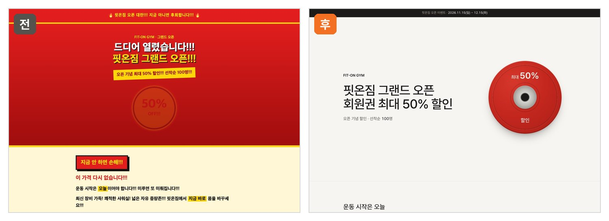
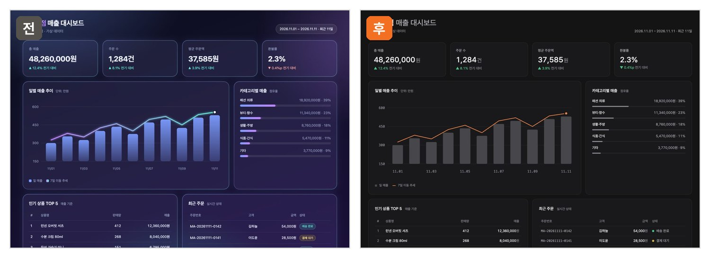
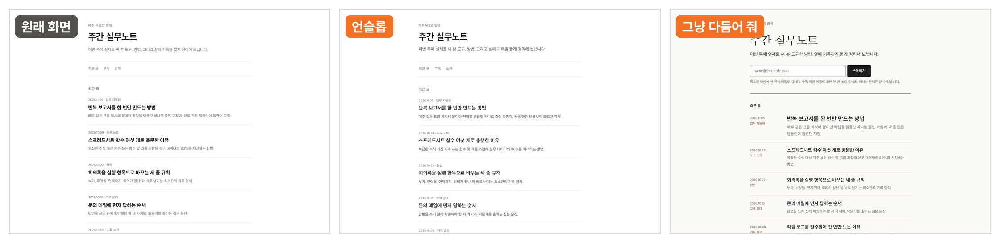

# unslop: AI가 만든 티 나는 화면을 고쳐 주는 무료 스킬

AI로 만든 웹페이지에서 "AI가 만든 티"(보라색 그라데이션, 이모지 범벅, 느낌표 많은 문구)를 찾아 정리해 주는 Claude Code용 스킬입니다. 스킬은 AI에게 넣어 주는 작업 설명서 묶음입니다.

## 결론부터

- **요란한 화면일수록 효과가 큽니다.** 그라데이션과 이모지를 걷어 내고, 그 화면에 맞는 그림까지 새로 그려 넣습니다.
- **깔끔한 화면은 거의 그대로 둡니다.** 고칠 게 없으면 없다고 말합니다.
- **그냥 쓰면 내 글까지 고칠 때가 있습니다.** 요청에 한 줄만 붙이면 막을 수 있습니다(아래 "추천 요청").
- **스킬은 무료입니다.** Claude Code 사용료는 따로 듭니다. 화면 하나에 5&#126;10분쯤 걸립니다.

## 전과 후

AI가 만든 화면 10개에 돌려 봤습니다. 모두 연습용으로 만든 가상 화면입니다.

**요란한 이벤트 페이지**



**파스텔 색 예약 페이지** — 이모지가 사라지고 손끝 그림이 새로 들어갔습니다.


**보라색 랜딩 페이지** — "글과 원래 색은 그대로"라고 요청한 결과입니다.


**어두운 대시보드**



## 1. 설치하기

Claude Code를 열고 아래를 그대로 붙여 넣으세요. 설치를 AI가 대신 해 줍니다.

```
https://github.com/heydamir/unslop
이 저장소의 unslop 스킬을 Claude Code에서 쓸 수 있게 설치해 줘. 끝나면 어디에 무엇을 뒀는지 알려 줘.
```

중간에 명령을 실행해도 되는지 물으면 내용을 읽고 허용하면 됩니다. 1분 안에 끝납니다. 설치가 끝나면 Claude Code를 새로 열거나 `/reload-plugins`를 입력하세요. 그래야 `/unslop`이 보입니다.

<details>
<summary>터미널에서 직접 설치하려면</summary>

```bash
claude plugin marketplace add heydamir/unslop
claude plugin install unslop@heydamir
```

예전 방식으로 `~/.claude/skills/`에 복사해 둔 unslop이 있으면 지우세요. 둘 다 있으면 예전 사본이 실행됩니다.

</details>

## 2. 쓰기

고칠 화면이 있는 폴더에서 Claude Code를 열고, 아래 셋 중 하나를 붙여 넣으세요.

> [!WARNING]
> 고치기 전에 폴더를 통째로 복사해 두세요. 스킬은 파일을 그 자리에서 바꿉니다.

### 추천 요청: 글은 그대로, 디자인만

대부분은 이것 하나면 됩니다.

```
/unslop this page — 물어보지 말고 그냥 끝까지 해 줘. 단, 글(문구·숫자·가격)은 그대로 두고 디자인만 바꿔 줘. 새 내용을 지어 넣거나 외부 글꼴을 불러오지는 마.
```

> [!TIP]
> 쓰던 색을 살리고 싶으면 끝에 아래 문장을 더하세요.

```
그리고 지금 화면의 주된 색은 버리지 말고 강조색으로 남겨 줘.
```

### 기본 요청: 만든 사람이 권하는 방식

```
/unslop this page
```

무엇을 어떻게 고칠지 먼저 보여 주고 물어봅니다. 마음에 안 드는 방향은 그 자리에서 말로 고치면 됩니다.

### 꼼꼼하게: 바뀔 곳을 먼저 받아 보고 고르기

문구 하나까지 직접 정하고 싶을 때 씁니다.

```
/unslop this page. 진단과 방향까지만 쓰고 멈춰 줘. 문구는 아직 고치지 말고, 바꾸고 싶은 곳을 '지금 문구 → 바꿀 문구 → 이유' 표로만 보여 줘. 새 그림을 넣을 생각이면 무엇을 그릴지도 한 줄씩 적어 줘.
```

표가 나오면 "3번과 7번만 바꿔 줘. 나머지 글은 그대로 두고 진행해"처럼 답하면 됩니다.

---

여기까지만 읽어도 쓸 수 있습니다. 아래는 더 궁금한 분을 위한 내용입니다.

## 써 보니 이랬습니다

| 화면 상태 | 몇 개 | 어떻게 됐나 |
|---|---|---|
| 요란한 화면 | 5개 | 크게 바뀜. 4개에는 그 화면에 맞는 그림까지 새로 그림 |
| 조금 티 나는 화면 | 4개 | 색과 간격만 살짝 정리 |
| 이미 깔끔한 화면 | 1개 | "고칠 것 없음"이라 하고 거의 그대로 둠 |

**좋았던 점**
- 화면 상태를 먼저 판단하고 그만큼만 고칩니다.
- 가격과 숫자는 그대로 지켰습니다.
- "매일 영업인데 일요일 휴무"처럼 앞뒤가 안 맞는 곳을 멋대로 고치지 않고 확인하라고 짚어 줍니다.

**아쉬운 점**
- 그냥 쓰면 10개 중 3개에서 헤드라인이나 홍보 문구를 고쳐 쓰거나 지웠습니다. "글은 그대로" 한 줄을 붙여 다시 돌린 세 화면에서는 한 줄도 바뀌지 않았습니다.
- 한 줄을 붙이면 과장된 문구도 그대로 남습니다. 글은 따로 손봐야 합니다.
- 화면 하나에 5&#126;10분으로, 그냥 시킬 때보다 2&#126;3배 느립니다.

## 그냥 "다듬어 줘"라고 시키는 것과 다른 점

스킬 없이 "AI 티 안 나게 다듬어 줘"라고만 해도 깔끔해지기는 합니다. 차이는 두 가지였습니다.

- **멀쩡한 화면을 덜 건드립니다.** 그냥 시킨 쪽은 이미 깔끔한 블로그도 색과 글꼴, 배치를 바꾸고 문장까지 고쳤습니다. 스킬은 거의 그대로 뒀습니다.
- **요란한 화면에는 그림을 넣습니다.** 그냥 시킨 쪽은 꾸밈을 걷어 내고 글자만 남겼습니다.



## 써 본 사람들은 뭐라고 하나

- "**훨씬 정돈돼 보인다**"는 반응이 가장 많습니다. 무엇이 중요한지 눈에 잘 들어온다는 평입니다.
- "**밋밋해진다, 개성이 빠진다**"는 불만도 꾸준히 있습니다. 위의 "원래 색은 남겨 줘" 한 문장이 이 문제를 줄여 줍니다.
- "**예시처럼 확 바뀌지는 않았다**"는 사람도 있습니다. 이미 어느 정도 정돈된 화면에서는 변화가 작습니다.
- **이름이 같은 다른 스킬이 있습니다.** 글을 다듬는 'unslop'도 있으니, 저장소가 `heydamir/unslop`인지 확인하세요.

## 쓰기 전에 알아 둘 것

스킬 파일을 전부 살펴봤고(2026-11-11 기준), 악성 코드나 몰래 정보를 보내는 동작은 찾지 못했습니다. 그 뒤 바뀐 부분도 2026-11-16에 읽어 봤는데, 오른쪽에서 왼쪽으로 쓰는 언어 안내와 보안 수정, 플러그인 설치 지원이었습니다. 설치하면 그 시점의 최신판이 깔리니 이후에 바뀐 내용은 저희가 확인한 범위 밖입니다. 다만 세 가지는 지켜 주세요.

1. **고치기 전에 폴더를 복사해 두기.** 스킬은 백업 없이 파일을 바로 고칩니다.
2. **남의 사이트 주소를 줄 때는 믿을 수 있는 곳만.** AI가 그 페이지의 글을 그대로 읽기 때문입니다.
3. **유료 이미지 생성 도구를 연결해 뒀다면** 그림을 만들기 전에 물어보라고 말해 두기.

## 자주 묻는 것

- **무료인가요?** 스킬은 무료입니다. Claude Code 사용료는 따로 듭니다.
- **Claude Code에서만 되나요?** 만든 사람 설명으로는 Codex와 Google Antigravity에서도 됩니다. 우리는 Claude Code로만 써 봤습니다.
- **PPT나 이미지도 되나요?** 아니요. 웹페이지와 앱 화면(코드로 된 화면)용입니다.
- **결과가 마음에 안 들면요?** 복사해 둔 폴더로 되돌리고, "꼼꼼하게" 방식으로 바뀔 곳을 먼저 받아 보세요.

## 확인 정보

- 원문: [heydamir/unslop](https://github.com/heydamir/unslop) · 만든 사람 Damir Sokolovsky(@heydamir) · CC BY 4.0
- GitHub 별 약 1.4만 개(2026-11-11 확인), 2026-10-29 공개
- 이 문서의 결과는 AI 에이전트(Claude Opus)로 가상 화면 10개에 각 한 번씩 돌린 것입니다. 화면과 모델이 다르면 결과도 달라질 수 있습니다.

## 더 보기

더 많은 AI 자동화 노하우는 유튜브 **시민개발자 구씨** 채널에서 다룹니다. 구독과 알림 설정을 해 두시면 새 가이드를 바로 받아 보실 수 있습니다.
